# Public source expansion

Use this optional path when a concrete development hypothesis needs a public series absent from the
registered production corpus. It is one possible research move, not a required stage or evidence
that the added series is useful.

Chronos currently supports the official Polymarket CLOB price-history source for one exact outcome
token, time window, and sampling fidelity. The path writes only to an operator-selected local
content-addressed workspace; it never inserts into the production database.

## Boundary

```mermaid
flowchart LR
    NEED["Exact token, window, and fidelity"] --> REQUEST["Bounded search request"]
    REQUEST --> SCOUT["External search agent"]
    SCOUT --> PROPOSALS["Passive untrusted proposal JSON"]
    PROPOSALS --> SELECT["Select one exact candidate"]
    SELECT --> FETCH["Bounded public HTTPS acquisition"]
    FETCH --> RAW["Immutable source bytes"]
    RAW --> PARSE["Offline strict parser"]
    PARSE --> REGISTER["Time-legal registered observations"]
    REGISTER --> ANALYZE["Researcher-authored analysis"]

    PROPOSALS -. "no authority" .-> ANALYZE
```



The external scout proposes URLs only. It does not fetch for Chronos, assign availability, register
data, expose protected evidence, or decide whether a hypothesis is credible. The selected CLOB URL
must exactly match the declared outcome token, bounds, and fidelity. Chronos refuses redirects,
retains exact response bytes, rejects malformed, unordered, out-of-range, or non-probability
samples, and attaches explicit availability caveats before registration.

## Public commands

Create a strict `polymarket-price-history-need/v1` JSON document with exact server-provided market,
event, outcome-token identity, aware time bounds, and fidelity. Then produce the request an external
search agent can answer:

```bash
uv run research-agent data polymarket-price-history-request \
  --need <need.json> \
  --research-question <question>
```

Record the scout's passive `source-scout-response/v1` response through the existing command:

```bash
uv run research-agent data scout \
  --workspace <local-workspace> \
  --request <request.json> \
  --response <response.json> \
  --provider-id <external-scout-label> \
  --idempotency-key <exact-attempt-key>
```

After explicitly selecting the candidate whose resource URL exactly matches the need, cross the
retention and temporal-registration boundary:

```bash
uv run research-agent data register-polymarket-price-history \
  --workspace <local-workspace> \
  --need <need.json> \
  --report <scouting:report-id> \
  --candidate <candidate-id>
```

The final command emits identities, observation count, time coverage, availability rule, and
caveats. It emits no sampled probabilities. The resulting in-memory catalog can feed legal
`InformationSet` construction and authored analysis; a later process must still retain the receipt
and decide how the added dataset joins an exact development study.

## Interpretation examples

Possible uses include comparing database-retained samples with an independently retained official
endpoint, adding a different clock or fidelity for a development control, or inspecting a public
history slice for a newly posed mechanism. These are examples, not a feature list to exhaust.

Do not call price-history samples trades, fills, order-book depth, or executable quotes. Do not infer
event identity from token similarity. Do not use this path to tune against the protected partition,
backfill the production database, or turn an exploratory result into durable memory.
