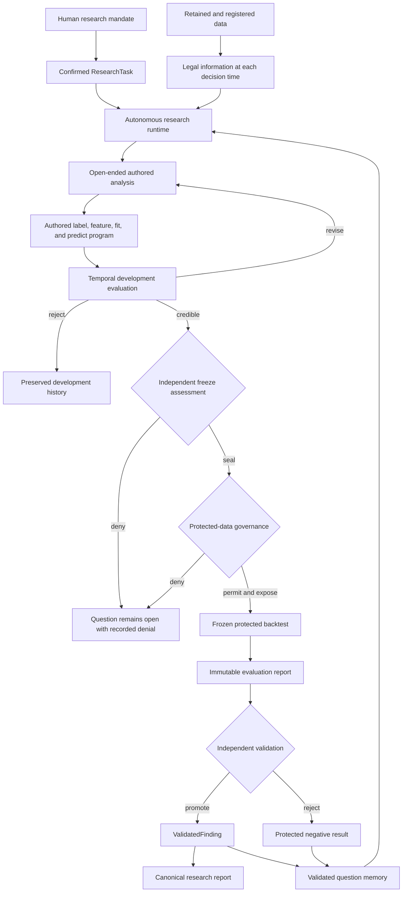
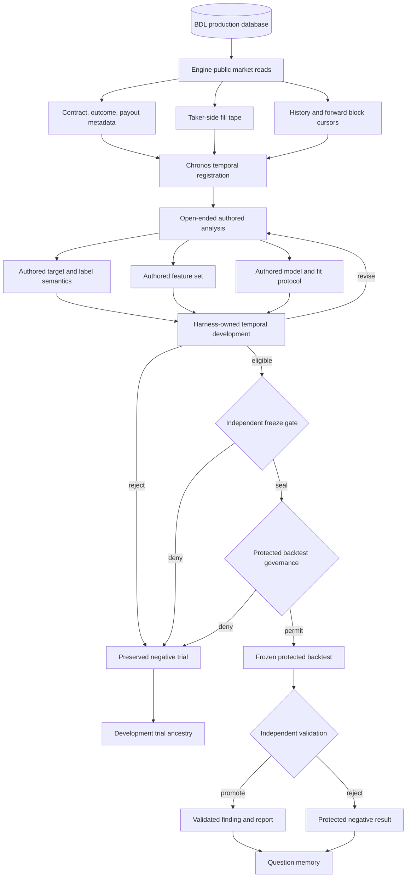
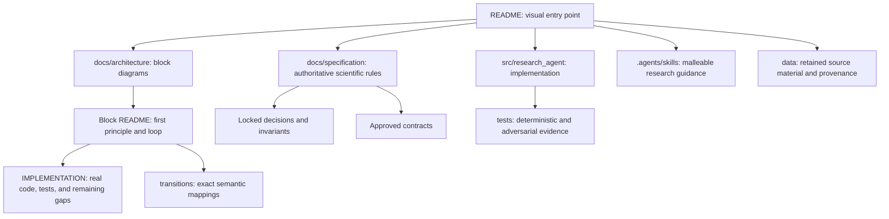

# Chronos: Autonomous Time-Series Research Kernel

Chronos is a self-contained research project inside `bdl-polymarket`. It was imported from the
canonical time-series harness at the exact commit recorded in [`VENDORED_FROM.md`](VENDORED_FROM.md)
and now evolves independently from that repository and from Kthais.

A reusable scientific research kernel for asking:

> Given information legally available at time `t`, does anything predict a declared target at
> `t+h`?

The researcher is free to invent questions, analyses, labels, features, transformations, and model
code. The harness controls information access, time legality, fitted state, provenance, protected
evidence, scientific promotion, and durable memory.

## See the whole product first



The ordinary research loop ends at development evidence. A true backtest is a separate protected
gate over a frozen candidate—not another tuning fold.

## How the researcher works

```mermaid
flowchart LR
    QUESTION["Polymarket research mandate"] --> START["Start Polymarket research"]
    START --> DATA_SKILL["Analyze time-series data"]
    DATA_SKILL --> CODE["Researcher writes arbitrary analysis code"]
    CODE --> SANDBOX["Capability-constrained execution"]
    SANDBOX --> OBS["Provisional evidence and actual provenance"]
    OBS --> FEATURE_SKILL["Design label and feature set"]
    FEATURE_SKILL --> PROGRAM["make_features, make_label, fit, predict"]
    PROGRAM --> FOLDS["Harness-owned legal temporal folds"]
    FOLDS --> DEV["Out-of-fold evidence and trial ancestry"]
    DEV -->|"revise or reject"| QUESTION
    DEV -->|"credible"| GATE_SKILL["Review backtest gate"]
    GATE_SKILL --> REQUEST["Request independent assessment"]
```



The concise startup and three stage-specific guidance skills are editable Markdown under
[`.agents/skills/`](.agents/skills/). The startup skill preserves the live Polymarket boundary and
routes optional examples from the larger
[financial-ML idea catalog](docs/research-guidance/financial-machine-learning-ideas.md). These files
improve research judgment but cannot authorize data, fitting, freeze, protected access, validation,
promotion, or memory. The standalone provider does not currently inject repository skills into its
context automatically.

## What is implemented

| Capability | Current executable boundary |
|---|---|
| Autonomous authored research | A researcher can author arbitrary bounded Python for features, labels, fitting, and prediction through four fixed phase-separated entrypoints. |
| Temporal data legality | Observations carry `reference_time` and `available_at`; predictor information, label maturity, and training windows are rebuilt independently. |
| Data workspace | Exact source bytes can be retained, verified, cataloged, and transformed offline before a trusted temporal profile registers them. |
| Development research | Legal temporal folds, fold-local fitting, out-of-fold metrics, feature diagnostics, trial ancestry, revision, and negative evidence are executable. |
| Protected evaluation | Independent freeze, governance, exposure, historical refitting, immutable runs, measurement, validation, finding or rejection, and canonical reporting are executable. |
| Research memory | Terminal protected outcomes can be stored in structured question memory, projected to Markdown and Mermaid, and supplied to future context with explicit reopening rules. |
| Operator view | A read-only local library shows ongoing questions and finalized reports. |
| Verification | `research-agent verify` executes the registered proof adapters and keeps unproved compositions visibly red. |

This is a research system, not a claim that every model run is scientifically good. Current limits
include the restricted local scientific-library surface, in-memory authority stores in several
subsystems, incomplete real-provider quality evidence, and source-specific gaps such as historical
release vintages. Each block's `IMPLEMENTATION.md` records its exact green and red boundaries.

## Run it

Install and verify:

```bash
uv sync --locked
./scripts/check.sh
uv run research-agent verify
```

Run the complete synthetic development-to-report workflow:

```bash
uv run research-agent demo --report
uv run research-agent demo --reject
```

Open the read-only research library:

```bash
uv run research-agent ui
```

Then visit `http://127.0.0.1:8765/`.

The CLI also exposes generic retained-data operations through `research-agent data`. Polymarket
research begins from the production database adapter, not from a copied external dataset.

## Polymarket research boundary



The database adapter is intentionally narrower than the researcher. It registers prices, sizes,
signed flow, and exact blocks. The researcher remains free to write new analysis, feature, label,
and model code inside the existing constrained execution and evaluation boundaries.

The original fill-tape path still treats resolved payouts as descriptive metadata. A separate
resolved-corpus path consumes the server's append-only resolution timestamp/payout facts,
server-recorded event identity, and historical sampled prices. It retains exact canonical bytes
before registration, so outcome labels mature only at recorded settlement and event-grouped
research does not invent independence.

Block bounds are also not an immutable database snapshot. The scope-repair backfill may insert rows
inside an already recorded cursor window. Chronos binds a digest to every read so reruns detect the
change, but the live database cannot reconstruct the earlier bytes. A protected study therefore
needs retained immutable source bytes or a database snapshot identity beyond the current cursors.

`fill_time` is used as `available_at` only under the explicit
`polymarket-onchain-block-inclusion/v1` public-chain observability rule. It does not claim when the
collector or database received the event, and every registered observation carries that caveat.

Run the fail-closed live smoke after opening the approved `human_ro` tunnel:

```bash
PYTHONPATH=src:../../engine/src \
  uv run python -m research_agent.data_adapters.polymarket.smoke \
  --market-id <condition-id>
```

The command prints no DSN, password, fill values, or question text. It first proves the current role
is `human_ro`, transactions default to read-only, and the role lacks update/insert privileges. It
then reports only identities, counts, digests, vintage, and caveats. Without `BDL__DB__URL` it exits
with `BLOCKED` and does not describe any fixture as live evidence.

Run researcher-authored exploration over an exact legal view of a live registration:

    PYTHONPATH=src:../../engine/src \
      uv run python -m research_agent.data_adapters.polymarket.live_analysis \
      --market-id <condition-id> \
      --decision-time <timezone-aware-ISO-8601> \
      --code <authored-analysis.py> \
      --field trade_price \
      --field signed_trade_size \
      --field outcome_index \
      --field reference_time_epoch_seconds \
      --artifact-directory <explicit-output-directory> \
      --receipt <sanitized-receipt.json>

The command proves the same read-only database contract, registers the tape, builds an
`InformationSet` at the explicit decision time, exposes only the requested view fields, and runs
the unchanged code through `AnalysisHarness`. Large sandbox results are persisted only to the
operator-selected artifact directory; authored code receives no filesystem path or capability.
The receipt records actual accesses and exact data/code/result identities without credentials.
Output remains `EXPLORATORY` and has no formal, protected, promotion, or durable-state authority.
Retained live analyses and negative results are indexed in the
[exploratory research ledger](studies/README.md); that ledger does not replace terminal runtime
question memory.

Retain and register a bounded resolved-market corpus after opening the same tunnel:

    PYTHONPATH=src:../../engine/src \
      uv run python -m research_agent.data_adapters.polymarket.corpus_snapshot \
      --as-of <timezone-aware-ISO-8601> \
      --min-points <minimum-per-contract> \
      --max-markets <hard-bound> \
      --outcome-index 0 \
      --fidelity 60 \
      --workspace <ignored-local-data-root> \
      --receipt <sanitized-receipt.json>

The read executes in one read-only repeatable-read transaction, selects only complete binary
contracts with exact event and settlement identity, and retains canonical content-addressed bytes.
The receipt contains identities, coverage, and caveats but no questions, prices, payouts, DSN, or
credentials. Registration alone is not scientific evidence and does not expose a protected split.

Run authored studies offline against an exact retained corpus:

    uv run python -m research_agent.data_adapters.polymarket.run_corpus_studies \
      --snapshot-sha256 <exact-sha256> \
      --snapshot-size <exact-byte-count> \
      --workspace <ignored-local-data-root> \
      --source <authored-study.py> \
      --receipt-directory <study-receipt-directory>

This composition orders whole server event groups by recorded resolution time, exposes only the
earlier development block to `AnalysisHarness`, and keeps the final chronological block out of all
exploratory views. A successful receipt binds the partition, source, actual field accesses, and
structured result. It remains development evidence and cannot authorize protected evaluation or
validated question memory. The first real run and its development rejection are retained in the
[resolution-probability study](studies/polymarket-resolution-research-2026-08-17/).

## Explore the architecture visually

Start with the [documentation map](docs/README.md), then the
[whole architecture map](docs/architecture/README.md). Each block begins with its
first principle and Mermaid diagram, then links to implementation status and exact transition
contracts.

| If you want to understand... | Open this visual block |
|---|---|
| The complete system and its loops | [Architecture map](docs/architecture/README.md) |
| How a mandate becomes authorized research | [Mission and environment](docs/architecture/mission/README.md) |
| How the autonomous model loop runs | [Runtime](docs/architecture/runtime/README.md) |
| How retained data becomes time-legal evidence | [Data foundation](docs/architecture/data-foundation/README.md) |
| How arbitrary analysis remains constrained | [Open-ended exploration](docs/architecture/exploration/README.md) |
| How the model authors labels, features, fit, and prediction | [Autonomous investigation](docs/architecture/autonomous-investigation/README.md) |
| How feature and system meaning becomes reproducible | [Formalization](docs/architecture/formalization/README.md) |
| How iterative temporal evidence is generated | [Development validation](docs/architecture/development/README.md) |
| Why the true backtest is a privileged gate | [Protected evaluation](docs/architecture/protected-evaluation/README.md) |
| How findings become readable without changing substance | [Reporting](docs/architecture/reporting/README.md) |
| How humans browse ongoing and finalized work | [Operator interface](docs/architecture/operator-interface/README.md) |
| How prior research may influence later research | [Validated learning](docs/architecture/learning/README.md) |
| How the repository is built and objectively checked | [Orchestration and evals](docs/architecture/orchestration/README.md) |

## How the repository documentation fits together



For scientific or architecture changes, read [AGENTS.md](AGENTS.md), the relevant block README and
implementation map, [locked decisions](docs/specification/DECISIONS.md),
[invariants](docs/specification/INVARIANTS.md), and the applicable contract. Canonical terminology
lives in [CONTEXT.md](CONTEXT.md).

## Source-of-truth order

When two representations disagree:

1. correctly encoded executable invariant or contract tests;
2. locked decisions, invariants, and approved contracts;
3. the authoritative subsystem specification;
4. architecture prose and canonical vocabulary;
5. Mermaid diagrams, plans, examples, and comments.

Follow the [contradiction protocol](docs/specification/ALIGNMENT_AND_DIAGRAMS.md) rather than making
a diagram or test silently redefine the system.
