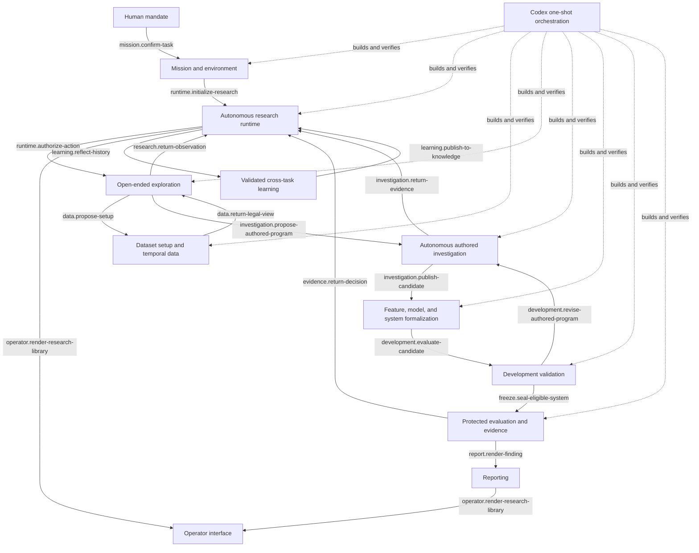
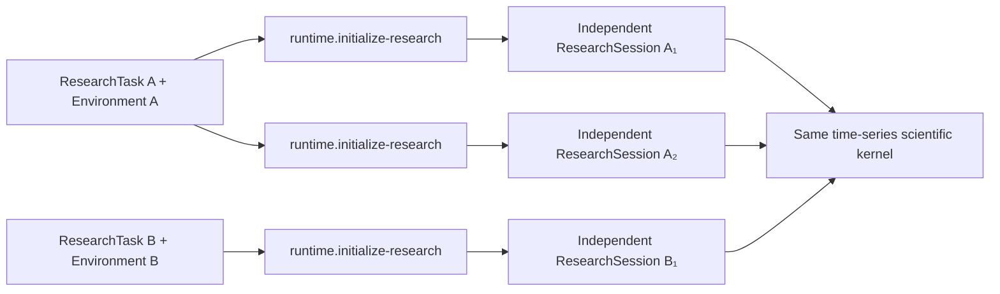
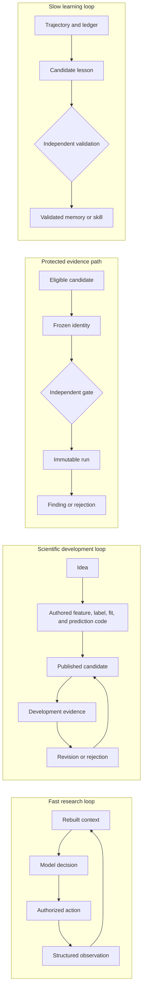

# Semantic Architecture Map

Status: **current visual architecture and implementation entry point**.

This directory organizes the implemented system around responsibilities and meaningful semantic
transitions. Locked decisions, invariants, approved contracts, and subsystem specifications remain
authoritative; each block links its diagram to current code, tests, remaining gaps, and transition
contracts.

## Product thesis

The product is a model-enabled scientific environment that can autonomously discover and test
time-series predictive systems. The harness should expand the model's useful agency while owning the
boundaries that models must not self-authorize: information access, temporal legality, durable state,
scientific identity, protected exposure, and promotion.

## Whole-system architecture



The autonomous research loop and the Codex construction loop are different systems. The first is
the product. The second is the governed process used to build the product.

## Kernel reuse boundary

Different subjects do not receive different scientific kernels by default. The reusable boundary
is task and session initialization:



A different target, dataset, hypothesis family, evaluation standard, report framing, or downstream
use is normally configuration and formal scientific identity carried by a `ResearchTask` and
`ResearchEnvironment`. Introduce domain-exclusive machinery only when a concrete scientific or
downstream-action failure cannot be represented through those existing boundaries.

## Blocks and first principles

| Block | First principle | Detailed map |
|---|---|---|
| Mission and environment | The model may explore uncertainty, but only the human can authorize the durable mission. | [`mission/`](mission/) |
| Autonomous runtime | Context is reconstructed from system-owned truth; the provider supplies intelligence, not authority. | [`runtime/`](runtime/) |
| Data foundation | Data is usable only when identity, provenance, availability, and target maturity are explicit. | [`data-foundation/`](data-foundation/) |
| Open-ended exploration | Constrain information and side effects, not scientific creativity. | [`exploration/`](exploration/) |
| Autonomous authored investigation | The researcher authors the method; the harness owns legality, evidence, budget, and state transitions. | [`autonomous-investigation/`](autonomous-investigation/) |
| Formalization | Exploration becomes science only through explicit, reproducible identity. | [`formalization/`](formalization/) |
| Development validation | Iteration is encouraged, but selection changes what the evidence means. | [`development/`](development/) |
| Protected evaluation | Evidence is protected by freeze, independent authority, and irreversible exposure history. | [`protected-evaluation/`](protected-evaluation/) |
| Reporting | Presentation may clarify a finding but cannot change its scientific substance. | [`reporting/`](reporting/) |
| Operator interface | A readable projection has no authority to change research status or evidence. | [`operator-interface/`](operator-interface/) |
| Validated learning | Past experience changes future behavior only after independent validation. | [`learning/`](learning/) |
| One-shot orchestration | Agents may build in parallel; objective evidence, not agent confidence, controls integration. | [`orchestration/`](orchestration/) |

## The principal product loops



## Transition naming rule

An architectural transition is named `<responsibility>.<verb>-<object>`, for example:

```text
context.build-packet
action.authorize-request
data.build-information-set
feature.materialize-definition
backtest.authorize-request
learning.validate-lesson
```

The name describes an observable semantic mapping, never a class, queue, endpoint, or storage
technology. Its formal reading is:

\[
f_{\text{transition-name}} : A \rightarrow B
\]

The architecture uses these semantic names directly. Historical numeric aliases and the completed
restructure plan are available through Git history rather than appearing in the current navigation
tree.

## Current data boundary

Dataset identity, schema, target, availability, vintage, population, alignment, and missingness are
represented through explicit source-neutral components. No canonical `DatasetSetup` aggregate is
required by the implemented kernel; introduce one only if a concrete composition failure earns it.
