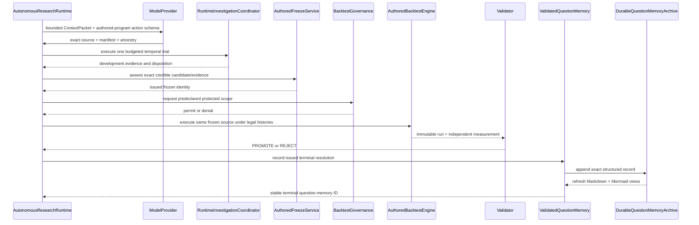
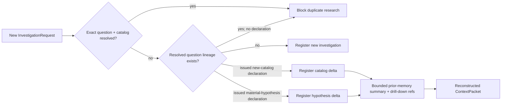

# Autonomous investigation implementation map

Status: **question-to-authored-development, independent freeze, exact authored protected
walk-forward execution, independent finding/rejection, validated question memory, an optional local
crash-durable archive, generated Markdown/Mermaid research views, automatic future-context
reconstruction, and explicit new-catalog/material-hypothesis reopen are implemented; hidden
research-family evaluation and broader scientific worker capability remain subsequent packets**.

- Code: `src/research_agent/investigation/`
- Application acceptance: `tests/integration/test_autonomous_investigation_acceptance.py`
- Protected application acceptance: `tests/integration/test_authored_protected_evaluation.py`
- Worker adversaries: `tests/investigation/test_scientific_program_harness.py`
- Locked contract: `docs/specification/AUTONOMOUS_INVESTIGATION_CONTRACT.md`

## Project-local research guidance

One Polymarket startup skill and three stage-specific repository skills now guide Codex and other
repository-aware researchers without changing the scientific runtime:

- `.agents/skills/start-polymarket-research/` establishes exact contract/data/time scope, preserves
  the adapter's unresolved label/group/snapshot gates, selects a falsifiable first question, and
  routes to the smallest stage-specific skill;
- `.agents/skills/analyze-time-series-data/` covers data meaning, time axes, coverage, missingness,
  revisions, aggregation, rival explanations, and traceable exploratory output;
- `.agents/skills/design-time-series-feature-set/` covers target/label meaning, mechanism-driven
  feature sets, fold-local learned state, model recipes, feature-analysis interpretation, and
  trial-preserving revision;
- `.agents/skills/review-backtest-gate/` covers development/freeze readiness, selection and leakage
  challenges, predeclared protected protocols, immutable-result interpretation, and independent
  authority.

Each stable `SKILL.md` routes a short reasoning loop and exact output memo. Its
`references/principles.md` is the deliberately malleable first-principles layer. Feedback updates
must name a traceable general failure pattern, applicability, and counterexample; Git preserves the
prior guidance. `AGENTS.md` routes project research to the smallest applicable skill and states the
authority boundary explicitly.

`docs/research-guidance/financial-machine-learning-ideas.md` retains optional sampling, labeling,
overlap, transformation, ensemble, validation, feature-diagnostic, and tuning examples outside the
default skill context. The active skills contain only selection prompts and authority constraints;
the catalog is not a prescribed pipeline or architectural source.

These files affect repository-aware Codex behavior only. The standalone provider/runtime does not
currently discover repository skills or bind their versions into `ContextPacket`; implementing
that behavior would require a separate tested transition. No skill output is scientific evidence
or authority until consumed and verified by the existing exploration, formalization, development,
freeze, governance, validation, and memory boundaries.

## Implemented composition

`AutonomousInvestigation.run` begins with a `ResearchQuestion`, exact `DataCatalogSnapshot`, exact
`SampleKey` population, current clock, and `DevelopmentBudget`. The provider-neutral `Researcher`
sees schema meaning plus prior trial evidence and proposes arbitrary Python implementing four fixed
entrypoints. It does not receive a preassembled target, feature definition, model, workflow, or
answer.

`CandidatePublisher` resolves every declared field against the exact catalog, binds question,
environment, code digest, rationale, exploratory evidence, provenance, and parent trials, then
publishes into a non-copyable authority-owned registry. The evaluator refuses a merely self-hashed
candidate. A manifest may bind either one exact dimension-value slice or one complete
dimension-name schema. Schema-only panel candidates require every declared field and `SampleKey`
to carry that exact schema; the schema is scientific identity, not permission to choose data.

A manifest may additionally declare `ContextHistoryDependency` entries. Each entry binds one exact
field plus a nonempty subset of the sample dimension names that must match. The publisher verifies
the names against both population and field schemas. The evaluator—not authored code—constructs the
matching decision-time rows and exposes them only through the separately audited
`context_history(field_id)` interface. This supports generic grouped or relational features without
encoding event, sibling, geography, or other domain semantics in the harness.

For each simulated decision, the evaluator builds an `InformationSet` using `available_at`, then
passes only declared observations whose `reference_time` is no later than the decision. It builds a
separate outcome path inside the declared horizon, matching the exact population and requiring
availability by the development clock. Feature and label invocations execute in fresh authored
namespaces with separate phase grants and access logs. Each exposed observation carries the same
reference and availability timestamps in ISO and epoch seconds; the numeric form permits
elapsed-time features and labels without granting another clock or parser capability. Development
and protected execution use the same payload contract.
Panel candidates repeat this construction independently for each key's exact dimension values and
order same-time keys deterministically. Exact `history()` never crosses the sample slice. A
`context_history()` invocation receives other slices only when its manifest dependency explicitly
names the shared matching dimensions; `available_at` and decision-time legality remain unchanged.

Expanding out-of-fold evaluation admits a training example only when its label matured by the
validation decision. Each fit invocation receives only training features and labels. Each
prediction invocation receives only fitted JSON state and validation features, never the validation
label or outcome path. The parent harness computes the declared metric and applies the threshold
fixed before the first trial.

The current local worker enforces source, wall-time, address-space, and JSON-result bounds. It
forbids imports, attribute access, filesystem/process/network interfaces, dynamic calls, classes,
and runtime introspection. Actual capability calls are recorded by the harness. A development or
protected evaluation opens one bounded worker session instead of forking once per scientific
invocation; the validated source is compiled once, but every call re-executes it in a new namespace
with a new builtins dictionary and access recorder. Per-call timeout/result bounds, the session
memory limit, an explicit invocation bound, and fail-closed worker teardown remain enforced. The
original one-shot path remains the equivalence reference. This syntax-gated fork is a real local
security boundary but not production hostile-code containment. A broader
NumPy/pandas/scikit-learn surface requires the separately verified OS-isolated worker packet; the
contract must not be weakened by enabling imports in this process.

## Protected resolution and validated question memory



`AuthoredProtectedResolutionService` resolves governance and validation grants from external
composition-owned authority registries. It resolves the protected scope through an external exact
resource registry; the authored candidate does not carry a catalog, binding, authority label, or
promotion outcome. A governance denial is truthful but does not close the scientific question.

`ValidatedQuestionMemory` accepts records only from a recorder bound to this exact resolution
service and investigation authority. Its repeat guard is exact: normalized question text plus exact
environment and catalog identity. Exact replay returns the original record and original timestamp;
different terminal evidence conflicts. A different catalog identity remains open.

Resolved question lineage is never retrieved by fuzzy similarity. A new investigation with the same
`question_id` must either be genuinely new or carry `QuestionReopenDeclaration` referencing an
issued prior memory. `NEW_CATALOG` requires a different exact catalog identity;
`MATERIAL_HYPOTHESIS` requires changed normalized question text and an explicit rationale. The
registration observation carries a bounded exact-lineage summary plus immutable drill-down artifact
references, so a rebuilt `ContextPacket` tells the researcher what was already resolved and why the
new branch exists.



`DurableQuestionMemoryArchive` stores canonical JSON records in a locally configured SQLite
database with full-synchronous transactions, reloads and identity-checks them after restart, and
generates a deterministic research index plus one Markdown/Mermaid evidence-chain page per terminal
question. The database commit is authoritative. If rendering fails after commit, the question stays
closed and an exact retry repairs only the projections. Editing a generated `.md` page is overwritten
from structured truth and cannot change status.

The archive is optional composition configuration; it is not a model-supplied path. The trusted
local filesystem remains the persistence authority. Content identities detect ordinary corruption
or un-rehashed edits, but this does not claim cryptographic protection from an administrator who can
rewrite the database and recompute every identity.

## Harness-enforced research campaigns

`exploration/campaign.py` adds a durable campaign authority around authored exploratory programs.
Before execution, one immutable manifest binds every analysis ID to exact source bytes, declared
and required field accesses, dataset/environment references, the evidence ceiling, and an
`AnalysisHarness` binding identity. That binding hashes the registered view values as well as the
policy, session, and resource limits, so a caller cannot substitute different values under the
same human-readable dataset labels. The authority itself invokes the harness and derives the
action, actual accesses, source digest, execution status, and result artifacts; externally created
or legacy receipts have no admission route.

`CampaignStore` publishes manifests, executions, externalized result bytes, and completion
receipts as immutable conflict-detecting objects. Restart recovery re-verifies campaign, source,
binding, receipt, and artifact identities. Completion requires one successful, admissible receipt
and an explicit disposition for every manifest row, rejects undeclared rows, and prevents an
execution-validated disposition beneath a lower evidence ceiling. Completion proves exact
execution only: exposed reruns remain exposed, sampled marks remain non-executable, and the
authority cannot open protected data or issue a finding.

The Polymarket catalog runner composes this boundary with registered development,
fresh-replication, and parent-bound taker-fill views. A catalog-wide rerun tier may only reduce,
never exceed, each study's prior evidence ceiling. Sources that are formal transitions,
superseded failures, protected one-shot resolutions, or scientifically data-blocked enter a
separate value-bound non-replay audit; the audit proves complete accounting without pretending
those sources were validly re-executed.

## Application evidence

- **Green:** question → authored interaction feature/label/model → legal expanding OOF evidence →
  credible candidate is one executable path.
- **Green:** a zero-slope first recipe returns evidence to the researcher, a second authored version
  carries the exact parent trial, and both trials remain in the ledger.
- **Green:** changing a tempting field whose `available_at` is after every decision changes neither
  prediction nor metric and produces no access record.
- **Green:** a no-signal world exhausts the fixed budget and returns a negative question status;
  there is no best-trial promotion.
- **Green:** authored `open`, imports, host attributes, and outcome reads during prediction fail
  closed.
- **Green:** the four phase interfaces and actual access provenance come from the harness, not from
  authored claims.
- **Green:** persistent-session and original one-shot execution return exactly equal values and
  access records for all four phases; mutable authored globals reset between calls, timeout closes
  the session, result and invocation limits remain active, and a complete development evaluation
  retains the exact candidate and evidence identities.
- **Green:** one exact authored recipe develops across multiple entity values without cross-slice
  history, rejects mismatched field/sample schemas, and replays after freeze on a new protected
  entity value under the same frozen schema.
- **Green:** a manifest-bound context dependency exposes only rows matching the declared group
  dimension, excludes an unreleased same-group poison row, records `context_history` separately,
  rejects dimensions absent from the field schema, and replays unchanged through protected
  execution.
- **Green:** trusted runtime composition registers only question/data/budget, the registration is
  visible in reconstructed context, a provider action supplies authored source, and the exact
  development evidence is visible in the next packet.
- **Green:** a provider with no instance state or preassembled proposal reads exact field identities
  and already-authorized value-free analysis surfaces from reconstructed context, authors a losing
  baseline, authors exploratory diagnostic code from that failure, and then authors a credible
  interaction revision carrying the exact losing-trial and analysis-observation ancestry.
- **Green:** unissued investigation IDs deny before hostile source execution; exact retry converges
  and changed authored semantics conflict.
- **Green:** protected data/training/evaluation/validation/freeze protocol identities are fixed in
  the registered investigation before trial one; a separate authority resolves only the exact
  coordinator-issued credible candidate/evidence pair and seals its source digest and ancestry.
- **Green:** a merely successful-but-not-credible trial cannot be frozen, and the model supplies no
  freeze authority or favorable decision field.
- **Green:** the protected scenario, decision schedule, resource scope, metric specification,
  validation standard, and claim template are authority-issued and fixed before trial one.
- **Green:** the exact frozen source is refit at every declared protected decision using only legal
  prior examples, while prediction receives only fitted state and current features. Exposure is
  recorded before protected catalog resolution and the sealed run is accepted by the independent
  evaluator.
- **Green:** a self-consistent post-development claim-plan substitution and an altered frozen
  identity both deny before the protected loader or exposure recorder runs; exact retry loads and
  exposes once.
- **Green:** the runtime composes the exact issued run through independent measurement, validation,
  finding publication or protected negative-result publication; the provider supplies none of
  those statuses or authorities.
- **Green:** both a protected finding and a protected rejection publish one exact question-memory
  record; a governance denial cannot do so, exact retry preserves the original timestamp, and the
  same normalized question over the same exact catalog cannot be registered again.
- **Green:** one real `AutonomousResearchRuntime` turn accepts provider-authored source, reaches a
  protected finding, records question memory, exposes its reference in rebuilt context, and blocks
  exact repeat registration.
- **Green:** the same runtime path can publish through the durable archive, rebuild the exact memory
  after process reconstruction, and produce deterministic Markdown containing Mermaid evidence
  chains. A post-commit rendering failure leaves structured truth intact and exact retry repairs the
  human view.
- **Green:** caller-edited Markdown is regenerated from SQLite; a direct non-rehashed structured
  database mutation fails identity reconstruction; an unissued archive writer capability denies.
- **Green:** an exact repeat is blocked; changed catalog and materially changed hypothesis branches
  require an explicit issued-memory ancestor and rationale; fabricated memory ancestry denies.
- **Green:** the runtime registration observation and rebuilt provider context contain bounded prior
  status, question, catalog, terminal evidence, reasons, time, and drill-down references. No fuzzy
  match can silently suppress or inject a question.
- **Green:** a campaign refuses an injected receipt, a source-byte change, an omitted required
  access, a same-label/different-value harness, a missing disposition, and an evidence-tier
  elevation; exact restart recovers and verifies immutable manifest, executions, artifacts, and
  completion.

## Honest remaining work

- Extend the worker behind the same protocol to an OS-isolated scientific-library environment.
- Avoid recomputing identical legal protected training examples across successive decisions. The
  session change removes process startup only; it does not introduce scientific-result caching or
  alter walk-forward fitting.
- Persist candidate/development-evidence/protected-ledger artifacts alongside the now-persisted
  terminal question-memory records; SQLite currently owns only the terminal memory projection.
- Add hidden application families for unknown lag, interaction, path label, regime transform,
  future poison, and no signal. Scripted providers prove plumbing only; real-provider researcher
  quality remains separately assessed.

## Focused verification

```bash
uv run pytest -q tests/investigation tests/integration/test_autonomous_investigation_acceptance.py \
  tests/integration/test_authored_protected_evaluation.py
uv run ruff check src/research_agent/investigation tests/investigation \
  tests/integration/test_autonomous_investigation_acceptance.py \
  tests/integration/test_authored_protected_evaluation.py
uv run basedpyright src/research_agent/investigation tests/investigation \
  tests/integration/test_autonomous_investigation_acceptance.py \
  tests/integration/test_authored_protected_evaluation.py
```

The complete canonical gate is `UV_CACHE_DIR=/tmp/chronos-uv-cache ./scripts/check.sh`.
