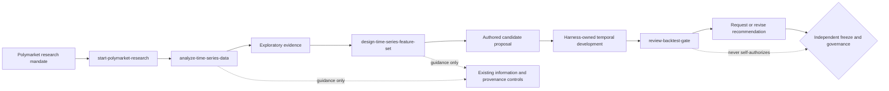
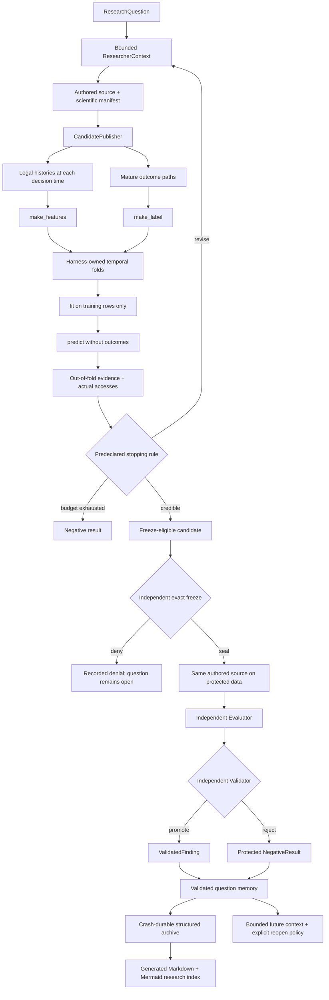

# Autonomous authored investigation

## First principle

The researcher authors the scientific method. The harness owns information access, temporal
legality, evidence identity, resource bounds, trial ancestry, and state-transition authority.

This block implements the missing semantic bridge between exploratory interpretation and the
existing deterministic formalization/development/protected machinery. It is explicitly not a
catalog of domain-specific analysis tools.

Repository-aware researchers may begin with one Polymarket scope router and then load the smallest
of three stage-specific, versioned guidance skills. The skills improve scientific judgment but
remain outside every authority boundary:

The skill instructions are deliberately malleable Markdown. Their outputs are analysis memos,
candidate proposals, and gate recommendations—not observations, definitions, permits, decisions,
findings, or memory records merely because an agent wrote them.

## Responsibilities

- accept a question, an exact authorized development catalog, sample population, and fixed budget;
- publish exact authored source, manifest, rationale, evidence refs, and trial ancestry;
- expose the universal exact-sample `history`, explicitly scoped `context_history`, `outcome_path`,
  `training_rows`, `model_state`, and `feature_values` interfaces inside phase-separated workers;
- construct temporal information and outcome boundaries outside authored code;
- return selection-exposed evidence for model interpretation and revision;
- preserve negative and failed trials rather than only the winner.
- resolve an exact frozen authored candidate through external protected-data, governance, and
  validation authorities;
- record only an issued protected finding or protected rejection as terminal question memory.

## Non-responsibilities

- it does not declare development evidence validated;
- it does not let the researcher authorize protected access, freeze, promotion, memory, or
  reporting; those decisions remain independently configured;
- it does not prove a scripted test researcher has good scientific judgment;
- it does not replace the optimized `FeatureExpression` substrate;
- it does not add a special action for geography, importance, interactions, or each model family.
- repository skill guidance is not automatically injected into standalone `ModelProvider` context;
  that requires an explicit, version-bound context-routing transition rather than an implicit file
  read.

See [IMPLEMENTATION.md](IMPLEMENTATION.md) and the locked
[autonomous investigation contract](../../specification/AUTONOMOUS_INVESTIGATION_CONTRACT.md).
The executable transition contracts are indexed under [transitions/](transitions/README.md).
