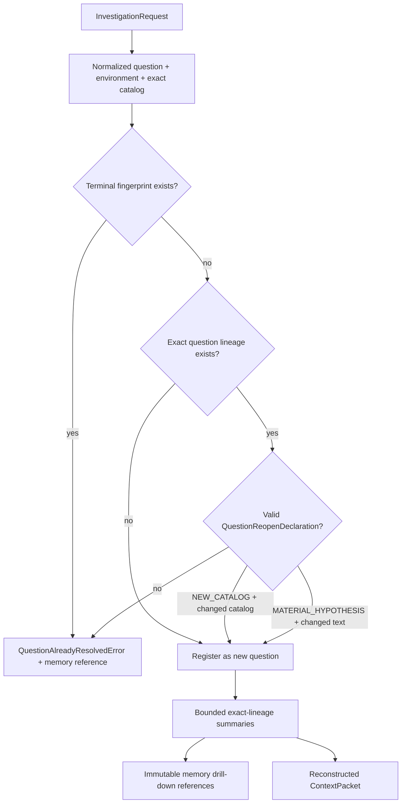

# `context.reconstruct-question-memory`

## Mapping

\[
f_{\text{context.reconstruct-question-memory}}:
(InvestigationRequest, ValidatedQuestionMemory) \rightarrow
(RegistrationDecision, PriorMemoryContext)
\]

## Contract

- An exact resolved question/environment/catalog fingerprint never reopens in place.
- A resolved `question_id` lineage requires an explicit prior `memory_id`, typed reason, and
  non-empty rationale.
- `NEW_CATALOG` must change exact catalog identity.
- `MATERIAL_HYPOTHESIS` must change normalized question text; this is a structural declaration, not
  an automated judgment that the new idea is scientifically valuable.
- Fabricated, cross-environment, or mismatched reopen ancestry denies registration.
- Retrieval is bounded, deterministic, and exact-lineage only. It does not use embeddings or fuzzy
  similarity as a suppression authority.
- Provider context receives concise summaries and artifact references, never authority to edit the
  underlying record or generated status.

## Honest boundary

The harness proves that prior validated memory reaches the next packet and that duplicate lineages
cannot silently reopen. A scripted provider test proves information flow, not that a real model will
always use prior research wisely. Semantic discovery across differently named but conceptually
equivalent questions remains a non-authoritative retrieval enhancement for later evaluation.
