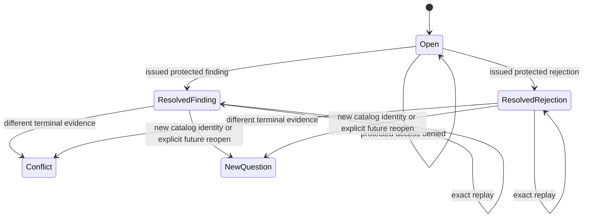
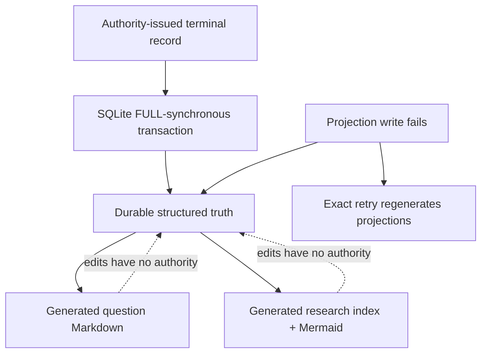

# `investigation.record-question-resolution`

## Mapping

\[
f_{\text{investigation.record-question-resolution}}:
IssuedProtectedResolution \rightarrow QuestionMemoryRecord
\]

## Contract

- Only a resolution issued by the configured protected-resolution authority may be recorded.
- Findings and protected rejections are terminal; governance denials are not scientific answers.
- The record retains question, environment, exact catalog, development candidate/evidence,
  protected resolution, terminal evidence, reasons, and first resolution time.
- Exact replay preserves the original record and timestamp.
- The repeat guard uses normalized question text plus exact environment and catalog identity. It
  performs no fuzzy or nearest-neighbor lookup.
- Markdown/Mermaid views are generated from these records and cannot create or mutate them.

## Remaining boundary

The local SQLite archive and deterministic Markdown projection are implemented. The archive is
single-machine and composition-owned; distributed durability, external identity attestation,
semantic search beyond explicit lineage, and cross-machine atomicity remain outside this transition.
Bounded exact-lineage future-context retrieval and explicit reopen declarations are implemented by
[`context.reconstruct-question-memory`](reconstruct-question-memory.md).
