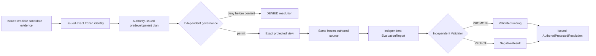

# `investigation.resolve-protected-candidate`

## Mapping

\[
f_{\text{investigation.resolve-protected-candidate}}:
(CredibleCandidate, DevelopmentEvidence, FrozenIdentity, Predeclaration)
\rightarrow ProtectedResolution
\]

## Contract

- The service resolves, rather than accepts from the researcher, governance authority, validation
  authority, protected scope binding, protected catalog, evaluation specification, promotion
  standard, and claim template.
- The executed source and scientific manifest are the exact frozen candidate selected by the
  issued development evidence.
- Protected exposure is recorded before content becomes available to execution.
- A denial carries no protected view, run, report, decision, finding, or negative-result reference.
- Exact idempotent replay returns the original resolution; changed semantics under the same key
  conflict.

## Failure modes exercised

- self-consistent frozen or plan substitution;
- caller-appointed governance/validation authority;
- protected binding or catalog substitution;
- future predictor poison;
- duplicate exposure or protected execution on retry;
- finding or rejection status supplied by the researcher.
