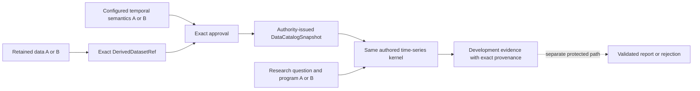

# Work packet: retained data to reusable time-series kernel

## Identity

- Packet: `data.register-derived-temporal-dataset`
- Owning architecture block: data foundation, composed with development validation
- Semantic responsibility: turn one exact retained `DerivedDatasetRef` plus independently
  configured temporal semantics into an authority-issued `DataCatalogSnapshot` that the unchanged
  time-series kernel can evaluate
- Input repository state: `c777b68` (`Add generic content-addressed data workspace`)

## Objective

Prove one source-neutral path:

```text
verified retained bytes
→ exact derived temporal envelope
→ authority-issued registered observations/catalog
→ unchanged legal feature/label/model development kernel
→ development evidence eligible for the separately governed protected path
```

The same bridge and kernel instance must execute two structurally different time-series subjects
without adding source-specific code to the kernel.



## Context boundary

- Global authority loaded: `AGENTS.md`, `CONTEXT.md`, locked decisions, I1–I3, I6, I13, I17,
  I23–I26, architecture, lifecycle, scientific-kernel, test, and diagram policies.
- Owning contracts: `data.retain-source-snapshot`, `data.derive-dataset`,
  `data.register-observations`, `data.build-information-set`, and
  `data.build-training-sample`.
- Adjacent interfaces: `DataWorkspace`, `ObservationRegistrar`, `DataCatalogSnapshot`,
  `TrainingInformationBuilder`, `SystemTrainer`, and `DevelopmentEvaluator`.
- Explicit exclusions: web discovery, source-specific parsing semantics, protected-data
  authorization, protected backtesting, canonical `ValidatedFinding` reporting, broad ML-library
  enablement, production databases/object stores, and UI changes.
- Assumption: a trusted composition root configures each dataset's semantic profile. Retained or
  model-authored bytes never authorize their own field meaning, availability, or vintage policy.

## Change boundary

- Permitted components: generic data workspace read seam, data-foundation registration bridge,
  development training-information issuance, focused tests, and owning documentation.
- Allowed state effects: append verified workspace objects/manifests; issue immutable in-process
  registration/catalog/training-information/evidence/paper records.
- Forbidden state effects: physical-source rewrite, inferred temporal semantics, caller-issued
  scientific authority, hidden fit, protected access/exposure, promotion, or durable researcher
  belief mutation.

## Correctness

- Governing rules: `available_at <= t`; predictor legality and label maturity are independent;
  every learned value fits inside `W_t`; `predict()` never learns; formal failure blocks success;
  provenance and environment identity follow every result.
- Concrete failure modes:
  - treating a verified derived object as scientifically registered without a configured profile;
  - accepting caller-supplied values instead of resolving exact retained bytes;
  - accepting a fabricated, changed, or unhealthy `DerivedDatasetRef`;
  - inventing `available_at`, field meaning, dimensions, vintages, or revisions;
  - accepting a content-rehashed `TrainingInformationBundle` not issued by the configured builder;
  - making development evidence with `catalog=None` eligible for freeze;
  - producing a paper whose metrics/status differ from issued evidence;
  - adding source-specific branches to the kernel.
- Expected input: exact verified `DerivedDatasetRef`, exact configured temporal profile, research
  question/system/protocol, candidate sample keys, and current clock.
- Expected output: authority-issued `DataCatalogSnapshot` and legal development evidence that
  remains distinct from a protected result, validated finding, and canonical research report.
- Violating mutations: replace `available_at` with `reference_time`; mutate retained JSON under the
  same ref; self-rehash a training-information bundle; omit the catalog; or branch kernel logic on
  a dataset/source name.
- Required tests: strict temporal-envelope parsing, exact-ref integrity, configured authority,
  registration identity, copy/substitution denial, temporal-poison pairs, training-information
  issuance, non-promotable row-local development, and two-subject kernel reuse.
- Required integration evidence: both subjects traverse the same public bridge and kernel types;
  one future-unreleased observation cannot change the legal fit; changed research definitions
  change scientific identities without changing kernel code.

## Completion evidence

- Focused bridge/development/integration tests pass.
- `UV_CACHE_DIR=/tmp/insurance-uv-cache ./scripts/check.sh` passes through the installed `uv`.
- Data-foundation and development implementation maps plus Mermaid diagrams match the code.
- One committed transition receipt names exact state, evidence, limits, and remaining reds.
- `main` moves only after the worktree is clean and the integrated branch passes the same gate.

## Boundary revisions

The packet includes the training-information issuance and row-local non-promotion repairs because
the new bridge would otherwise create an authority-bearing catalog while downstream fitting could
still accept an unissued substitute or freeze evidence produced without any catalog. It does not
expand into protected execution or reporting authority.

## Transition receipt

- Status: **COMPLETE**.
- Resulting repository state: the commit containing this receipt on
  `codex/data-kernel-bridge`; integration is permitted only after the same gate passes on the
  destination branch.
- Delivered transition: exact verified `DerivedDatasetRef` + exact trusted
  `TemporalDatasetProfile` + exact approval → immutable registered observations →
  authority-issued `DataCatalogSnapshot` → unchanged `AutonomousInvestigation` kernel.
- Reuse evidence: one kernel instance executed a dimensioned weekly regional subject and a
  dimensionless daily market subject; only data, semantics, questions, horizons, populations, and
  authored programs changed. Both produced legal development evidence with MSE `0.0`.
- Authority repairs: formal fitting now requires the exact bundle issued by the trainer's
  non-copyable `TrainingInformationRegistry`; row-local `catalog=None` development remains usable
  for provisional iteration but cannot receive freeze inputs.
- Causal denials: unconfigured/equal-looking approval, changed retained bytes, malformed envelope,
  unknown field/type/dimension, naïve time, reconstructed catalog, copied training authority,
  self-rehashed training bundle, and catalog-free freeze all fail closed.
- Exact gate:
  `PYTHONPATH=<worktree>/src:<worktree> VIRTUAL_ENV=<root>/.venv UV_NO_SYNC=1 UV_OFFLINE=true ./scripts/check.sh`
  → Ruff format clean, Ruff lint clean, basedpyright `0 errors, 0 warnings, 0 notes`, pytest
  `384 passed`.
- Honest limits: approval and issuance registries are in-process; the bridge does not infer
  temporal meaning, reconstruct absent release history, provide crash-durable registration,
  authorize protected data, judge researcher quality, or turn development evidence into a
  validated finding. Protected execution and canonical reporting remain separate governed
  transitions.
