# Data-foundation implementation map

Status: **generic temporal boundary, Polymarket production-tape adapter, and retained resolved-
contract corpus adapter implemented. Live fill exploration is accepted; exact event grouping,
on-chain label availability, and immutable retained source bytes are proved for bounded
price-series corpora. Development/protected composition over that corpus remains separate work**.

## Generic kernel

- Temporal registration: `src/research_agent/data_foundation/`
- Content-addressed workspace: `src/research_agent/data_workspace/`
- Registration adversaries: `tests/data_foundation/`
- Workspace adversaries: `tests/data_workspace/`
- Data-to-research composition: `tests/integration/test_data_to_research_kernel.py`

The generic kernel keeps `reference_time`, `available_at`, predictor legality, label maturity,
fitting, and protected exposure as separate boundaries. No source adapter may grant itself later
scientific or protected authority.

## Polymarket adapter

- Source records and import request:
  `src/research_agent/data_adapters/polymarket/models.py`
- Public engine read adapter:
  `src/research_agent/data_adapters/polymarket/reader.py`
- Temporal registration:
  `src/research_agent/data_adapters/polymarket/ingestion.py`
- Fail-closed live smoke:
  `src/research_agent/data_adapters/polymarket/smoke.py`
- Shared proved read-only composition:
  `src/research_agent/data_adapters/polymarket/database.py`
- Registered information-set to authorized wide view:
  `src/research_agent/data_adapters/polymarket/analysis.py`
- Public authored live-analysis command:
  `src/research_agent/data_adapters/polymarket/live_analysis.py`
- Standalone live runtime dependencies: `asyncpg>=0.31.0`, `tenacity>=9`, and
  `prometheus-client>=0.26.0` in `pyproject.toml`
- Causal and command adversaries:
  `tests/data_adapters/polymarket/`

```mermaid
flowchart LR
    IDS["Explicit contract IDs"] --> READ["Engine public market reads"]
    CURSORS["History and forward cursors"] --> READ
    READ --> CONTRACTS["Contract, outcome, payout metadata"]
    READ --> FILLS["Taker-side fills"]
    CONTRACTS --> VALIDATE["Exact identity validation"]
    FILLS --> VALIDATE
    VALIDATE --> WINDOW["Inclusive block-window filter"]
    WINDOW --> REGISTER["ObservationRegistrar"]
    REGISTER --> CATALOG["Domain-neutral DataCatalogSnapshot"]
    WINDOW --> DIGEST["Exact read digest"]
    CATALOG --> INFO["InformationSet at explicit decision time"]
    INFO --> VIEW["Requested non-protected AuthorizedDataView fields"]
    VIEW --> SANDBOX["Unchanged authored code in AnalysisHarness"]
    SANDBOX --> OBS["EXPLORATORY StructuredObservation + artifacts"]
```



Each retained print produces price, absolute size, signed size, and block observations. Dimensions
bind `market_id`, `outcome_index`, `outcome_token`, and `fill_uid`. Source and provenance bind the
fill, transaction when present, block, and cursor vintage.

The availability rule is `polymarket-onchain-block-inclusion/v1`: `fill_time` represents public
chain observability. It does not represent collector or database arrival. Confirmation and
collector delay remain caveats on every observation.

On the fill-tape path, resolved payouts remain descriptive contract metadata rather than target
observations. That interface has neither exact resolution availability nor event grouping, so it
cannot support resolution labels or event-grouped validation. The retained corpus below is a
separate executable path with the additional facts and immutable bytes those claims require.

## Snapshot limitation

The cursor window is not an immutable database snapshot. The scope-repair backfill may insert a row
inside an existing window. The source digest makes a rerun observably different, and the adversary
proves that the registration identity moves, but the live database cannot reconstruct the prior
bytes. Protected evaluation needs retained immutable input bytes or an external database snapshot
identity.

## Retained resolution corpus

The production run exposed that the server now carries facts the original fill-only adapter did
not consume: `event_id`, append-only `market.resolutions` with `resolved_time`, and historical
`market.price_series`. Chronos now has a separate direct read-only corpus boundary:

- strict records and selection policy: `data_adapters/polymarket/models.py`;
- parameterized SELECT-only reader: `data_adapters/polymarket/reader.py`;
- canonical retention and temporal registration: `data_adapters/polymarket/corpus.py`;
- repeatable-read `human_ro` composition: `data_adapters/polymarket/database.py`;
- public command: `data_adapters/polymarket/corpus_snapshot.py`;
- causal/retention tests: `tests/data_adapters/polymarket/test_resolution_corpus.py`.

The retained object, not the mutable database, anchors downstream identity. Sampled prices use
their source timestamp for both reference and availability under
`polymarket-clob-price-sample/v1`. A settlement payout describes the contract close but becomes
available only at the append-only resolution fact's `resolved_time` under
`polymarket-onchain-resolution/v1`. Server `event_id` remains a grouping dimension. Contracts that
settle before their declared close are excluded from this close-anchored corpus instead of having
their lifecycle silently rewritten.

The accepted live corpus contains 200 resolved contracts across 31 event groups and 71,467
60-second price samples. Its exact canonical bytes are retained outside Git under the ignored local
data root and identified by the sanitized study receipt. This registration is data, not development
evidence, protected evidence, or memory.

## Verification

```bash
PYTHONPATH=src:../../engine/src uv run pytest tests/data_adapters/polymarket -q
PYTHONPATH=src:../../engine/src uv run ruff check \
  src/research_agent/data_adapters/polymarket tests/data_adapters/polymarket
PYTHONPATH=src:../../engine/src uv run basedpyright \
  src/research_agent/data_adapters/polymarket tests/data_adapters/polymarket
```

The real smoke additionally requires the approved `human_ro` tunnel and `BDL__DB__URL`. A missing
connection exits `BLOCKED`, not green. The driver is a direct Chronos runtime dependency because
the shipped smoke composes the engine's PostgreSQL pool; it must not depend accidentally on the
parent repository's environment.

The live read-only acceptance was rerun through the standalone Chronos environment. It proved
`human_ro`, session and transaction read-only settings, and denied insert/update privileges before
reading one contract, 10,140 fills, and registering 40,560 observations. No DSN or secret is stored
in this repository or emitted in the receipt.

The live authored-analysis path was then exercised on two explicit high-coverage contracts. It
registered 60,518 and 59,937 fills respectively, built exact cutoff-scoped information sets,
recorded actual requested-field accesses, and persisted digest-verified result artifacts and
sanitized receipts under `studies/polymarket-flow-2026-08-17/`. A same-direction-trade falsifier
rejected the initial raw-flow interpretation as likely transaction-price mechanics. The study is a
preserved exploratory negative result, not development evidence or a finding.
