# Data-foundation implementation map

Status: **generic temporal boundary, Polymarket production-tape adapter, and retained resolved-
contract corpus adapter implemented. Live fill exploration is accepted; exact event grouping,
on-chain label availability, immutable retained source bytes, and whole-event development/protected
composition are proved for bounded price-series corpora**.

## Generic kernel

- Temporal registration: `src/research_agent/data_foundation/`
- Content-addressed workspace: `src/research_agent/data_workspace/`
- Registration adversaries: `tests/data_foundation/`
- Workspace adversaries: `tests/data_workspace/`
- Data-to-research composition: `tests/integration/test_data_to_research_kernel.py`

The generic kernel keeps `reference_time`, `available_at`, predictor legality, label maturity,
fitting, and protected exposure as separate boundaries. No source adapter may grant itself later
scientific or protected authority.

## Polymarket adapter

- Source records and import request:
  `src/research_agent/data_adapters/polymarket/models.py`
- Standalone legacy-schema read-only adapter:
  `src/research_agent/data_adapters/polymarket/reader.py`
- Standalone PostgreSQL pool:
  `src/research_agent/data_adapters/polymarket/pool.py`
- Public dual-clock L2 snapshot command:
  `src/research_agent/data_adapters/polymarket/book_corpus_snapshot.py`
- Temporal registration:
  `src/research_agent/data_adapters/polymarket/ingestion.py`
- Fail-closed live smoke:
  `src/research_agent/data_adapters/polymarket/smoke.py`
- Shared proved read-only composition:
  `src/research_agent/data_adapters/polymarket/database.py`
- Registered information-set to authorized wide view:
  `src/research_agent/data_adapters/polymarket/analysis.py`
- Public authored live-analysis command:
  `src/research_agent/data_adapters/polymarket/live_analysis.py`
- Standalone live runtime dependencies: `asyncpg>=0.31.0`, `tenacity>=9`, and
  `prometheus-client>=0.26.0` in `pyproject.toml`
- Causal and command adversaries:
  `tests/data_adapters/polymarket/`

```mermaid
flowchart LR
    IDS["Explicit contract IDs"] --> READ["Chronos parameterized read-only queries"]
    CURSORS["History and forward cursors"] --> READ
    READ --> CONTRACTS["Contract, outcome, payout metadata"]
    READ --> FILLS["Taker-side fills"]
    CONTRACTS --> VALIDATE["Exact identity validation"]
    FILLS --> VALIDATE
    VALIDATE --> WINDOW["Inclusive block-window filter"]
    WINDOW --> REGISTER["ObservationRegistrar"]
    REGISTER --> CATALOG["Domain-neutral DataCatalogSnapshot"]
    WINDOW --> DIGEST["Exact read digest"]
    CATALOG --> INFO["InformationSet at explicit decision time"]
    INFO --> VIEW["Requested non-protected AuthorizedDataView fields"]
    VIEW --> SANDBOX["Unchanged authored code in AnalysisHarness"]
    SANDBOX --> OBS["EXPLORATORY StructuredObservation + artifacts"]
```



Each retained print produces price, absolute size, signed size, and block observations. Dimensions
bind `market_id`, `outcome_index`, `outcome_token`, and `fill_uid`. Source and provenance bind the
fill, transaction when present, block, and cursor vintage.

The availability rule is `polymarket-onchain-block-inclusion/v1`: `fill_time` represents public
chain observability. It does not represent collector or database arrival. Confirmation and
collector delay remain caveats on every observation.

On the fill-tape path, resolved payouts remain descriptive contract metadata rather than target
observations. That interface has neither exact resolution availability nor event grouping, so it
cannot support resolution labels or event-grouped validation. The retained corpus below is a
separate executable path with the additional facts and immutable bytes those claims require.

## Snapshot limitation

The cursor window is not an immutable database snapshot. The scope-repair backfill may insert a row
inside an existing window. The source digest makes a rerun observably different, and the adversary
proves that the registration identity moves, but the live database cannot reconstruct the prior
bytes. Protected evaluation needs retained immutable input bytes or an external database snapshot
identity.

## Retained resolution corpus

The production run exposed that the server now carries facts the original fill-only adapter did
not consume: `event_id`, append-only `market.resolutions` with `resolved_time`, and historical
`market.price_series`. Chronos now has a separate direct read-only corpus boundary:

- strict records and selection policy: `data_adapters/polymarket/models.py`;
- parameterized SELECT-only reader: `data_adapters/polymarket/reader.py`;
- canonical retention and temporal registration: `data_adapters/polymarket/corpus.py`;
- repeatable-read `human_ro` composition: `data_adapters/polymarket/database.py`;
- public command: `data_adapters/polymarket/corpus_snapshot.py`;
- development-only composition and public offline study command:
  `data_adapters/polymarket/corpus_analysis.py` and
  `data_adapters/polymarket/run_corpus_studies.py`;
- causal/retention tests: `tests/data_adapters/polymarket/test_resolution_corpus.py`.

The retained object, not the mutable database, anchors downstream identity. Sampled prices use
their source timestamp for both reference and availability under
`polymarket-clob-price-sample/v1`. A settlement payout describes the contract close but becomes
available only at the append-only resolution fact's `resolved_time` under
`polymarket-onchain-resolution/v1`. Server `event_id` remains a grouping dimension. Contracts that
settle before their declared close are excluded from this close-anchored corpus instead of having
their lifecycle silently rewritten.

The accepted live corpus contains 200 resolved contracts across 31 event groups and 71,467
60-second price samples. Its exact canonical bytes are retained outside Git under the ignored local
data root and identified by the sanitized study receipt. This registration is data, not development
evidence, protected evidence, or memory.

The offline composition orders complete server event groups by their latest recorded resolution,
hides the final whole-event block, and issues exact development-only price and outcome views. The
views include the authoritative chronological event ordinal plus contract question and selected
outcome label; these let authored code fit legal walk-forward folds and form semantic hypotheses
without inferring time, outcome meaning, or event membership. Changing any protected price,
payout, lifecycle fact, question, or outcome leaves every development view and result unchanged.

An independently registered temporal field can also enter that same development sandbox through
`PolymarketRegisteredEventField`. The composition requires the exact corpus environment and an
`event_id` dimension, rejects every observation outside the existing development partition, and
records each external field read under the registration attestation. This is a composition seam,
not source authority: scouting, retention, derivation, semantic approval, and temporal registration
must already have succeeded. The XTracker study demonstrates the complete path and retains its
negative model result under `studies/polymarket-xtracker-2026-08-17/`.

## Verification

```bash
uv run pytest tests/data_adapters/polymarket -q
uv run ruff check \
  src/research_agent/data_adapters/polymarket tests/data_adapters/polymarket
uv run basedpyright \
  src/research_agent/data_adapters/polymarket tests/data_adapters/polymarket
```

The real smoke additionally requires the approved `human_ro` tunnel and `BDL__DB__URL`. A missing
connection exits `BLOCKED`, not green. The async PostgreSQL driver and bounded-retry pool are direct
Chronos runtime dependencies; the shipped smoke has no parent-repository code or environment-path
dependency.

The live read-only acceptance was rerun through the standalone Chronos environment. It proved
`human_ro`, session and transaction read-only settings, and denied insert/update privileges before
reading one contract, 10,140 fills, and registering 40,560 observations. No DSN or secret is stored
in this repository or emitted in the receipt.

The live authored-analysis path was then exercised on two explicit high-coverage contracts. It
registered 60,518 and 59,937 fills respectively, built exact cutoff-scoped information sets,
recorded actual requested-field accesses, and persisted digest-verified result artifacts and
sanitized receipts under `studies/polymarket-flow-2026-08-17/`. A same-direction-trade falsifier
rejected the initial raw-flow interpretation as likely transaction-price mechanics. The study is a
preserved exploratory negative result, not development evidence or a finding.

## Parent-bound behavioral taker corpus

`data_adapters/polymarket/behavioral_fills.py` retains one canonical aggregate-taker leg per
Polymarket match for an exact parent corpus and as-of ceiling. The bounded production reader uses
only the parent market IDs, the legacy schema's explicit taker predicate, and the proved `human_ro`
repeatable-read boundary. Canonical rows preserve wallet, market, fill clock/identity, outcome,
side, price, size, block, and transaction identity under a content-addressed snapshot; no authored
study receives a database connection.

Registration joins fills only to the parent's visible whole-event development block, assigns
fold-local training/evaluation labels, and excludes the parent's protected events before values
enter `AnalysisHarness`. Exact fill values participate in the harness binding identity. This makes
wallet-skill, delayed-consensus, activity-matched, and crowd-exhaustion sources reproducible through
the same campaign authority as price-path studies. It does not turn sampled hourly marks into
quotes, repair historical inventory, prove independent private signals, or authorize production
writes.

## Dual-clock L2 corpus boundary

The low-latency successor adds a separate, fail-closed book path in
`data_adapters/polymarket/book_corpus.py`. An exact request binds a scope-authority reference, names
canonical `(venue, market_id, outcome_index)` legs, and fixes a half-open collector-time interval.
The direct reader
queries snapshots and deltas with parameter arrays, requires `reference_time IS NOT NULL`, and
then rechecks every leg, clock, bound, row kind, decimal level, ordering key, and snapshot anchor in
Python. This deliberately excludes legacy rows whose `ts` preceded the engine's dual-clock
contract.

Canonical source rows are retained under a content-addressed SHA-256 identity before replay. Each
leg is reconstructed independently; deltas before its first retained snapshot cannot publish
state. A complete source event produces at most one two-sided non-crossed full-depth state. The
state preserves every best-first price/size level plus unchanged top fields. Registration publishes
top observations and every `(side, level)` ladder observation with venue event time as
`reference_time` and collector absorb time as `available_at` under
`decoded-book-collector-absorb/v1`; source-event ordinal and sequence remain explicit dimensions.
Displayed price and size do not grant fill, hidden-depth, quote-owner, queue, fee, semantic-match,
or live-trading authority.

Focused adversaries cover exact parameter scope, legacy-null rejection, independent Python scope
validation, missing anchors, pre-anchor deltas, crossed state, dual-clock information-set gating,
and retained-byte tampering. This is replay-ready infrastructure, not a retained production corpus
or a strategy result. Production deployment and a new live capture remain required before LL-01
can inspect quote values.

`data_adapters/polymarket/book_corpus_snapshot.py` is the bounded operator bridge to that capture.
It requires the separately reviewed scope-authority reference, repeated canonical
`venue:market_id:outcome_index` legs, and an aware half-open collector interval. It proves the
existing `human_ro` repeatable-read boundary, retains and reloads canonical bytes, registers the
replay, and emits only sanitized request identity, hashes, bounds, counts, and caveats. Missing
database access reports `BLOCKED`; malformed scope and conflicting receipt bytes fail explicitly.
The command neither deploys the engine collector nor discovers or authorizes market semantics.

## Dual-clock activity and quiet-duration features

`data_adapters/polymarket/book_activity.py` adds the value-blind LL-00 timing substrate for the H4
activity gate. It first coalesces captured venue messages across multiple delta rows and outcome
legs by exact venue, collector time, reference time, sequence, and row kind. Two venues never share
an event, while all messages affecting one leg at the same collector time publish one decision
point. The feature series carries the retained snapshot identity, environment, scope authority, and
half-open coverage.

For each exact leg, `quiet_duration` is the elapsed collector time since the previous distinct
update. The first value remains missing. `recent_source_event_count` covers the fixed
`[t - window, t)` interval, excludes the current burst, and remains missing until the entire window
lies inside retained coverage. Concurrent message count and signed reference-delay range are
diagnostics. Per-venue delay profiles preserve negative skew, exact-zero ambiguity, and fixed
nearest-rank nonnegative `p50/p90/p95/p99` values separately.

This transformation deliberately does not call venue-to-collector delay action latency. The source
schema cannot distinguish an exact venue timestamp from the collector fallback, and update activity
may describe the observation mechanism rather than information arrival. The twelve focused
adversaries prove causal feature mechanics and direct replay-clock composition only. No threshold,
direction, H4 improvement, or strategy result exists without a captured corpus and chronological
ungated comparison.

`data_adapters/polymarket/book_activity_gate.py` supplies that chronological comparison for the
taker-only LL-04a branch. It joins each unchanged H3 or H5 parent attempt to the LL-00 point at the
exact `(reference_leg, decision_at)` key and fails if snapshot, coverage, scope, parent definition,
window, or leg identity differs. A fixed gate passes only when both maximum quiet duration and
minimum prior source-event count pass; incomplete history abstains and no nearest/as-of feature
fallback is allowed.

Every parent attempt remains in the paired ungated population, including no-entry, cancelled,
missing-exit, and truncated attempts. The gated population is only an ordered subset. Summaries
preserve unresolved PnL as missing, report status and sign coverage, and normalize unchanged touch
PnL by both one-share and displayed-quantity collateral-seconds. The implementation contains no
threshold defaults or fitting path. It makes no fill, queue, maker-cancellation, latency, or
profitability claim; those require a retained corpus, fixed thresholds, chronological blocks, and
execution evidence.

LL-04b adds the component rivals required to interpret that paired result. From the same immutable
comparison it derives five ordered populations: all attempts, complete feature history, quiet-only,
recent-activity-only, and the joint gate. Six fixed left-minus-right contrasts isolate feature
warm-up removal, each component's marginal effect, the joint common-support effect, and each
component's incremental contribution to the joint rule. The all-attempt and joint endpoints must
equal LL-04a exactly; result objects recompute every subset and contrast to reject mutation.

The numerical gate thresholds remain intentionally absent. Prior hourly and five-minute sampled-
probability studies support duration-dependent arrival as a mechanism, but they do not identify a
seconds-level L2 collector threshold. Their exact continuous-arrival protected candidate was also
rejected on coverage, failure rate, and concentration. LL-04b transfers the rival structure, not a
parameter value or positive result.

`data_adapters/polymarket/book_activity_campaign.py` adds LL-04c, the chronological campaign layer.
One campaign binds the complete market-independent H3 or H5 parent recipe, exact activity policy,
scope, joint-versus-rival primary contrast, and primary metric. Warm-up and component-only effects
remain diagnostics and cannot become the headline contrast. Its aware half-open collector blocks
must be ordered and non-overlapping; each ablation's retained coverage must lie inside its block.
Duplicate ablation or parent-attempt identities fail rather than being silently deduplicated.

Each block and the pooled campaign recompute all five populations and six contrasts from unchanged
attempt objects. Primary stability retains scored and missing blocks, positive/zero/negative signs,
block-macro value, an early/late split performed before removing missing values, and positive-
improvement concentration. Stored block, pooled, or stability evidence is recomputed on
construction to reject mutation. These are collector-block diagnostics, not semantic event-family
breadth or validation gates; the caller must still predeclare thresholds and advancement standards.

`data_adapters/polymarket/book_activity_policy.py` supplies the first such predeclared threshold
candidate as LL-04d. `ll04d-latency-scaled-primary-v1` has a one-trial budget: maximum quiet
duration is one parent action-delay interval, the recent window is five action-delay intervals, and
the prior window must contain at least two source messages. The current triggering burst remains
excluded through LL-00 semantics. These dimensionless values are authored before L2 inspection and
do not copy sampled-price hour-scale coefficients.

Derivation requires a positive declared parent action delay and preserves microsecond-exact elapsed
arithmetic. It binds kind, definition, scope, reference leg, thresholds, and a SHA-256 identity of
the complete H3/H5 parent definition. Thus a meaning change under a reused parent label still
creates a different gate ID. The parent delay remains a replay assumption until measured production
latency exists; LL-04d does not relabel it as observed order latency or provide alternate thresholds.

`data_adapters/polymarket/book_activity_advancement.py` is the development-only LL-04e consumer of
that fixed identity. Before reading campaign values, `ll04e-primary-development-v1` fixes coverage,
chronological-sign, concentration, unresolved-outcome, retention, and both component-rival clauses.
It verifies that every market ablation uses the exact LL-04d gate derived from its complete H3/H5
parent, so a manually relabeled threshold copy cannot claim the candidate's ancestry. Missing
denominators stay insufficient; sufficient evidence that fails any economic clause is rejected;
all clauses passing can only request a separately authored paper-execution study. The assessment
does not freeze, validate, access protected evidence, model fills, or grant trading authority.

`data_adapters/polymarket/book_activity_application.py` supplies LL-04f, the exact offline
application boundary for retained L2 objects. One immutable plan binds environment, scope,
chronological blocks, unique content-addressed snapshot refs, complete market-specific H3 or H5
definitions, one shared market-independent parent recipe, and the exact LL-04d/e identities. The
read-only runner verifies and loads each retained object, requires its environment, scope, two legs,
and half-open coverage to equal rather than merely fit the plan binding, and then composes replay,
registration, LL-00, the parent screen, LL-04a/b/c, and LL-04e without manual intermediate
reconstruction. Empty/no-attempt markets remain in the campaign and produce insufficiency rather
than disappearing. Stored output is recomputed from plan-ordered canonical bytes.

LL-04f performs no capture, retention write, fitting, block selection, or parameter selection. Its
structural identity cannot by itself prove that a plan was persisted before values were inspected;
scientific use still requires a pre-inspection plan receipt. Synthetic composition proves mechanics
only, and no production L2 application has run.

`data_adapters/polymarket/book_activity_plan.py` supplies LL-04g, the local immutable receipt for
that exact plan. It canonicalizes every nested plan field, including ordered blocks and bindings,
snapshot hashes, complete parent definitions, recipe, policy, and standard, into a path-independent
SHA-256/size identity. Exclusive creation makes exact retries idempotent and refuses conflicting,
missing, or corrupted objects. The precommitted runner verifies both the retained bytes and the
structurally identical caller plan before LL-04f can load any corpus value.

LL-04g creates only an isolated operator-selected local object. It does not decode arbitrary bytes
into executable plans, grant ledger or protected authority, or prove wall-clock ordering from file
metadata. A scientifically used production campaign still needs independently ordered durable
evidence that the receipt existed before quote inspection. No production L2 application has run.

The first consumer is the fixed-policy gross screen in
`data_adapters/polymarket/low_latency.py`. It applies the semantically authorized directed pair,
payout floor, strict minimum edge, maximum quote age, and action delay to the union collector clock.
All source events at one `available_at` are coalesced before one decision. The other leg is an as-of
state only; a future nearest quote cannot enter the signal. A separately recorded delayed display
may falsify persistence but cannot rewrite the original legal decision. The screen sizes only at
the smaller displayed best-ask size and makes no fee, fill, queue, atomicity, or PnL claim.

## Authored cross-venue print scout

The active external-data study contains a deterministic source-time H2 diagnostic in
`brazil_cross_venue_fill_lead_lag.py`, its exact JSON output, and a human-readable non-advancement
memo. The program validates the immutable semantic audit and 59,000-fill tape identities, uses
strict pre-trigger same-side baselines, leaves missing responses missing, applies fixed horizons and
cooldowns, and reports reverse-window, freshness, candidate, month, and coverage diagnostics.

The exact run discovered that all retained Kalshi rows are BUY because the source acquisition kept
only one selected outcome leg. Response-ineligible trigger sides are excluded explicitly. On the
remaining one-sided Kalshi-to-Polymarket path, the apparent 30-second aligned mean has an
effectively zero median, 14.8% matched-print coverage, unstable slices, and a negative paired
post-minus-reverse comparison. The reverse direction is nearly unobservable at low latency because
Kalshi transaction prints are sparse. The artifact is therefore an exploratory print diagnostic,
not a candidate or an extension of the registered L2 view. It grants no collector-time ordering,
quote, execution, PnL, formalization, protected, or memory authority.

## Book-confirmed post-jump reversal screen

The L2 registration now carries the exact half-open retained collector-time bounds in addition to
its states and content identity. This lets downstream labels distinguish a completed holding
window from a corpus that merely stopped before the deadline.

`data_adapters/polymarket/low_latency.py` also implements LL-03 as a fixed marketable-touch screen
for one semantically authorized binary Polymarket market. Consecutive coalesced YES-book midpoints
produce shocks in collector order. A fixed delayed entry buys NO after an upward YES shock and YES
after a downward shock, then sells that selected outcome at its displayed bid on the first fixed
reversal/continuation crossing or holding deadline. It records exact entry/exit ordinals, touch
prices and sizes, gross spread-inclusive PnL, an explicit per-share cost budget, overlap exclusion,
stale/missing execution state, and truncated coverage.

The screen consumes registered state but does not extend its authority. In particular, its output
does not prove fills, hidden depth, queue position, acknowledgement timing, partial-fill handling,
actual fee schedules, complement arithmetic, or deployable PnL. The eight synthetic adversaries
prove clock, as-of, side-symmetry, touch, missingness, coverage, and non-overlap mechanics only. A
new post-deployment dual-clock corpus remains necessary for empirical evaluation.

## Multi-level depth-imbalance impulse screen

`data_adapters/polymarket/book_imbalance.py` implements LL-05 over the complete registered ladder.
Its exact decimal diagnostic reports all-level and top-touch imbalance, spread, total and side
depth, midpoint, and level counts. A raw crossing must pass fixed imbalance, spread, depth, and
price-band gates. The strategy re-confirms the same direction at a fixed delayed arrival; bid-heavy
YES selects YES while ask-heavy YES selects the authorized NO outcome, avoiding a naked-short
assumption. It exits the selected outcome at its displayed bid on take-profit, stop, imbalance
decay, or timeout.

The screen distinguishes initial left-truncated imbalance from a new crossing, coalesces all rows
at one collector time, suppresses persistent-signal re-entry, and reports arrival cancellation,
missing exit, incomplete coverage, displayed quantity, gross touch PnL, and explicit cost-budget
diagnostics. Its eleven focused adversaries prove mechanics, including a far-depth-only signal that
top-touch imbalance misses. They do not prove directional alpha. The cited Polymarket paper
supports retaining the ladder and measuring ingestion tails, not the lab's `.50` signal threshold;
that threshold, `.03` spread cap, `100`-share floor, and old two-minute hold remain unscored
ancestry pending the new corpus.
