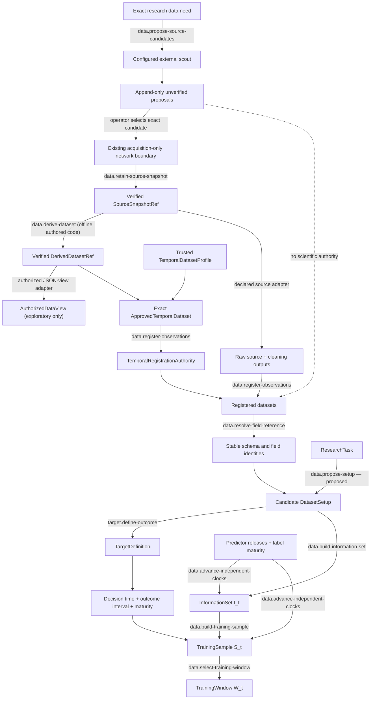

# Data Foundation and Dataset Setup

## First principle

**Data is scientifically usable only when identity, provenance, availability, and target maturity
are explicit.**

`DatasetSetup` is proposed here as the task-specific, versioned configuration connecting registered
data to a target and legal analysis surface. It is not yet canonical and must be reviewed before
contract promotion.

The generic workspace separates source scouting, acquisition, retention, transformation, and
scientific registration. Codex or another external process performs search outside this project;
the scouting command accepts only its passive, untrusted JSON response and executes no provider
code or network request. The explicit `acquire-scouted` handoff resolves one exact issued candidate
and delegates to the unchanged acquisition implementation. Fetch results expose no usable response values;
research code receives bytes only after an exact ref verifies. Neither a snapshot nor a derived
dataset is a registered `Dataset`, legal `InformationSet I_t`, or durable belief merely because it
exists. A source adapter or the source-neutral `TemporalRegistrationAuthority` must independently
bind exact field meaning, availability, vintage, dimensions, and provenance before values enter the
kernel.

The first source-specific composition is the official Polymarket CLOB price-history adapter. It
accepts one exact server-provided outcome token, time window, and fidelity; verifies that the
selected proposal has the one canonical URL; refuses redirects; retains exact public response
bytes; parses them offline; and registers sampled probabilities under a versioned availability
rule. The timestamp is provisionally used as both `reference_time` and `available_at` with an
explicit caveat: the endpoint does not establish historical revision/deletion behavior, and its
samples are neither trades nor executable quotes. This local workspace path does not write to the
production database or grant protected/scientific promotion authority.

### Proposed `DatasetSetup` responsibility

It should bind exact dataset versions, selected stable fields, population/geography, target and
horizon, timestamp alignment, availability/vintage rules, label maturity, missingness, exclusions,
and provenance. Physical file paths are not scientific identity.

This block must preserve the independence of predictor availability and label maturity. Target
construction may be endpoint-based, cumulative, path-dependent, duration/event-based, censored, or
state-conditioned, but those semantics must be explicit and cannot be inferred later by the sample
builder.

- [Transition contracts](transitions/README.md)
- [Implementation map](IMPLEMENTATION.md)

Authoritative sources: Scientific kernel, data-flow specification, I1–I3, I23, I24, and I26.
