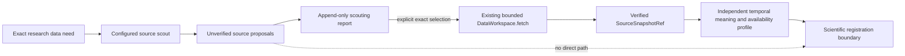

# data.propose-source-candidates — research need → unverified source proposals

## Status

`CANDIDATE_CONSENSUS` — implemented as an additive, provider-neutral proposal ledger ahead of
acquisition. It does not grant scientific authority.

## Architectural purpose

Let Codex or another externally orchestrated scouting agent look for useful public data, then hand
the application a passive JSON response. The application executes no provider callback and gives
no scouting code a handle to the data store, temporal kernel, research state, or protected
evidence. The result is a bounded list of URLs and source descriptions that an operator can review.
Only a later, explicit selection may enter the existing acquisition boundary.

## Contract

- **Source:** one strict `SourceSearchRequest`, one passive `RecordedSourceScoutProvider` response
  value, and an idempotency key.
- **Destination:** one append-only `SourceScoutingReportRef`, or a retained sanitized failure.
- **Must preserve:** exact request identity, unverified caller-supplied provider label, proposal
  order, resource and landing URLs, stated relevance, temporal coverage, license/access notes,
  risks, and evidence URLs.
- **Must exclude:** executable provider hooks, dedicated response-byte/preview fields, inferred
  `available_at`, field meaning, registered dataset references, scientific status, belief updates,
  and protected-data access. Free text remains untrusted and may contain claims or numbers; it never
  becomes a dataset. Acquisition credentials must not be supplied to the external scout.
- **State effect:** append request/report/operation metadata below the workspace's separate
  `scouting/` ledger. Scouting itself performs no HTTP acquisition.

`RecordedSourceScoutProvider` is a passive CLI handoff for a response authored outside the project
by Codex or another operator-controlled agent. It is not executable and accepts only detached JSON
or a sanitized external-failure code. Its `provider_id` is deliberately machine-labelled
`UNVERIFIED_CALLER_LABEL`; there is no tool receipt or authenticated provider claim. No provider
vendor, model, credential flow, or web-search implementation is embedded in the kernel.

## Explicit selection and acquisition

`data acquire-scouted` accepts only an exact report URI and candidate identity already issued by
the same workspace. It resolves both before delegating the selected URL to the unchanged
`DataWorkspace.fetch` implementation. It does not accept a free-form URL and cannot register the
result. The returned state is `ACQUIRED_NOT_SCIENTIFICALLY_REGISTERED`.

## Failure semantics

Externally reported denial/failure/timeout uses one sanitized allowlisted code. Malformed,
oversized, obvious credential-bearing, or authority-bearing responses become
`INVALID_PROVIDER_RESPONSE`. Exact retries return the retained receipt. Reusing the same
idempotency identity for changed intent conflicts. Forged or changed report/candidate references
deny before any HTTP request. Publication failures are not rewritten as provider failures.

Concurrent service objects in one process share a workspace lock and converge on one ledger
operation. External provider invocation and its retry/cost semantics remain outside this process.

## Falsifying tests

Two different research needs use the same provider seam; scouting makes zero HTTP requests; only
one selected loopback candidate reaches acquisition; the unselected URL is untouched; a forged
report and unknown candidate deny before network access; secret-like URL query keys and fabricated
authority fields are rejected; provider failure and exact retry remain reconstructible after
restart.

This transition proves source-proposal containment and traceability. It does not prove that a
proposed source is useful, truthful, licensed, temporally legal, historically available, or fit for
research.
