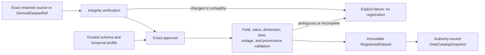

# data.register-observations — source bytes/cleaned rows + registration policy → registered observations

## Status

`CANDIDATE_CONSENSUS` — experimental, not canonical.

## Architectural purpose

Turn physical values into kernel-readable scientific observations by binding them to stable dataset/field identity, time semantics, provenance, vintage, dimensions, and caveats without rewriting raw evidence.

## Relevant locked invariants

- `docs/specification/INVARIANTS.md` I1, I11, I13, I24.
- `docs/specification/DECISIONS.md`, Time semantics and Dataset/feature ontology.
- `docs/specification/DATA_FLOW_AND_LIFECYCLE.md` 5.1.

## Source A

Immutable source bytes and/or cleaned rows; exact source/retrieval identity; versioned dataset schema/field registry; explicit release/availability/vintage rules; dimensions/entities; cleaning lineage; quality/caveat metadata.

## Destination B

Registered immutable observations identified by dataset/version and semantic field, each carrying value, `reference_time`, explicit `available_at` or exact versioned derivation rule/result, dimensions, source/provenance, vintage/revision identity, and caveats.

## Mapping f

Verify source identity/integrity; resolve fields only through exact schema; apply declared parsing/cleaning and availability rule; validate dimensions/time/value; publish observations and registration provenance coherently while retaining raw source.

## Must preserve

Raw source identity, value meaning, units, dataset/field semantics, both time axes, release-rule version, entity/dimensions, source lineage, revisions/vintages, missingness, quality flags, caveats, and environment/schema identity.

## May transform

Encoding, parsing, long-format normalization, declared cleaning, and derived `available_at` where the governing rule is explicit/versioned and the derivation is reconstructible.

## Must exclude

Field/path/column substitution, invented availability, treating `reference_time` as availability, overwritten raw data, latest-schema reinterpretation, silent unit conversion, deduplication that erases vintages, inferred scientific usefulness, fitting, and partial healthy registration.

## Authority boundary

Registration infrastructure may interpret only declared schema/policy. Data owners/versioned policy authorize semantics; registration cannot invent them or grant later access.

## Allowed state mutation

Append registered observations, schema/version/provenance records, and explicit rejection diagnostics.

## Forbidden state mutation

No raw-source rewrite, prior observation rewrite, permission/exposure change, feature/target/model creation, or scientific finding.

## Failure semantics

Unknown/ambiguous field, missing availability rule, invalid time/value/dimension, integrity mismatch, or publication failure rejects/quarantines affected registration explicitly. No nearby field, row timestamp, current rule, or imputed value silently substitutes. Retry is idempotent for exact source/policy and conflicts on changed semantics.

## Observable consequences

The same reference date with different publication delays produces distinct `available_at`; a later revised vintage coexists with lineage rather than rewriting the original; raw bytes remain identical.

## False-success implementations considered

- Set `available_at = reference_time`.
- Bind by physical column position.
- Apply today's release rule to historical registration without versioning.
- Overwrite old vintage with revision.
- Publish values before provenance/schema records.

## Falsifying tests

1. Register rows with identical `reference_time` but different declared release delays; assert distinct availability and rule provenance. **Level A/B.**
2. Reorder/rename physical columns while stable semantic IDs remain; exact mapping survives, while unknown ambiguity fails.
3. Register original and revision; assert both immutable vintages and lineage, unchanged raw source.
4. Inject failure across observation/provenance publication; assert no healthy orphan registration.
5. Supply conflicting vintages with one revision number or a higher revision available before its
   predecessor; assert explicit ambiguity/non-coherence failure before registration publishes.

## Mutation-sensitivity check

**Mutation:** derive availability from row/reference timestamp regardless of release policy.

**Expected failure:** test 1 becomes red because both observations become prematurely available.

## Composite dependencies

data.resolve-field-reference resolves fields; data.build-information-set admits legal observations; data.prove-temporal-substrate proves the temporal vertical slice; sandbox.record-provenance later records execution access.

## Fundamentals review

`CONSISTENT`. Registration creates explicit scientific identity/provenance without making access or predictive claims.

## Grill findings

Resolved non-semantically: added rule-version provenance, revision coexistence, and coherent publication to defeat plausible timestamp/overwrite shortcuts.

## Remaining user decisions

None. The source-neutral `temporal-observations/v1` envelope and in-process issuance authority are
implemented. Source-specific parsers, external approval services, and persistent store technology
remain implementation choices.
