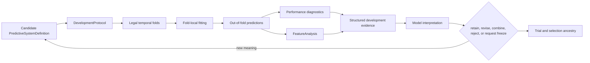

# Development implementation map

Status: **initial controlled fitting and development-validation vertical slice implemented; protected evaluation remains outside this block**.

- Code: `src/research_agent/development/`
- Tests: `tests/development/test_controlled_development.py`
- Transition contracts: [`transitions/`](transitions/)
- Required evidence: fitted state remains inside legal windows, prediction does not learn, and trial ancestry remains visible.

## Implemented public paths

- `TrainingInformationBuilder` reconstructs one exact legal `InformationSet` per selected row and
  binds their catalog, environment, sample, window, field scope, dimension slice, predictor values,
  and mature label lineage into an immutable `TrainingInformationBundle`. Every bundle is issued by
  the exact non-copyable `TrainingInformationRegistry` configured on `SystemTrainer`; an equal or
  self-rehashed caller object cannot acquire fitting authority, while exact builder replay returns
  the original issued object.
  `SystemTrainer.fit(PredictiveSystemDefinition, TrainingWindow, TrainingInformationBundle)` uses
  the formal compiler/materializer for field, lag, difference, rolling, arithmetic, log, and
  declared standardization expressions. Its `FitRecord` names the bundle, every row information
  set, compiled graph, and formal feature series. The legacy two-argument path remains for earlier
  row-local callers, but temporal operators fail there rather than reading the current value as a
  lag. Unsupported recipes, singular systems, invalid data, and incompatible identities raise
  `TrainingBlocked`; no alternate algorithm, dimension, or preprocessing path is selected. The
  fitted-through clock is the latest admitted label-maturity time, so prediction cannot precede
  information consumed by fitting.
- Every successful fit is issued into an explicit `FittedSystemRegistry`. `SystemPredictor` and
  fold replay accept state only from that same training authority. Content hashes still establish
  immutable identity, but cannot grant caller-authored coefficients inference authority.
- The dependency-light deterministic registry currently implements `mean`, `linear_regression`, and
  `linear_interactions` recipes. Algorithm and hyperparameter choice remains data in
  `ModelDefinition`; the registry is an initial executable surface, not a restriction on future
  model families. Fixed `weighted_mean` ensembles are supported when exactly declared. Learned
  ensemble weights are an explicit remaining capability, not an implicit default.
- `SystemPredictor.predict` consumes the exact immutable fitted system plus one legal
  `InformationSet`, asks the formal `FeatureMaterializer` to produce the frozen feature definitions
  using trainer-owned transform state, and creates an immutable `PredictionRecord`. There is no
  public caller-supplied `FeatureSeries` record path: development fold replay is private and binds
  immutable `TrainingRow` and `FitRecord` identities. The public predictor exposes no fit, update,
  selection, or adaptation surface.
- `OutcomeRecorder` reconstructs a label from the registered target catalog, exact prediction-time
  `InformationSet`, `TargetDefinition`, and current time; it creates a separate immutable
  `OutcomeRecord` only after full-interval completion and legal availability. Caller-supplied scalar
  outcomes cannot create records. Early-event maturity is an explicit remaining capability.
- `TemporalFoldBuilder` constructs ordered expanding development folds. It purges a training row
  only when purging is declared and its target interval overlaps a validation target interval. It
  applies an embargo only when an exact positive embargo is configured and records purge and embargo
  exclusions separately in fold identity. Independent of optional purge policy, a row whose label
  has not matured by the validation decision time is always excluded and recorded as unavailable.
  Target intervals are evaluated through the exact target `TemporalOffset`: a calendar quarter is
  not treated as 90 days. The separately configured embargo remains an explicit elapsed duration;
  no contract authorizes deriving or converting it from the task horizon.
- `DevelopmentEvaluator` requires the candidate's exact `evaluation_protocol_id`. When supplied
  the exact sample catalog (as the composed workflow and protected executor now do), it rebuilds
  fold-local training bundles, fits formal feature series, and routes baseline out-of-fold
  inference through `SystemPredictor` and legal validation-time information sets. It retains
  per-fold plus
  aggregate MSE/MAE, and labels all evidence `DEVELOPMENT`. Every accepted call records
  `ATTEMPTED` before protocol/fold execution; all typed precondition, fold, fitting, metric, or
  diagnostic failures then append `FAILED`. It never freezes, promotes, accesses protected data,
  or claims `VALIDATED`. The legacy `catalog=None` evaluation path remains available for row-local
  development fixtures, but its evidence is explicitly marked non-promotable and the registry does
  not issue `DevelopmentFreezeInputs` for it.
- Every successful evaluation is issued into the evaluator-owned `DevelopmentEvidenceRegistry`.
  Alongside the exact evidence, that registry retains `DevelopmentFreezeInputs` binding the
  evaluated system identity/version/ancestry, environment, and ordered data/training/evaluation
  protocol identities. When protected evaluation is intended, its exact `EvaluationSpec` and
  `PromotionStandard` identities must also be supplied together before development execution; the
  evaluator includes them in the issued freeze inputs. The protected freeze authority resolves
  this binding from the evaluator registry; its public issuance call does not accept a substitute
  system definition or post-hoc protocol.
- `FeatureAnalysis` preserves per-feature/per-fold permutation, zero-ablation, and single-feature
  evidence with baselines, direction, applicability, sample size, and warnings. Correlated
  substitutes and interaction-only fixtures retain conflicting diagnostics; no method mutates or
  automatically prunes the `FeatureSet`.
- `TrialLedger` is append-only for attempted, succeeded, failed, rejected, and selected events. It
  fixes candidate, protocol, and parent identities at the first attempt, requires existing acyclic
  parents, and enforces either `ATTEMPTED -> FAILED` or
  `ATTEMPTED -> SUCCEEDED -> REJECTED | SELECTED` lifecycle semantics.
  A selection event is a development-history fact, not promotion or freeze authority.

## Development feature-research loop



The model chooses the scientific question, suitable diagnostic method, and interpretation. The
harness makes the declared experiment executable and checks temporal legality, fold isolation,
provenance, evidence status, and complete trial ancestry.

## `DevelopmentProtocol` responsibilities

The development protocol must make the evidence-generating process reproducible without forcing one
universal statistical recipe. It binds or references:

- candidate system, target, feature-set, environment, and development-data identities;
- decision times and temporal split construction;
- label-span/overlap semantics needed to determine leakage risk;
- training-window, fitted preprocessing, selection, and hyperparameter procedures;
- scoring metrics, uncertainty summaries, benchmarks, and failure behavior;
- requested feature-analysis methods and their model/data applicability;
- random-state/repetition policy, resource limits, and trial identity/ancestry.

Ordinary shuffled IID cross-validation is not a time-series default. Splits must reproduce what was
legally knowable at each validation decision time. When label information intervals overlap across
train and validation observations, the split procedure purges contaminated training observations.
An embargo is used only when a declared dependence/overlap threat requires additional separation;
it is not mandatory ceremony for every task. Any learned preprocessing, PCA, imputation, feature
selection, hyperparameter search, model, or ensemble state is fitted independently inside the
training side of each fold.

## Feature-importance evidence

The implementation exposes feature analysis as an evidence toolbox, not as one compulsory ranking:

- impurity-based importance may provide fast in-sample, model-specific explanatory evidence;
- permutation/ablation importance may measure out-of-fold predictive dependence;
- single-feature evaluation may expose stand-alone signal while intentionally losing interactions;
- grouped or conditional perturbation may investigate correlated substitutes;
- interaction, redundancy, stability, regime, missingness, and sensitivity analyses may explain
  why importance changes;
- unsupervised structure such as fold-local PCA may provide corroborating evidence or become a
  fitted feature operation when explicitly formalized.

Each method must report its applicability and known failure modes. Conflicting results are valid
scientific information: correlated substitutes can dilute or mask individual importance, while
single-feature analysis can miss joint effects. The harness must not respond by automatically
dropping a feature, selecting the largest score, requiring every method, or forcing orthogonalization.

## Structured `FeatureAnalysis`

Development evidence returned to the model preserves:

- candidate, feature, feature-set, model, protocol, fold, data, and environment identities;
- metric definition, baseline, direction, sample size, temporal coverage, and uncertainty;
- per-fold and aggregate values rather than only one headline score;
- stability across time, entities, regimes, seeds, or related datasets where requested;
- redundancy, substitution, interaction, and perturbation scope;
- fitting boundary, purge/embargo exclusions, failures, warnings, and insufficiency;
- full artifact references, actual provenance, `DEVELOPMENT` status, and trial ancestry.

The next reconstructed context supplies this evidence to the model. The model then explicitly
proposes one of: continue analysis, retain, revise, combine/group, formalize, reject, or request
freeze assessment. Any meaning-changing decision creates a new candidate/version and preserves the
old result. No diagnostic directly mutates the candidate or durable belief.

## Tests before implementation

1. A future-distribution fixture catches global scaling, PCA, feature selection, or tuning outside
   the fold.
2. An overlapping-label fixture stays leaked under naive splitting and becomes legal only when the
   declared purge rule removes intersecting training observations.
3. A non-overlapping task does not receive an unnecessary embargo solely because the framework
   supports one.
4. Correlated substitute features make individual importance methods disagree; the evidence retains
   both results and no infrastructure path silently drops both features.
5. An interaction-only feature pair performs poorly in isolation but jointly out of fold; a rigid
   single-feature gate becomes red.
6. Equal headline performance with different temporal stability, redundancy, or concentration
   produces distinguishable observations and different packet-only research actions.
7. Every attempted, failed, rejected, and selected trial remains in ancestry; winner-only logging
   becomes red.
8. Development code cannot access protected data, claim `VALIDATED`, mutate the candidate in place,
   or train during evaluation/prediction.

## Explicit boundary with protected evaluation

Development evidence may be examined repeatedly and used to revise the system. It is never treated
as untouched protected evidence. Final backtest construction, selection-aware reporting,
promotion standards, and exposure policy are owned by the
[protected-evaluation block](../protected-evaluation/IMPLEMENTATION.md). Crossing that boundary
requires a complete frozen system and an independently authorized, predeclared request; development
diagnostics cannot cross it implicitly.

## Executable adversaries

`tests/development/test_controlled_development.py` and
`tests/development/test_temporal_feature_training.py` prove that:

1. a future poison row outside `W_t` cannot change learned standardization or coefficients;
2. prediction consumes exact fitted state without learning, and caller-authored `FeatureSeries`
   values have no public record-producing path;
3. unsupported recipes block with no fallback, and a recomputed content hash cannot disguise
   missing learned components;
4. overlap purging removes contaminated rows while a non-overlapping task receives no ceremonial
   embargo;
5. interaction-only and correlated-substitute evidence survives single-method disagreement without
   automatic feature removal;
6. dimensions survive prediction identity and outcomes remain separate until maturity;
7. failed, rejected, selected, and winning ancestry remains visible;
8. a failed development evaluation records both attempt and failure without returning success.
9. future decisions and labels immature at `TrainingSample.current_time` cannot enter `S_t`, even
   with a recomputed content identity;
10. fully rehashed caller-authored fitted coefficients are rejected by the trainer issuance
    boundary;
11. a candidate cannot run under an evaluation protocol other than the exact identity it binds;
12. trial identity/ancestry cannot be rewritten and pre-fold failures remain visible;
13. deterministic permutation and ablation fixtures assert exact per-fold deltas, so ignoring the
    perturbed vectors turns the suite red.
14. a July 31 calendar-quarter target overlaps a January 30 validation interval and is purged,
    while a 90-day target ends earlier and remains eligible; substituting one for the other changes
    the test outcome.
15. an irregular-signal lag feature learns the exact lagged relationship through reconstructed
    legal `InformationSet` history; replacing lag with latest/current changes the learned result;
16. every formal fit records its training-information bundle, row views, compiled feature graph,
    and feature series, while the same temporal expression without that bundle fails closed;
17. development-fold baseline predictions consume formal validation-time information rather than
    fabricated row-feature identities.

Verification at this implementation state:

```bash
uv run pytest -q tests/development
uv run pytest -q
uv run ruff format --check .
uv run ruff check .
uv run basedpyright
```

The repository-wide receipt is recorded at the integration checkpoint; these commands, rather than
historical pass counts, are the authoritative gate.

## Remaining reds and deliberate limits

- Direct legacy two-argument fitting still supports only row-local expressions; temporal operators
  require the explicit `TrainingInformationBundle`. This compatibility seam is not used by the
  registered scientific workflow or protected historical executor. Nested fitted transforms whose
  operand itself contains another fitted transform remain unsupported because their fit ordering is
  not yet declared.
- The initial protocol does not yet provide nested hyperparameter/model selection, grouped or
  conditional permutation, uncertainty intervals, seed repetitions, regime/entity stability views,
  learned ensemble weights, classification/probability models, or non-numeric outcomes.
- Single-feature analysis intentionally refits the declared deterministic linear-family recipe on
  one feature and reports its interaction blindness. It is evidence, not a universal admission
  gate.
- The ledger is in memory and proves append-only behavior within one process; durable transaction
  and correction persistence belongs to later integration work.
- Development evidence is repeatedly inspectable and selection-exposed. Freeze assessment,
  protected authorization/exposure, backtesting, validation, and promotion remain entirely in the
  protected-evaluation milestone.
