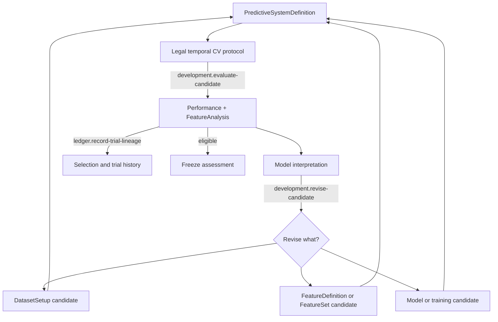

# Development Validation

## First principle

**Iteration is encouraged, but selection changes what the evidence means.**

Development evidence may guide revision repeatedly. It must retain trial ancestry and must never be
presented as protected, untouched evidence.

Cross-validation estimates development generalization; feature analysis helps the researcher learn
what information the candidate uses, where it is stable, and whether apparently useful variables
are redundant, substitutable, interactive, or fragile. Neither automatically decides which feature
survives. All learned preprocessing, selection, model, and ensemble state fits inside the legal
fold/window. Prediction does not learn. Failure does not silently substitute a different recipe.

- [Transition contracts](transitions/README.md)
- [Implementation map](IMPLEMENTATION.md)

Authoritative sources: Scientific kernel, backtest/evaluation specification, I2–I6, I12, I21, and
I22.
