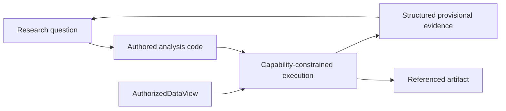

# Exploration implementation map

Status: **generic capability-constrained authored analysis implemented; no source-specific
convenience study is part of Chronos**.

- Sandbox: `src/research_agent/exploration/sandbox.py`
- Tests: `tests/exploration/test_research_sandbox.py`
- Data-to-research composition: `tests/integration/test_data_to_research_kernel.py`

The researcher may author open-ended computation. The sandbox owns data scope, resources, side
effects, and provenance. Exploratory output does not become a formal feature, label, fitted model,
protected result, finding, or durable belief merely because the code ran.

Chronos deliberately carries no bundled insurance study, EIOPA adapter, or copied source dataset.
Polymarket values enter through the data-foundation registration boundary and then use this same
domain-neutral analysis surface.
