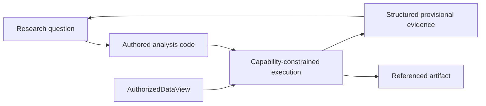

# Exploration implementation map

Status: **generic capability-constrained authored analysis implemented and composed with exact
live Polymarket registrations; scientific method remains researcher-authored**.

- Sandbox: `src/research_agent/exploration/sandbox.py`
- Tests: `tests/exploration/test_analysis_sandbox.py`
- Data-to-research composition: `tests/integration/test_data_to_research_kernel.py`
- Polymarket registration-to-sandbox composition:
  `src/research_agent/data_adapters/polymarket/analysis.py`
- Live command and regression evidence:
  `src/research_agent/data_adapters/polymarket/live_analysis.py` and
  `tests/data_adapters/polymarket/test_live_analysis.py`
- Retained-corpus development composition and offline study command:
  `src/research_agent/data_adapters/polymarket/corpus_analysis.py` and
  `src/research_agent/data_adapters/polymarket/run_corpus_studies.py`



The researcher may author open-ended computation. The sandbox owns data scope, resources, side
effects, and provenance. Exploratory output does not become a formal feature, label, fitted model,
protected result, finding, or durable belief merely because the code ran.

The deliberately small pure numerical namespace includes scalar `log`, `exp`, and `sqrt` for
researcher-authored transformations and diagnostics. These names expose standard-library pure
functions directly; the `math` module, attribute access, imports, and host interfaces remain absent.

Chronos deliberately carries no copied source-repository study, source-specific adapter, or dataset.
Polymarket values enter through the data-foundation registration boundary and then use this same
domain-neutral analysis surface. The retained Polymarket study under
`studies/polymarket-flow-2026-08-17/` is authored research evidence, not a hard-coded feature tool:
the application supplies exact values and authority while the researcher supplies the question,
transformation, diagnostics, and interpretation.

For retained resolution corpora, authored code can read only the earlier whole-event development
block. The capability supplies sampled probability paths, settlement/lifecycle fields,
partition-derived chronological event ordinals, exact question text, and selected outcome labels.
The latter fields support semantic discovery and prevent outcome meaning from being inferred from
an array position. Protected event values and arbitrary source metadata remain absent and denied.

Verification for the pure-square-root seam:

```bash
.venv/bin/pytest -q tests/exploration/test_analysis_sandbox.py
```
