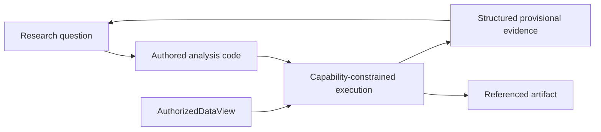

# Exploration implementation map

Status: **generic capability-constrained authored analysis implemented and composed with exact
live Polymarket registrations; scientific method remains researcher-authored**.

- Sandbox: `src/research_agent/exploration/sandbox.py`
- Tests: `tests/exploration/test_research_sandbox.py`
- Data-to-research composition: `tests/integration/test_data_to_research_kernel.py`
- Polymarket registration-to-sandbox composition:
  `src/research_agent/data_adapters/polymarket/analysis.py`
- Live command and regression evidence:
  `src/research_agent/data_adapters/polymarket/live_analysis.py` and
  `tests/data_adapters/polymarket/test_live_analysis.py`

The researcher may author open-ended computation. The sandbox owns data scope, resources, side
effects, and provenance. Exploratory output does not become a formal feature, label, fitted model,
protected result, finding, or durable belief merely because the code ran.

Chronos deliberately carries no copied source-repository study, source-specific adapter, or dataset.
Polymarket values enter through the data-foundation registration boundary and then use this same
domain-neutral analysis surface. The retained Polymarket study under
`studies/polymarket-flow-2026-08-17/` is authored research evidence, not a hard-coded feature tool:
the application supplies exact values and authority while the researcher supplies the question,
transformation, diagnostics, and interpretation.
