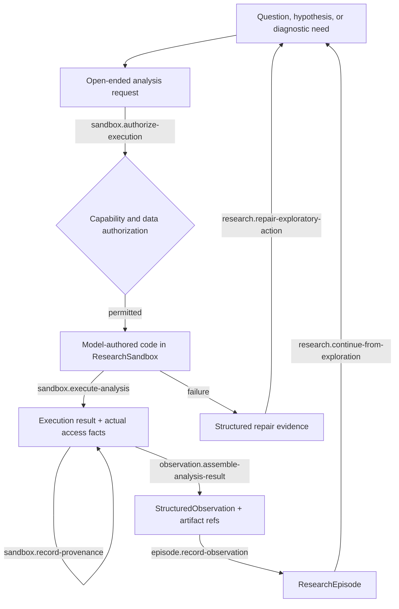

# Open-Ended Exploration

## First principle

**Constrain information and side effects, not scientific creativity.**

The sandbox gives the model a powerful scientific environment and a small number of deep actions.
Specialized tools are conveniences; open-ended analysis remains the escape hatch.

The harness controls authorized views, protected-data exclusion, side effects, resources, and
provenance. It does not prescribe the hypothesis, code, model family, diagnostic sequence, or
interpretation.

External discovery composes before this loop through the data-foundation workspace: a researcher
may use `data.propose-source-candidates` to retain unverified source proposals, explicitly select
one exact candidate for `data.retain-source-snapshot`, and parse verified bytes offline through
`data.derive-dataset`. Only a verified derived ref can be adapted into an `AuthorizedDataView`.
This does not make discovery results, raw bytes, or authored transformations scientifically
registered or temporally admissible.

- [Transition contracts](transitions/README.md)
- [Implementation map](IMPLEMENTATION.md)

Authoritative sources: Authority/sandbox specification, test strategy, I6, I9, I14, I17, and I18.
