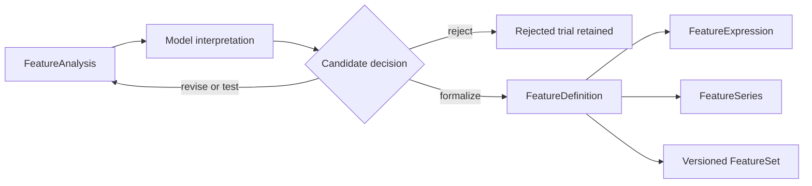

# Formalization implementation map

Status: **bounded Milestone 4 substrate implemented and consumed by downstream development**.

- Code: `src/research_agent/formalization/`
- Contract/adversarial tests: `tests/formalization/test_scientific_formalization.py`
- Transition contracts: [`transitions/`](transitions/)
- Implemented evidence: exact identity, lineage, legal feature materialization, fail-on-fit, and no
automatic promotion of exploratory evidence.

Controlled fitting and development validation are implemented separately in
`src/research_agent/development/`; this package remains a no-fit formalization boundary.

## Responsibility boundary

The model may discover and investigate feature ideas with open-ended analysis. Formalization does
not decide whether an idea is scientifically insightful. It converts an explicitly proposed meaning
into a reproducible scientific object and rejects incomplete, ambiguous, illegal, or silently
mutable definitions.



`FeatureAnalysis`, `FeatureDefinition`, `FeatureExpression`, `FeatureSeries`, and `FeatureSet` stay
distinct:

- `FeatureAnalysis` is provenance-bearing diagnostic evidence produced under a named protocol;
- `FeatureDefinition` is the stable meaning of `phi_j: D_<=t -> z_t^(j)`;
- `FeatureExpression` is an executable representation of that meaning;
- `FeatureSeries` is a materialization in one exact legal data/environment context;
- `FeatureSet` binds exact definition versions selected for one candidate, with selection ancestry.

An importance score, correlation, PCA component, plot, temporary column, or notebook function is not
a formal feature merely because it was useful during exploration.

## Minimum `FeatureDefinition` meaning

A formal feature proposal must resolve every dimension that can change scientific behavior:

- stable definition identity, version, parent lineage, and candidate ancestry;
- exact `FieldRef` and dataset/schema/environment dependencies;
- transformation semantics and code/expression identity;
- decision-time, lag, window, alignment, frequency, and availability semantics;
- output type, units, dimensions, entity/geography applicability, and naming;
- missingness, invalid-domain, insufficiency, and failure behavior;
- whether each operation is deterministic or fitted;
- the training-boundary procedure and state identity for fitted operations;
- the statistical failure/hypothesis addressed and information/history intentionally retained,
  removed, compressed, or approximated;
- warm-up, initialization, finite-history, truncation, and boundary behavior;
- provenance and the `FeatureAnalysis` evidence/rationale supporting formalization.

Equivalent internal representations may compile from the same definition. Any change to the above
meaning creates a new version; it cannot mutate a prior definition or silently resolve a newer
field/operator implementation.

## Formal construction responsibilities

The implementation needs cohesive responsibilities—not necessarily one class per item—for:

1. validating and publishing immutable `FeatureDefinition` identities;
2. compiling exact definitions to an executable expression/graph without approximation;
3. materializing non-fitted operations against an exact legal `InformationSet`;
4. requiring trainer-supplied, window-bound state for fitted operations such as scaling, PCA,
   clustering, learned imputation, or auxiliary models;
5. assembling exact member versions into a `FeatureSet` without implicit selection or latest-version
   substitution;
6. retaining diagnostic rationale, rejected candidates, and selection ancestry for development and
   later freeze assessment.

The formalizer validates meaning and legality. It does not fit transforms, run feature selection,
interpret importance evidence, or decide that a candidate deserves freeze.

## Implemented slice

The current package provides:

- immutable `FeatureDefinition` records binding exact `FieldRef` dependencies, one exact dimension
  slice, an expression, causal temporal mapping, expanding/fixed-width history, warm-up,
  initialization/truncation, explicit missing/invalid/insufficient failure policies, fitted-state
  procedures, evidence ancestry, candidate ancestry, and provenance;
- an exact `FeatureExpression` AST and `FeatureCompiler` for field, constant, lag, difference,
  rolling mean, log, arithmetic, division, and trainer-state-backed standardization;
- a `FeatureMaterializer` that accepts only prebuilt `InformationSet` boundaries, revalidates their
  temporal/field scope, preserves exact dimensions and source observation IDs, and exposes no fit
  capability;
- a training-only materialization mode that accepts already trainer-issued transform state bound to
  the same exact `TrainingWindow`. It permits a fold-fitted transform to encode rows inside its own
  window, while ordinary prediction still rejects state learned after the decision time. The
  materializer never estimates those parameters itself;
- `FittedTransformState` bound to a definition, environment, training-window identity, exact
  `InformationSet`, fit cutoff, parameters, and provenance; it can be consumed but never learned by
  materialization;
- immutable `FeatureSet`, `ModelDefinition`, distinct `FittedModel`, optional
  `EnsembleDefinition`, and complete candidate `PredictiveSystemDefinition` records;
- `record_material_change`, which accepts only an exact next-version child naming its immutable
  parent and emits an append-only lineage record.

Feature decision offsets, lags, rolling windows, history warm-up, and fixed widths now use the same
identity-bearing `TemporalOffset` as targets. A calendar-month lag from March 31, 2024 reaches
February 29 under the declared month-end policy; 30 elapsed days reaches March 1. These expressions
have distinct identities and materializations. Mixed elapsed/calendar width comparisons block when
their magnitude depends on the decision-time anchor rather than inventing an ordering.

`FeatureSeries` currently represents one declared dimension slice across unique increasing
decision-time `InformationSet` boundaries. A panel is expressed as exact per-dimension definitions
and series rather than collapsing multiple entities into one row. The evaluator never queries a
catalog or resolves a friendly/latest name: all values must already exist inside the supplied legal
view.

## Transformation families remain researcher choices

The kernel does not require stationarity or one transformation family. Raw levels, differences,
fractional differences, detrending, scaling, smoothing, aggregation, interactions, and learned
representations are candidate mappings the model may investigate. The researcher selects them by
the failure mode and evidence, not because infrastructure declares one statistically respectable.

If a transformation parameter is chosen from data—including differencing order, truncation
threshold, window length, stationarity cutoff, smoothing strength, or representation dimension—the
selection procedure is learned state. It must run inside each legal development/training boundary.
The selected state and its training provenance cannot be embedded globally into a supposedly fixed
feature definition.

## Executable verification coverage

- Exploratory code or a `FeatureAnalysis` cannot enter a `FeatureSet` without an explicit
  `FeatureDefinition`.
- Omitting or varying a material semantic dimension blocks publication or changes definition
  identity.
- Compilation preserves non-commutative lag, transform, alignment, and missingness semantics.
- Materialization cannot read future/latest-vintage data or fit missing preprocessing state.
- Two same-name definitions with different versions cannot collide or auto-upgrade in a historical
  `FeatureSet`.
- A fitted transform carries exact training-window provenance and cannot be reused across an
  incompatible fold or decision time.
- Expanding-history and fixed-width implementations with different warm-up/truncation behavior
  cannot share one scientific identity merely because they use the same mathematical family.
- A future-regime fixture catches globally selected differencing/window/stationarity parameters;
  fold-local candidate comparison remains legal and preserves every tried variant.
- A stationarity diagnostic cannot automatically promote a feature or prove predictive value; an
  equally stationary but signal-destroying transformation remains distinguishable in development.
- Rejected and superseded feature candidates remain traversable from the selected set's ancestry.
- Calendar feature windows cannot be replaced by fixed 30/90-day durations without changing both
  identity and observed values at adversarial anchors.

The Milestone 4 tests currently make the implemented subset of these claims executable. Fold-local
selection, future-regime diagnostics, rejected-trial ledger traversal, and model development belong
to the later development/training slice rather than this formalization package.

Focused verification from a fully bootstrapped checkout:

```bash
uv run pytest tests/formalization/test_scientific_formalization.py -q
uv run ruff check src/research_agent/formalization tests/formalization
uv run ruff format --check src/research_agent/formalization tests/formalization
uv run basedpyright src/research_agent/formalization tests/formalization
```

## Deferred implementation choices

Caching, persistence, broader operator coverage, frequency conversion, multi-output features,
trainer implementations, model fitting, cross-validation, and protected evaluation remain
deferred. The implemented slice consumes the public `FieldRef`, `InformationSet`, and
`TargetDefinition` APIs directly and does not introduce or depend on a `DatasetSetup` aggregate.
Calendar semantics currently support month/quarter and exact-input anchoring only; formalization
does not infer a frequency, month-end, timezone, or DST policy.
