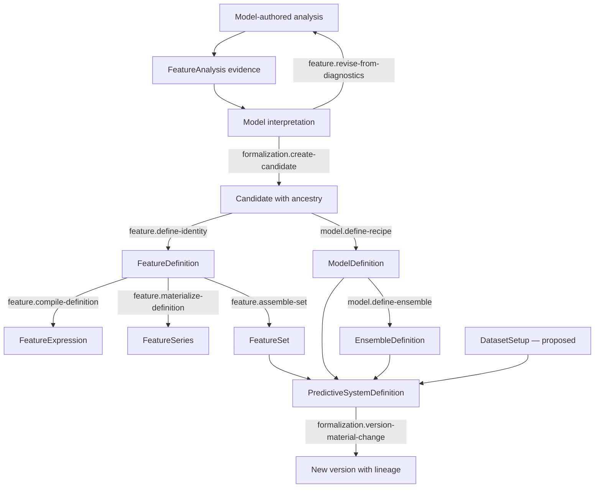

# Scientific Formalization

## First principle

**Exploration becomes science only through explicit, reproducible identity.**

Temporary analysis is free-form. Promotion captures exactly what a candidate means, depends on,
and changes. Material change creates lineage rather than mutating an identity in place.

The model owns the interpretation that turns diagnostic evidence into a proposal to retain, revise,
combine, formalize, or reject a candidate. The harness owns exact feature identity, temporal
legality, provenance, fitted-state boundaries, and version lineage. Feature analysis remains
evidence, not automatically a feature. Fitted transforms are learned state and must later fit inside
the legal training boundary.

- [Transition contracts](transitions/README.md)
- [Implementation map](IMPLEMENTATION.md)

Authoritative sources: Scientific kernel, architecture, I2, I3, I5, I6, and I13.
