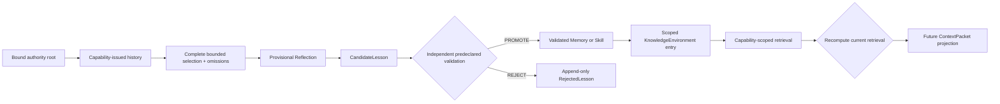

# Learning implementation map

Status: **bounded Milestone 9 substrate implemented in memory**.

The implementation follows the slow loop without treating reflection as belief:

## Code and evidence

- Records and content identities: `src/research_agent/learning/models.py`
- Authority-bearing reflection, proposal, validation, promotion, publication, retrieval, and
  context projection: `src/research_agent/learning/service.py`
- Causal/adversarial tests: `tests/learning/test_validated_cross_task_learning.py`
- Transition contracts: [`transitions/`](transitions/)

The focused tests prove:

- a repository accepts only its original authority root; a newly configured issuer cannot be
  mounted over it;
- source, validator, reader, and publisher actions require exact registry-issued in-memory
  capabilities; copied/self-rehashed capabilities have no authority;
- source policy, not the caller, determines protected classification, and evidence status uses a
  closed enum where only `SUCCEEDED` is affirmative support;
- reflection consumes a complete declared task/scope selection; bound omissions preserve status,
  and a selection invalidated by later evidence cannot be reflected;
- protected or unreadable history cannot enter reflection;
- reflection and candidates remain explicitly provisional;
- a configured validator still cannot approve its own/beneficiary lesson;
- original sources/evidence/tasks, non-current evidence, non-affirmative statuses, and evidence from
  another environment do not count as independent replication;
- candidate applicability cannot exceed its reflection evidence scope;
- a self-rehashed decision or retrieval has no authority;
- rejected lessons remain in append-only history and cannot be published;
- promoted knowledge preserves Memory-versus-Skill type, content, caveats, scope, and provenance;
- permission, task kind, environment, subject scope, and currentness govern retrieval;
- one validation decision produces one learning effect; supersession requires explicit same-kind,
  non-broadening candidate lineage and each learning has at most one successor;
- projection recomputes an issued retrieval against current entries, so a retrieval captured before
  supersession cannot revive stale learning;
- publication retries cannot silently change or broaden reader permissions;
- a packet-only policy changes its next action only when the substantive validated Skill is present;
- exact retries do not duplicate learning effects.

## Authority and API crosswalk

| Transition | Required issued input | Decisive check | Durable effect |
|---|---|---|---|
| history registration | `EvidenceSourceCapability` | exact capability object belongs to repository-bound `LearningAuthorityRegistry`; source policy binds environment/task/subject/protection | canonical `HistoryEvidence` + ledger event |
| history selection | `LearningReaderCapability` | exact reader capability and complete recomputation inside declared task/scope/bound | canonical `ReflectionEvidenceSelection` + omission descriptors |
| reflection | current issued selection | selection still equals a fresh selection over current repository evidence | provisional `Reflection` only |
| lesson validation | `LessonValidatorCapability` + predeclared standard | independent authority, source/task/evidence separation, affirmative/current/in-scope evidence | immutable PROMOTE/REJECT decision |
| lesson promotion | issued decision | decision consumed once; successor lineage is single, explicit, same-kind, and non-broadening | `ValidatedLearning` or `RejectedLesson` + ledger event |
| knowledge publication | `KnowledgePublisherCapability` | publisher scope/readers, exact validated learning, no permission broadening | current `KnowledgeEntry`; predecessor represented as superseded |
| retrieval/context | `LearningReaderCapability` + issued retrieval | query binds capability; projection recomputes the exact current result and builds observations under the same publication lock | bounded observations in a new `ContextPacket`; no durable belief commit |

## First-principles boundary

This subsystem enables a capable researcher with relevant, validated experience. It does not encode a
catalog of scientific methods or force a lesson to be followed. The harness controls only evidence
authority, validation independence, scope, currentness, provenance, and publication. A future model
receives the lesson's substance and caveats and remains free to accept, challenge, or ignore it.

## Honest limits

- Stores and the learning ledger are in-memory contract implementations, not crash-durable storage.
- Authority bootstrap and stores are in-process. The repository is bound to one authority root, but
  production ledger/trajectory identity and an externally administered authority issuer are not
  wired. Possession of that root is therefore a trusted composition capability.
- Applicability is exact structured matching, not semantic retrieval or ontology inference.
- Context projection is an explicit composition over a system-issued retrieval. Runtime automatic
  retrieval policy and token-budget arbitration remain integration work.
- The causal policy test proves information flow and side-channel exclusion for a deterministic
  packet-only consumer. It does not measure a real model's research quality or generalization.
- No model weights are updated, and no rejected/unvalidated lesson changes future context.
- `validated-learning-to-future-behavior` remains `EXPECTED_RED` in the production proof registry:
  these tests prove the in-memory contract, not independently administered production authority or
  runtime-integrated future-task behavior.

## Verification receipt

- focused learning and verification causality: `20 passed`;
- repository deterministic/integration suite: `231 passed`;
- Ruff lint and format check: passed across `87 files`;
- basedpyright strict check: `0 errors, 0 warnings, 0 notes`;
- production proof classification preserved at `1 HARNESS_GREEN / 14 EXPECTED_RED`.
