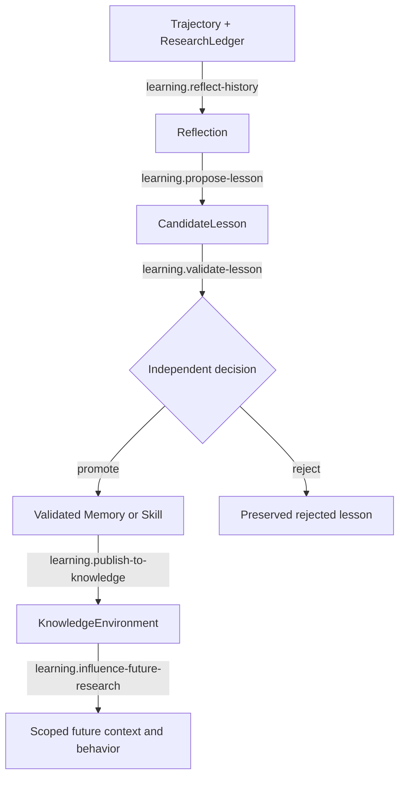

# Validated Cross-Task Learning

## First principle

**Past experience changes future behavior only after independent validation.**

The actor benefiting from a lesson cannot approve it. Scope and provenance travel with promoted
learning; publication does not make a lesson universally applicable.

- [Transition contracts](transitions/README.md)
- [Implementation map](IMPLEMENTATION.md)

Authoritative sources: State/context/memory specification, I8, I12, I13, I15, and I16.
