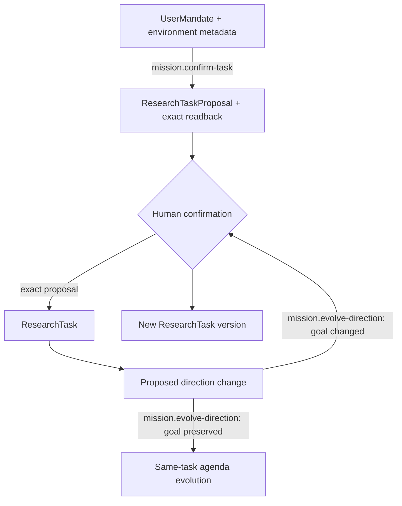

# Mission and Environment

## First principle

**The model may explore uncertainty, but only the human can authorize the durable mission.**

Task compilation preserves breadth, uncertainty, constraints, and original intent. It does not
perform research. Subordinate questions may evolve autonomously; a genuine change to the main goal
returns to exact human confirmation.

Authority changes only at human confirmation. Dataset contents, model calls, findings, and protected
evidence are outside this block.

- [Transition contracts](transitions/README.md)
- [Implementation map](IMPLEMENTATION.md)

Authoritative sources: Contract 001, locked task decisions, I10 and I24.
