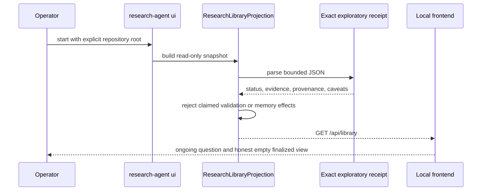

# Operator interface implementation map

Status: **read-only local research library implemented; canonical finalized-report persistence
remains red**.

- Projection: `src/research_agent/operator_ui/projection.py`
- Local HTTP boundary: `src/research_agent/operator_ui/server.py`
- Frontend: `src/research_agent/operator_ui/assets/`
- Operator command: `research-agent ui`
- Tests: `tests/operator_ui/`
- Transition: `operator.render-research-library`

## Implemented flow



The server exposes only fixed static assets, `GET /api/library`, and `GET /health`. `POST`, `PUT`,
`PATCH`, and `DELETE` return `405`; arbitrary paths and path traversal return `404`. Dynamic record
content is inserted with DOM `textContent`, not trusted HTML.

The visual system follows an institutional research-document pattern: white editorial canvas,
navy text, baby-blue navigation and rules, compact source notes, and evidence-first charts. It does
not copy a bank logo or imply affiliation.

## Verification standard

```bash
uv run pytest -q tests/operator_ui
uv run ruff check src/research_agent/operator_ui tests/operator_ui src/research_agent/cli.py
uv run ruff format --check src/research_agent/operator_ui tests/operator_ui src/research_agent/cli.py
uv run basedpyright src/research_agent/operator_ui tests/operator_ui src/research_agent/cli.py
./scripts/check.sh
```

Adversarial tests cover exploratory receipts that self-assert validation or durable memory effects,
malformed authority, all state-changing HTTP methods, and static-path traversal.

## Remaining red

- The canonical reporting registry is currently in memory. Until it has a persisted resolver, the
  finalized view must remain empty rather than trust files that merely claim to be findings.
- The frontend does not start, cancel, approve, or mutate research. Those require separate
  authority-bearing operator transitions.
- The local server is single-operator development tooling, not an authenticated multi-user service.
- The projection currently understands the retained exploratory receipt schema used by the Swedish
  waiting-queue study. A generic versioned receipt registry remains future work.
