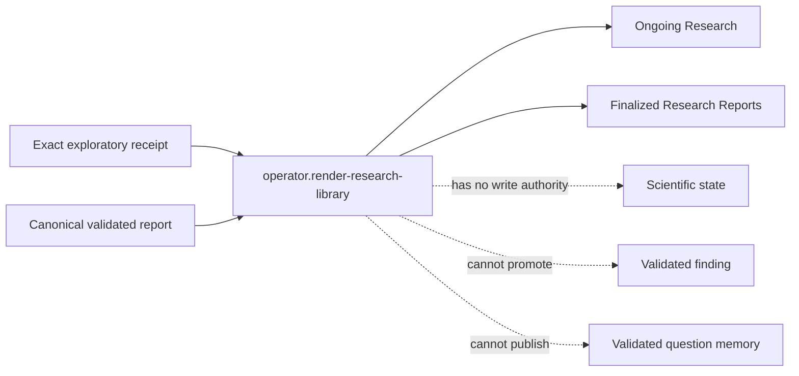

# Operator interface

## First principle

**A readable projection has no authority to change research status or evidence.**

The operator interface has exactly two top-level views: ongoing research questions and finalized
research reports. It is an observation surface, not a workflow editor, validation gate, or finding
publisher.

The first implemented view reads bounded, machine-readable exploratory receipts and preserves their
exact `EXPLORATORY`, `NONE_EXPLORATORY_ONLY`, and no-memory-effect status. The finalized view stays
empty until a persisted canonical-report resolver exists. A synthetic example is deliberately not
shown as finalized research.

- [Implementation map](IMPLEMENTATION.md)
- [Transition contract](transitions/render-research-library.md)

Authoritative sources: reporting first principle, I13, I19, and the autonomous investigation
resolution contract.
