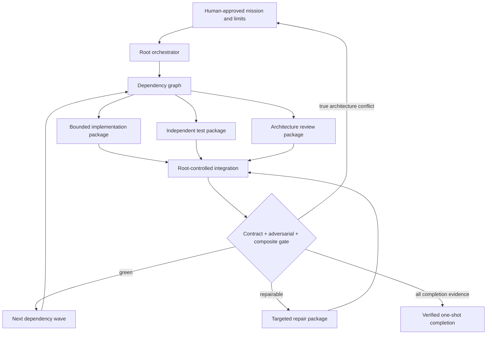

# Codex One-Shot Orchestration

## First principle

**Agents may build in parallel; objective evidence, not agent confidence, controls integration.**

This block builds the product but is not part of the product's scientific runtime.

Work packages own semantic transitions and explicit files, not vague milestones. A package declares
inputs, outputs, upstream contracts, invariants, forbidden changes, tests, evidence, and stopping
conditions. Shared mutable state and cross-block transitions remain root-controlled.

- [Transition contracts](transitions/README.md)
- [Implementation map](IMPLEMENTATION.md)

This block requires a separate review before it becomes an executable one-shot protocol.
