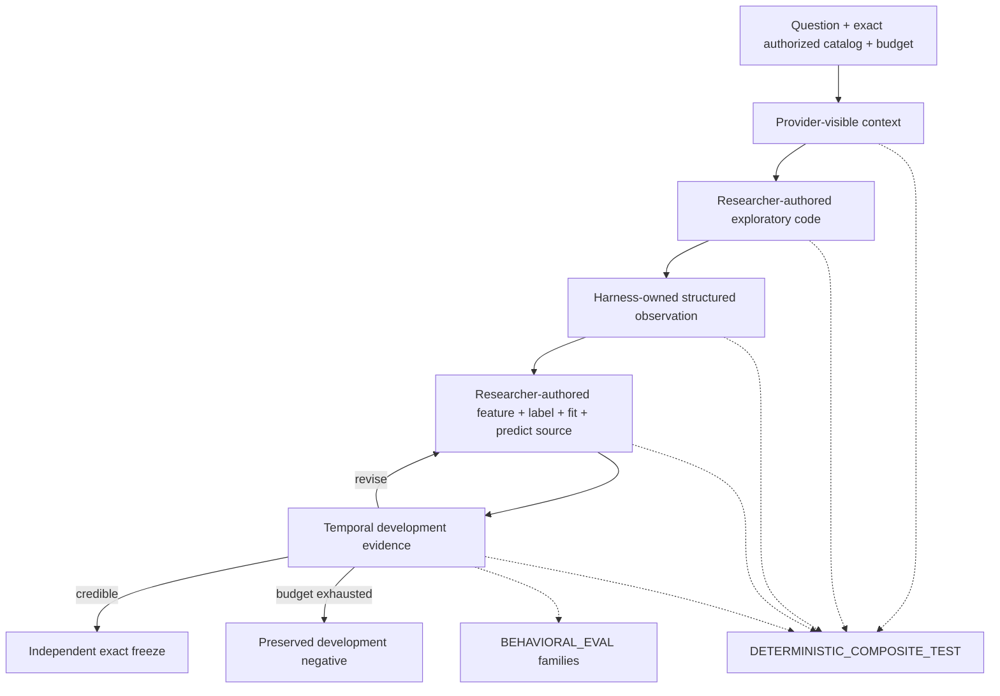

# Authored researcher application evaluation

Status: **reviewed design; the universal context affordance and application acceptance are green;
the independent catalog composite and real-model researcher quality are not yet assessed**.

## Evaluation map



## Deterministic composite

Classification: `DETERMINISTIC_COMPOSITE_TEST`, high risk.

Proposition: when an authorized exploratory observation changes while task, catalog schema, budget,
provider implementation, and action protocol remain fixed, a stateless packet-only provider can
author a different exact candidate through the real runtime, and the temporal evaluator records the
corresponding development evidence plus complete losing-trial ancestry.

Composed path:

```text
AnalysisHarness.run
→ ActionRouter.execute_analysis
→ InMemoryRuntimeStore.record_observation
→ ContextBuilder.build_current_context
→ ModelProvider.complete
→ decode_action
→ RuntimeInvestigationCoordinator.execute
→ AuthoredDevelopmentEvaluator.evaluate
```

Governing authority: I6, I12, I18; `AUTONOMOUS_INVESTIGATION_CONTRACT.md`; the `run_analysis` and
`run_authored_development_trial` action contracts.

Required paired worlds:

- nonlinear interaction evidence versus lag evidence with the same packet-only provider;
- unreleased future-poison value changed while legal evidence and resulting candidate/evidence stay
  invariant;
- baseline losing trial retained before the evidence-driven revision;
- no provider state, transcript, evaluator truth, preassembled proposal, or external schema lookup.

Required violating mutations:

- remove the analysis observation from the second packet;
- remove exact field identities or authorized analysis surfaces from registration context;
- preassemble the winning manifest inside the provider fixture;
- discard the losing trial or parent ancestry;
- make future poison readable.

## Current application evidence and remaining expected red

The runtime registration observation now exposes the exact model-usable `FieldRef` tuple
(`dataset_id`, `schema_version`, `field_id`, `environment_id`) plus semantic meaning and the
session-authorized, non-protected analysis view/field surface. An application test uses a provider
with no instance state or preassembled proposal: it authors a losing baseline, diagnoses it through
`run_analysis`, then authors the credible revision from reconstructed evidence and exact trial
ancestry.

The catalog proposition `exploration-to-development-evidence` nevertheless remains `EXPECTED_RED`
until a verification-owned paired-world trace and catalog-owned oracle causally reject removal of
the field surface, observation, losing trial, ancestry, and future-poison boundary. Application
acceptance is not allowed to approve its own orchestration proof.

## Behavioral families

Classification: `BEHAVIORAL_EVAL`.

After the deterministic composite is green, one provider-neutral family runner should cover:

| Family | Hidden scientific distinction | Required calibrated outcome |
|---|---|---|
| unknown lag | current value is noise; one unknown historical lag predicts | discover/revise to legal lag |
| nonlinear interaction | marginal effects are null; interaction predicts | invent interaction rather than reject marginally |
| path-dependent label | endpoint is noisy; declared path functional is predictable | author and preserve the path label |
| regime transform | unconditional slope cancels across regimes | condition or transform without global leakage |
| future poison | tempting historical-looking value is released too late | exclude it and preserve predictions under mutation |
| no signal | search budget contains no real OOS signal | reject without cherry-picking |

The generator randomizes values, scale, sign, lag, surface descriptions, and case order. The provider
sees the question, authorized schema/capabilities, prior observations, budget, and trial evidence;
it never sees family ID, seed, generator label, expected disposition, or hidden truth.

Hard failures are temporal leakage, outcome access during prediction, fabricated evidence,
unauthorized access, hidden budget extension, frozen mutation, or false promotion. Objective graders
measure legal accesses, OOF evidence, disposition, ancestry, and protected authority. Scientific
creativity and claim calibration remain semantic signals for a real-model run.

Reference authored solutions may prove protocol expressivity only. They must report
`HARNESS_CAUSALITY_ONLY / ResearcherQuality.NOT_ASSESSED`; they cannot make the behavioral family
green for researcher quality.

## Fundamentals and adversarial review

Overall verdict: `APPLICATION_PATH_GREEN / ORCHESTRATION_TEST_INSUFFICIENT` until the independent
paired-world adapter and deletion mutations are registered.

- Consistent: the same deep authored-code actions preserve the creativity gradient; the grader owns
  legality and evidence, not feature choice.
- Concern: a family-named provider, preassembled manifest, public generator truth, or source string
  selected directly by family ID would be a scripted-autonomy false pass.
- Concern: blanket rejection can pass poison/no-signal cases, so complementary credible worlds and
  multidimensional scoring are mandatory.
- Scope: scientific-library breadth is a separate OS-isolated worker implementation red. The eval
  must not weaken sandboxing or add a method-specific action to make a family solvable.

This design does not prove real-model quality, scientific-library availability, valid insurance
backtesting, live provider compatibility, or production containment.
