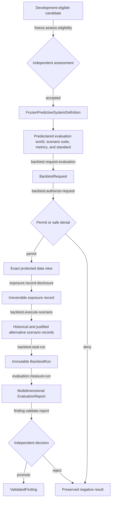

# Protected Evaluation and Evidence

## First principle

**Protected evidence is credible only when scientific identity is frozen, authorization is
independent, and exposure is irreversible history.**

The requester cannot grant its own permit or promotion. Failed execution can still create exposure.
Evaluation measures; it does not retrain, select a replacement, or revise the frozen system. A
historical walk-forward path, a temporally legal alternative-path analysis, and a synthetic
counterfactual have different meanings and remain distinguishable in the evidence. Rejection and
every attempted trial remain history.

- [Transition contracts](transitions/README.md)
- [Implementation map](IMPLEMENTATION.md)

Authoritative sources: Backtest/evaluation specification, I4–I8, I11–I13, I17, I21, I22, and I25.
