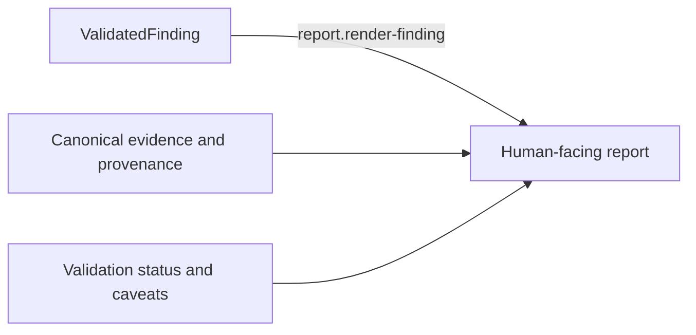

# Reporting

## First principle

**Presentation may clarify a finding but cannot change its scientific substance.**

Wording, ordering, layout, and explanation may change. Evidence, caveats, provenance, validation
status, and scientific conclusion may not. Drafting a report grants no power to promote a claim.

The implemented boundary is deliberately two-channel. Markdown is the flexible human presentation;
the adjacent `FindingMachinePayload` is an exact, content-addressed reconstruction of the canonical
`ValidatedFinding`. Both are bound to the same scientific fingerprint. The `ReportBuilder` resolves
the finding independently from a ledger-verified `CanonicalReportRegistry`, so a caller cannot gain
reporting authority by supplying a plausible object with a freshly calculated content hash.

Presentation specifications select only predefined audience, ordering, detail, and wording styles.
They contain no fields for replacing the conclusion, metrics, caveats, status, evidence, or
provenance. Every supported style renders every canonical scientific field; "concise" changes
presentation density, not scientific coverage. Reporting also states that scientific promotion is
not a downstream business or economic decision and provides no action/recommendation interface.

- [Transition contracts](transitions/README.md)
- [Implementation map](IMPLEMENTATION.md)

Authoritative sources: Reporting decisions, backtest/evaluation specification, I13 and I19.
