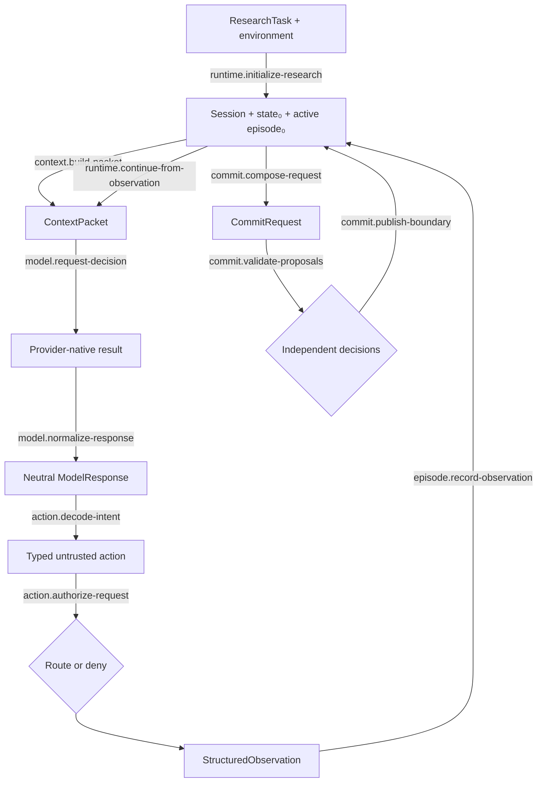

# Autonomous Runtime

## First principle

**Context is reconstructed from system-owned truth; the model supplies intelligence, not authority.**

The runtime is a loop, not a provider transcript. Observation updates the current investigation;
durable understanding changes only through a separately validated semantic commit.

Ordinary permitted work continues without human approval. Current identity, permissions, state
versions, and idempotency remain harness-owned.

The same confirmed task may initialize multiple isolated sessions, and a different subject enters
through a different task/environment pair. Session initialization does not import a domain-specific
runtime, generate a target, or manufacture prior beliefs. It creates a clean autonomous attempt
that receives the same kernel instructions and only the capabilities and data authorized by its
exact environment.

- [Transition contracts](transitions/README.md)
- [Implementation map](IMPLEMENTATION.md)

Authoritative sources: State/context specification, provider boundary, Contracts 001–002, I9,
I14–I16, I20, and I25.
