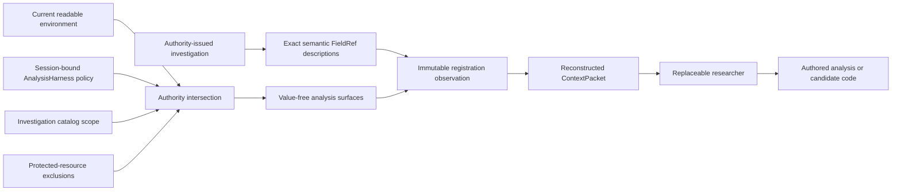
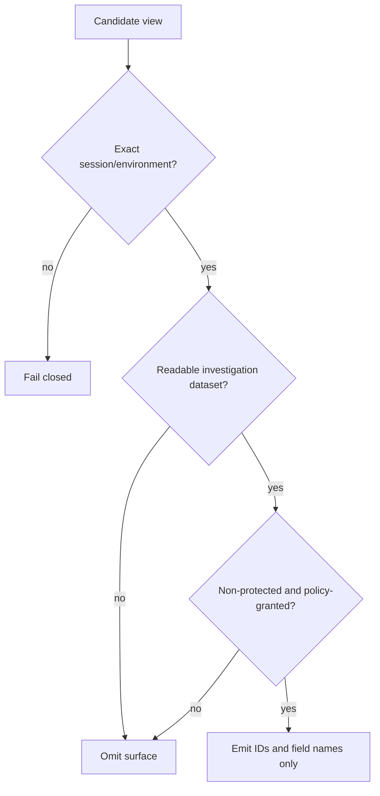

# context.expose-authored-investigation-surface — authorized investigation → value-free research surface

Status: **implemented locally; application acceptance green; independent catalog proof pending**.

## Purpose

Give a provider enough exact, reconstructible information to invent analysis and candidate code
without preloading a manifest or giving it a data, filesystem, protected-resource, or authority
handle.

## Source A

- one exact authority-issued `RegisteredInvestigation`;
- the current task/session/episode/environment snapshot;
- the investigation's exact registered schemas;
- the session-bound `AnalysisHarness` views and `CapabilityPolicy`;
- current readable and protected dataset identities.

## Destination B

One immutable registration observation containing:

- exact investigation, question, catalog, environment, budget, and stopping-rule identities;
- one value-free definition for every registered field, including the exact `FieldRef` tuple,
  semantic name, type, unit, dimensions, and description;
- only analysis surfaces surviving the exact intersection of session, environment, readable
  dataset, investigation catalog, policy field grant, actual view fields, and non-protected status;
- no observations, outcome values, protected values, capability object, path, authority object,
  target recipe, feature recipe, model recipe, or favorable answer.

## Mapping and authority

`AnalysisHarness.authorized_runtime_surfaces` owns the value-free policy projection.
`ActionRouter.register_investigation` owns the exact catalog/schema projection and publishes the
result as working evidence. `ContextBuilder` later reconstructs that immutable observation; it does
not recreate it from a provider transcript.

## Must preserve

- exact schema version and environment identity;
- exact current capability scope and field grant;
- deterministic ordering and immutable packet reconstruction;
- separation between knowing that a field may be requested and reading its values;
- broad method freedom after authorization.

## Must exclude

- method-specific tools or preferred features;
- a preassembled manifest, source program, label, model, or research answer;
- disallowed fields, foreign-session views, datasets outside the investigation, and protected
  resources;
- view values or provider-side hidden state.

## Failures

- advertising `run_analysis` without a session-bound harness fails registration;
- a foreign session/environment harness fails registration;
- protected, unreadable, out-of-catalog, missing-policy, and empty-field surfaces are absent;
- later concrete access is independently reauthorized by `execute_analysis` and the harness.

## Causal evidence

`tests/integration/test_autonomous_investigation_acceptance.py` uses a researcher with no instance
state or preassembled proposal. From reconstructed packet content it:

1. authors a baseline feature/label/fit/predict program;
2. receives a development failure;
3. authors generic relationship-analysis code against the advertised view;
4. receives harness-observed evidence and actual accesses;
5. authors a different interaction manifest with exact `FieldRef` identities and losing-trial
   ancestry;
6. reaches credible development evidence.

Removing the field definitions or analysis surfaces makes that path unable to construct a valid
action. This proves decision sufficiency for the deterministic application fixture, not real-model
research quality.

## Remaining proof

The orchestration catalog proposition `exploration-to-development-evidence` remains red until a
verification-owned paired-world adapter and catalog-owned oracle independently reproduce the path
and its mutations. Hidden scientific-family evaluation remains separate.
