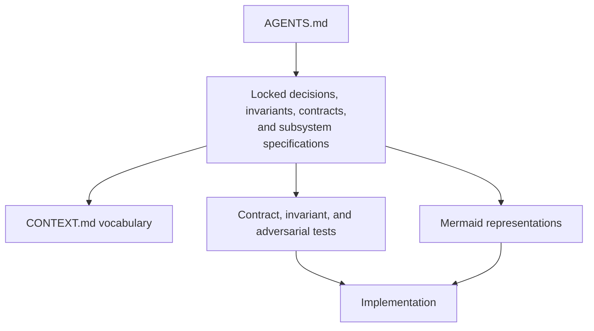
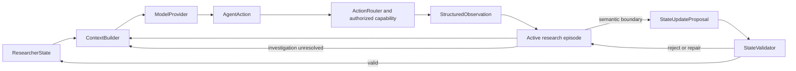
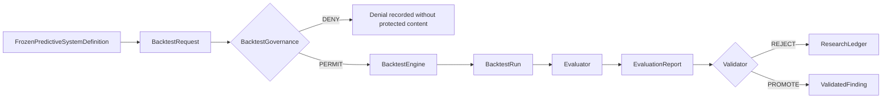
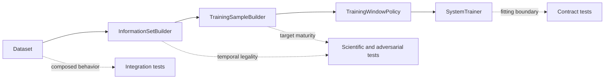

# Alignment, Vocabulary, and Diagram Policy

Status: **repository policy**. This document governs how Codex consumes and represents the
architecture. It does not redefine subsystem semantics.

## 1. Purpose

Before implementation or architecture edits:

1. read the repository authority documents;
2. use the canonical language in `CONTEXT.md`;
3. distinguish locked decisions, deferred choices, local implementation details, and genuine
   contradictions;
4. use diagrams only when they remove meaningful ambiguity;
5. stop at a genuine conflict instead of inventing a local reconciliation.

The existing specifications contain the product decisions. Alignment work must preserve them.

## 2. Vocabulary discipline

`CONTEXT.md` is the canonical glossary. It defines what terms mean and what nearby concepts they
must not be confused with. It is not another full architecture document.

Before introducing a new domain noun:

1. search `CONTEXT.md`;
2. follow its authoritative `See` reference;
3. reuse the canonical term when the meaning matches;
4. add a new term only when the meaning is genuinely distinct;
5. surface conflicting existing terms rather than choosing one silently.

Do not create near-synonyms such as `FeatureSpec`, `FeatureConfig`, and `FeatureDefinition`
for one concept.

Use the `domain-modeling` workflow when project language is being changed. Use
`grill-with-docs` when unresolved design decisions need an explicit alignment session. Merely
reading and following the glossary does not require invoking either workflow.

## 3. Dependency of truth

Each concept has one detailed authoritative home. Other documents link to that home and summarize
only what their own responsibility requires.

The intended dependency direction is:

Architecture and invariants drive tests and implementation. Implementation does not retroactively
redefine architecture.

## 4. Precedence

When representations disagree, use this order:

1. executable tests that correctly encode an explicitly locked invariant or contract;
2. explicit locked decisions, invariants, and approved formal contracts;
3. the authoritative subsystem specification;
4. global architecture prose;
5. `CONTEXT.md` vocabulary definitions;
6. Mermaid diagrams;
7. comments, examples, temporary plans, and implementation notes.

A test is not authoritative merely because it exists. First ask whether it correctly represents the
locked contract. Never weaken architecture merely to make an incorrect test pass.

## 5. Contradiction protocol

If two authoritative sources say incompatible things:

1. stop work on the affected decision;
2. cite the exact files and sections;
3. explain the practical consequence;
4. ask the user which interpretation is intended;
5. update the authoritative source after resolution;
6. update dependent glossary entries, diagrams, contracts, and tests.

Do not create a third interpretation in code.

A missing low-level implementation detail is not automatically an architectural contradiction.
Consult `OPEN_QUESTIONS.md` before treating it as a gap.

## 6. Stable project principles

Preserve the meaning of these principles:

> The agent generates hypotheses. Deterministic research infrastructure decides whether they
> survive.

> Constrain information and side effects, not intellectual or computational creativity.

> Good harness = good actions + good structured observations.

> Broad access, selective working context.

> Compression changes accessibility latency, not information existence.

> Every scientific observation can update research state, but not every observation may be reused as
> fresh validation evidence.

> Freedom decreases and evidentiary burden increases as a candidate moves through the pipeline.

> The actor benefiting from approval cannot also grant approval.

> Scientific identity, provenance, and evidence boundaries are non-negotiable.

> Architecture top-down. Implementation bottom-up.

> Contract -> tests -> implementation -> verification.

> A discovered failure becomes permanent test knowledge.

> Steal abstractions, not implementations.

> Complexity must be earned by a concrete failure mode.

## 7. Mermaid policy

Mermaid is a communication representation. It is subordinate to locked invariants, contracts,
authoritative prose, and correct executable tests.

Create a diagram only when it answers a concrete question such as:

- What calls what?
- Who owns a state mutation?
- Where does a feedback loop return?
- Where does authority change?
- Where can protected evidence become exposed?
- At what seam is correctness observable?

Prefer:

- `flowchart` for architecture, data flow, ownership, and test seams;
- `sequenceDiagram` for call order, authorization, side effects, and returned observations;
- `stateDiagram-v2` for legal lifecycle transitions.

Follow the rendering rules in `docs/styleguide/module-readmes.md`.

## 8. Semantic diagram rules

### Use canonical terms

Labels must use `CONTEXT.md` terminology. Avoid vague labels such as Manager, Processor, Helper,
AI Layer, or Data Stuff unless the glossary defines them.

### Show loops as loops

Do not draw the autonomous runtime as a one-way pipeline:

This representation must make it impossible to infer that a `StructuredObservation` directly
mutates `ResearcherState`.

### Expose privileged gates

Do not collapse a request, authorization gate, execution, evaluation, and promotion into one arrow:

### Distinguish stores from working context

A store arrow means data is persisted or retrievable. It does not mean the store's full contents are
inserted into model context.

### Label meaningful transitions

Use edge labels when the arrow carries semantic meaning such as unresolved, committed, permitted,
denied, exposed, rejected, or promoted.

### Keep diagrams close to their authority

Embed a diagram in the subsystem document whose prose defines it. Avoid parallel diagram documents
that restate the same architecture.

### Avoid speculative internals

Before implementation, draw stable responsibilities such as `ContextBuilder -> ModelProvider`.
Do not add caches, factories, databases, or provider adapters until a concrete failure mode or locked
decision earns them.

## 9. Test seams in design

For an important subsystem, identify:

1. purpose;
2. highest stable public or observable seam;
3. contract including inputs, outputs, authority, provenance, state effects, and failure behavior;
4. plausible ways it could appear to work while being wrong;
5. tests justified by those failure modes;
6. evidence required for completion.

A diagram may mark a few critical seams:

Do not maximize test count or line coverage. Ask whether each test attacks a real failure mode.

## 10. ADR threshold

Create an ADR only when a decision is:

1. hard to reverse;
2. surprising without context;
3. the result of a real tradeoff.

Do not create ADRs for deferred package layout, helper classes, enum spelling, exact context
percentages, provider authentication mechanics, report styling, or other cheap-to-refactor details.

Recover rationale from authoritative specifications. Do not invent it.

## 11. Canonical episode terminology

`ResearchEpisode` is the only public and domain type for an investigation. **Active research episode** means a `ResearchEpisode` whose lifecycle status is `ACTIVE`; it is descriptive prose, not a second type.

A tool result may update the current `ResearchEpisode` without becoming durable `ResearcherState`. The complete action and observation history remains `Trajectory`.

An implementation may introduce a private buffering or persistence helper if a concrete need emerges. It must not expose that helper as another scientific concept.
