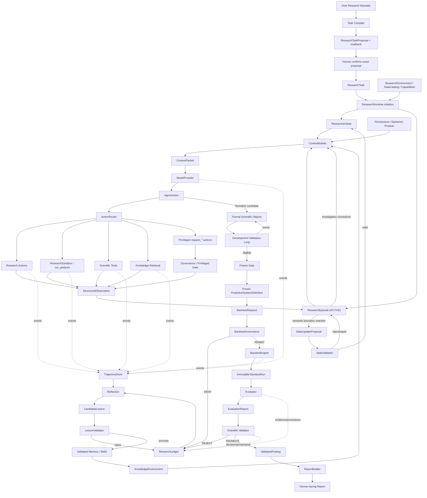

# End-to-End Architecture

> Navigation note: the subsystem-oriented review map, first-principles statements, loop diagrams,
> and semantic transition names live in [`../architecture/README.md`](../architecture/README.md).
> This specification remains authoritative during the block-by-block migration.

## 1. Mission

The system is an autonomous scientific researcher for time-series predictive discovery.

At a high level:

\[
\text{Research mandate}
\rightarrow
\text{autonomous research}
\rightarrow
\text{scientifically governed evidence}
\rightarrow
\text{validated finding or explicit rejection}
\]

The product must remain useful if the underlying LLM/model provider is replaced.

---

## 2. Integrated topology



This is a conceptual topology, not a requirement that every box become a separate process/class.

---

## 3. Fast autonomous research loop

The core runtime loop is:

\[
\boxed{plan\rightarrow act\rightarrow observe\rightarrow revise\ plan\rightarrow act\ again}
\]

Operationally:

```text
ResearcherState + ResearchEpisode
→ ContextBuilder
→ ModelProvider
→ AgentAction
→ authorized action/tool
→ StructuredObservation
→ ResearchEpisode
→ next ContextPacket
```

This loop continues without human supervision until one of these occurs:

- the current semantic subproblem is resolved;
- the investigation is abandoned/suspended;
- a material re-scope is needed;
- a privileged gate is requested;
- a checkpoint/termination boundary is reached.

At a semantic boundary:

```text
ResearchEpisode
→ AI synthesis
→ StateUpdateProposal
→ StateValidator
→ committed ResearcherState delta
```

The state validator checks integrity, not whether the AI's scientific interpretation is "smart". The AI owns interpretation; the harness owns structural/provenance/authority validity.

---

## 4. Research loops that must remain explicit

### 4.1 Data-understanding loop

```text
inspect
→ question
→ write/run analysis
→ structured observation
→ update working understanding
→ inspect again
```

### 4.2 Hypothesis / feature loop

\[
Hypothesis\rightarrow Experiment\rightarrow Evidence\rightarrow Interpretation\rightarrow Hypothesis'
\]

Most ideas should die.

Feature funnel:

```text
Idea → Candidate → Tested → Validated → Promoted
```

### 4.3 Model/system development loop

```text
FeatureSet
→ candidate models / ensembles
→ development validation
→ diagnostics
→ AI interpretation
→ modify feature/model/ensemble candidate
→ repeat
```

All modifications remain development activity until the system is frozen.

### 4.4 Protected evidence boundary

Protected evidence intentionally breaks the ordinary development loop.

Once final/protected evidence has been seen, that evidence is an exposure. It may inspire a new research cycle, but the period cannot be represented as fresh/unseen validation evidence for the next candidate.

### 4.5 Slow cross-task learning loop

```text
Trajectory + ResearchLedger
→ Reflection
→ CandidateLesson
→ LessonValidator
→ validated Memory/Skill
→ future ResearchTasks
```

A lesson cannot promote itself merely because the agent that generated it believes it is useful.

---

## 5. Scientific path

The scientific kernel separates exploration from formal, reproducible scientific identity.

```text
Exploratory idea / code
→ Candidate feature/model
→ formal FeatureDefinition / ModelDefinition
→ FeatureSet / EnsembleDefinition
→ Candidate PredictiveSystemDefinition
→ development validation
→ research-validation gate
→ FrozenPredictiveSystemDefinition
→ protected backtest governance
→ BacktestRun
→ EvaluationReport
→ Scientific Validator
→ ValidatedFinding or rejection
```

The protected backtest is evidence generation, not an iterative feature-selection tool.

---

## 6. Backtest data flow

At simulated decision time `t`:

\[
D
\rightarrow
\mathcal I_t
\rightarrow
S_t
\rightarrow
W_t
\rightarrow
F_t
\rightarrow
\hat y_{t+h}
\rightarrow
record
\]

Where:

- `D`: dataset(s);
- `I_t`: information legally knowable at time `t`;
- `S_t`: completed supervised training examples legally available at `t`;
- `W_t`: selected training window;
- `F_t`: fitted instance of the frozen predictive-system recipe;
- prediction/outcome records: immutable observations of the simulated run.

Default behavior is to refit at every decision time.

Advancing historical time has two distinct information effects:

- predictor releases/revisions change `I_t`;
- newly matured labels/outcomes change `S_t`.

The scenario supplies explicit decision times. This does not require a heavyweight `SimulationClock` object; a simple ordered decision-time sequence is sufficient until richer semantics are justified.

---

## 7. Authority topology

### AI-heavy / free

- understand task;
- inspect allowed data;
- form hypotheses;
- write exploratory code;
- run diagnostics;
- propose features/models/ensembles;
- interpret development evidence;
- revise research direction;
- draft presentation of validated findings.

### Harness-controlled

- data authorization;
- temporal admissibility;
- provenance;
- formal object compilation/versioning;
- sandbox side effects;
- standardized deterministic checks;
- state integrity;
- context permissions;
- protected evidence exposure tracking.

### Privileged gates

The agent may request, but cannot self-authorize:

- protected backtest;
- final scientific promotion;
- memory/skill promotion.

### Forbidden direct authority

- direct protected holdout reads;
- rewriting immutable ledger history;
- mutating completed `BacktestRun`;
- silently mutating a frozen system;
- directly promoting its own lesson/finding;
- disguising a changed scientific experiment as the same frozen object.

---

## 8. State / trajectory topology

Three distinct layers:

```text
TrajectoryStore     = complete action/observation history
ResearchEpisode     = current investigation and working evidence
ResearcherState     = committed resumable research understanding
```

Do not merge them.

If the entire LLM context disappears, the system should be able to reconstruct a scientifically equivalent working context from durable state, active research episode/checkpoint, permissions, and referenced evidence.

---

## 9. Context topology

The LLM context is rebuilt, not treated as precious history.

```text
CoreInstructions
+ ResearcherState
+ ResearchEpisode or EpisodeCheckpoint
+ RelevantEvidence
+ current environment/permissions/warnings
→ ContextPacket
```

Large artifacts and long time series remain externally accessible. Return summaries and references first, with drill-down on request.

Compaction changes accessibility latency, not information existence.

---

## 10. Events vs observations

Maintain the distinction:

```text
Observation = information returned to the intelligence loop
RuntimeEvent = information for audit/UI/logging/replay/trajectory
```

For example:

```text
ToolStarted
ToolCompleted
ToolFailed
EpisodeStarted
EpisodeCommitted
FeaturePromoted
BacktestRequested
BacktestDenied
BacktestCompleted
FindingPromoted
```

Events do not automatically enter model context.

---

## 11. Canonical domain objects

These names describe stable conceptual identities. Implementation may use different internal shapes if semantics remain clear.

### Entry/runtime

- `UserMandate`
- `ResearchTask`
- `ResearchEnvironment` / `ResearchEnvironmentSnapshot`
- `ResearchSession`
- `ResearcherState`
- `ResearchEpisode`
- `StateUpdateProposal`
- `ContextPacket`
- `ModelRequest` / `ModelResponse`
- `AgentAction`
- `ToolRequest`
- `StructuredObservation`
- `ArtifactRef`

### Scientific objects

- `Dataset` / `DatasetSchema` / `FieldRef`
- `TargetDefinition`
- `FeatureDefinition`
- `FeatureExpression`
- `FeatureSeries`
- `FeatureSet`
- `ModelDefinition`
- `FittedModel`
- `EnsembleDefinition`
- `TrainingProtocol`
- `EvaluationSpec`
- `PredictiveSystemDefinition`
- `FrozenPredictiveSystemDefinition`

### Evidence/governance

- `BacktestRequest`
- `BacktestPermit` / denial
- `FitRecord`
- `PredictionRecord`
- `OutcomeRecord`
- `BacktestRun`
- `EvaluationReport`
- `ValidationDecision`
- `ValidatedFinding`
- `ResearchLedger` entry

### Slow learning

- `CandidateLesson`
- validated `Memory`
- validated `Skill`

Do not generate a large class hierarchy merely because the conceptual list is long. Some concepts may be schemas/records rather than behavioral objects.

---

## 12. Design boundary: generic kernel vs downstream action

Prediction is the kernel:

\[
\mathcal I_t \rightarrow \hat y_{t+h}\quad\text{or}\quad\hat p_t
\]

Trading allocation, execution, insurance business actions, etc. are downstream:

```text
prediction
→ DecisionPolicy
→ allocation/trade/business action
```

Do not contaminate generic research/evaluation machinery with domain-exclusive action logic without a real need.

---

## 13. Architecture completion criterion

Do not attempt to pre-specify every internal arrow.

The architecture is sufficiently specified for implementation when:

- topology and loops are coherent;
- canonical scientific identities are clear;
- authority boundaries are explicit;
- high-risk invariants are executable as tests/evals;
- critical integration contracts are specified;
- the first vertical slice has an execution plan.

From there, implementation should reveal low-level interfaces and any remaining real architectural conflicts.
