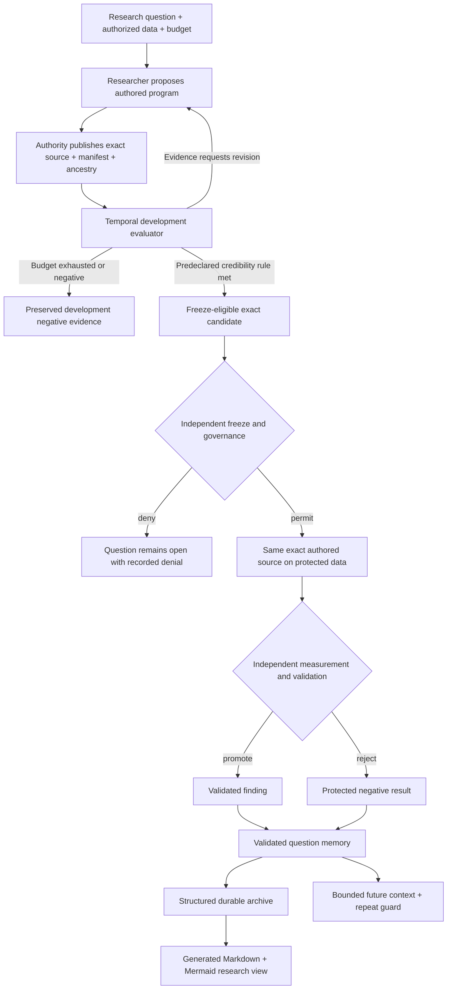

# Autonomous Investigation Contract

## Status

`LOCKED_FOR_IMPLEMENTATION`

## Product promise

Given one exact research question, an authorized development-data catalog, and a
predeclared search budget, a researcher may author arbitrary scientific Python for
features, labels, fitting, and prediction.  The harness constrains information,
resources, provenance, and scientific state transitions; it does not choose the
scientific method.

## Model-facing scientific protocol

The authored source defines four fixed entrypoints.  Their implementations are not
restricted to a predefined feature vocabulary.

- `make_features()` reads only through exact-sample `history(field_id)` and optional
  manifest-declared `context_history(field_id)` grants, then returns a finite JSON object of named
  feature values. Each contextual grant fixes the field and the sample dimension names that must
  match; the harness performs the match and decision-time cutoff.
- `make_label()` reads only through those same decision-time histories and `outcome_path()`, then
  returns one finite JSON label or `None` under the declared insufficiency policy.
- `fit()` reads only through `training_rows()` and returns finite JSON model state.
- `predict()` reads only through `model_state()` and `feature_values()` and returns one
  finite prediction.

The current deterministic `FeatureExpression` language remains a reusable optimized
substrate.  It is not the definition of what the researcher is allowed to invent.

## Harness-owned controls

- exact catalog, environment, field, population, source, candidate, and parent-trial
  identity;
- exact contextual field and match-dimension identity, with no authored row selection before the
  harness applies the declared scope;
- information-set construction at every decision time using `available_at`, not
  `reference_time`;
- outcome maturity and temporal fold construction outside authored code;
- no validation label in a fit or predict invocation;
- bounded source, wall time, memory, output, result, trials, and turns;
- actual harness access and execution provenance; self-reported provenance is ignored;
- append-only attempted, failed, rejected, revised, and successful trials;
- no protected view before independent freeze and governance.

## Research freedom

Within those controls, source code may invent transformations, interactions, path
labels, estimators, diagnostics, and combinations.  A missing convenience tool is not
a reason to add a domain-specific action to the runtime.

## Search and stopping semantics

The primary metric, minimum out-of-fold evidence, credibility threshold, maximum
trials, and failure policy are fixed before the first trial.  Development evidence is
selection-exposed.  Exhausting the budget without meeting the declared rule produces
a development negative result; it never selects the best-looking trial and calls it validated. A
development negative remains selection-exposed evidence. Only an independently issued protected
finding or protected rejection may become terminal validated question memory.

## Resolved-question memory and reopening

Terminal question memory is structured scientific state, not Markdown. Generated Markdown and
Mermaid pages are subordinate views over exact records and cannot grant promotion, rejection, or
reopen authority.

An exact normalized question, environment, and catalog fingerprint that already has a terminal
protected result cannot be registered again. A branch over a newly registered catalog or a
materially changed hypothesis must carry an explicit `QuestionReopenDeclaration` referencing the
issued prior memory, a typed reason, and a rationale. The old record remains terminal and visible.
Prior exact-lineage summaries and evidence references enter future reconstructed context; fuzzy
similarity does not have authority to suppress research.

## First vertical acceptance boundary

The initial slice ended at an exact `credible`, `revise`, or `reject` development disposition. The
implemented application boundary now continues an exact credible candidate through independent
freeze, protected evaluation, independent validation, terminal question memory, durable local
archive, and future-context reconstruction while preserving every trial and rejection.

## False successes

- accepting a preassembled workflow ID as autonomous scientific authorship;
- treating a scripted provider fixture as proof of researcher quality;
- allowing validation outcomes into `fit()` or `predict()`;
- proving only constructors or component registration;
- adding one action per feature, geography, model, or diagnostic;
- treating an exploratory score as a finding;
- discarding failed trials or silently extending the search budget.
- treating a selection-exposed development rejection as independently validated terminal memory;
- letting a renamed or new-catalog question silently bypass prior terminal memory;
- treating generated Markdown as scientific or memory-promotion authority.
