# Data Flow and Object Lifecycles

Status: **design elaboration**. This document explains how information changes shape and authority as it moves through the system. It is subordinate to `INVARIANTS.md` and explicit LOCKED decisions in `DECISIONS.md`.

It is not a class diagram. Names below identify responsibilities and durable scientific meanings. One implementation object may perform several low-risk responsibilities where doing so preserves the boundaries described here.

## 1. Why this document exists

The architecture already identifies the major components. The missing level of detail is the lifecycle of information between them:

```text
Who created this datum?
What did it mean at that moment?
Who may transform it?
What authority did that transformation require?
Where is the result stored?
Can it be revised, superseded, or never changed again?
```

The system has two coupled flows:

1. **Research-control flow** — the model plans, acts, observes, and updates its working position.
2. **Scientific-evidence flow** — data becomes legal information, training samples, fitted systems, predictions, evaluations, and governed findings.

The control flow may be creative and iterative. The evidence flow becomes progressively more constrained.

## 2. Whole-system flow

```mermaid
flowchart LR
    UM["UserMandate"] --> TC["Task compilation"]
    TC --> TP["ResearchTaskProposal + readback"]
    TP --> HC["Human confirms exact proposal"]
    HC --> RT["ResearchTask"]
    RE["ResearchEnvironment snapshot"] --> INIT["Runtime initialization"]
    RT --> INIT
    INIT --> LOOP["Autonomous research loop"]
    LOOP --> EXP["Exploratory evidence"]
    EXP --> LOOP
    LOOP --> COMMIT["Semantic state commit"]
    COMMIT --> LOOP
    LOOP --> FORM["Formal candidate definition"]
    FORM --> DEV["Development validation"]
    DEV -->|revise| FORM
    DEV -->|eligible| FREEZE["Frozen scientific identity"]
    FREEZE --> REQ["BacktestRequest"]
    REQ --> GOV["BacktestGovernance"]
    GOV -->|deny| LEDGER["ResearchLedger"]
    GOV -->|permit| BT["Historical simulation"]
    BT --> RUN["Immutable BacktestRun"]
    RUN --> EVR["Evaluator"]
    EVR --> EVAL["EvaluationReport"]
    EVAL --> VAL["Validator"]
    VAL -->|reject| LEDGER
    VAL -->|promote| FIND["ValidatedFinding"]
    FIND --> REPORT["Human-facing report"]
    LOOP -. actions and observations .-> TRAJ["TrajectoryStore"]
    EXP -. large outputs .-> ART["ArtifactStore"]
    FORM -. definitions and lineage .-> LEDGER
    RUN -. evidence and exposure .-> LEDGER
    EVR -. metrics and provenance .-> LEDGER
    VAL -. decision .-> LEDGER
```



No shortcut connects exploratory output directly to protected evidence, promotion, or durable belief.

## 3. The two time axes

The application must never conflate these clocks.

### 3.1 Runtime progression

Runtime progression orders autonomous work:

```text
model call 12 → action 12 → observation 12 → model call 13
```

It is used for trajectory, retries, episode progress, and state commits.

### 3.2 Simulated scientific time

Simulated time `t` answers what could legally have been known when a historical prediction was made.

```text
reference_time = period the value describes
available_at   = first time the value may legally be used
decision_time  = simulated prediction time
```

Admissibility requires `available_at <= decision_time`. A later runtime step does not make future historical information legal inside an earlier simulated decision time.

## 4. Research-control flow

### 4.1 Task compilation

```text
UserMandate + environment metadata → TaskCompiler → ResearchTaskProposal → human confirmation → ResearchTask
```

The compiler may structure human intent but may not silently complete missing scientific meaning.

| Item | Created by | May contain | Must not contain | Durable effect |
|---|---|---|---|---|
| `UserMandate` | human/interface | original request and explicit constraints | invented target/horizon | retained as provenance |
| `ResearchTask` | task compiler | structured objective, resolved/unresolved semantics, scope refs, lineage | findings, protected values | versioned scientific problem identity |

Subordinate questions, targets, horizons, objectives, hypotheses, and methods may evolve inside the same task while the confirmed main goal and hard constraints remain intact. A semantic change to that task-level core creates a new version with lineage.

### 4.2 Runtime initialization

```text
ResearchTask + ResearchEnvironmentSnapshot
→ ResearchSession + ResearcherState_0 + ResearchEpisode_0
```

Initialization is deterministic orientation. It performs no research and makes no model call. The initial state records the mission, environment reference, unresolved semantics, and epistemic zero state. The initial episode asks the researcher to orient and plan.

### 4.3 One autonomous turn

```text
ResearcherState_n
+ ResearchEpisode_n
+ relevant permitted evidence
+ environment/capability snapshot
→ ContextBuilder
→ ContextPacket_n
→ ModelProvider
→ normalized ModelResponse
→ AgentAction
→ ActionRouter
→ authorized capability
→ StructuredObservation
→ ResearchEpisode_(n+1)
```

| Destination | What a normal turn writes |
|---|---|
| `TrajectoryStore` | model/action/tool/runtime events and audit/replay refs |
| `ArtifactStore` | large tables, plots, code, tracebacks, exploratory objects |
| `ResearchEpisodeStore` | observation, temporary interpretation, progress, warnings, active refs |
| `ResearcherStateStore` | nothing merely because a tool returned |
| `ResearchLedger` | consequential scientific identity/evidence events, not every print statement |

The next context is rebuilt from state and references. It is not produced by blindly appending the full transcript.

### 4.4 Structured observation envelope

Every result presented to the model should answer what happened, what the payload describes, under what authority it was produced, what warnings matter, whether failure is recoverable, and where raw detail lives.

Conceptual envelope:

```text
observation_id
action_id / idempotency key
status
observation_type
decision-relevant payload
temporal and sample context
warnings / ATTENTION flags
artifact_refs / drill-down options
provenance
recoverability
```

Raw stdout, full tables, and tracebacks remain external artifacts.

### 4.5 Semantic commit

At a resolved, abandoned, suspended, materially rescoped, or required checkpoint boundary:

```text
ResearchEpisode
→ model-authored synthesis
→ StateUpdateProposal
→ StateValidator
→ ResearcherStateDelta
→ ResearcherState_(n+1)
```

The validator checks that evidence refs exist and were permitted, mission identity has not drifted, gate/exposure status is not forged, supersession rules hold, and an idempotency key cannot commit twice. It does not judge whether the interpretation is intellectually brilliant.

## 5. Scientific data transformation flow

```text
source bytes
→ registered observations
→ legal InformationSet I_t
→ completed TrainingSample S_t
→ selected TrainingWindow W_t
→ fitted predictive system F_t
→ PredictionRecord
→ OutcomeRecord
→ BacktestRun
→ EvaluationReport
→ ValidationDecision
→ ValidatedFinding
```

### 5.1 Source bytes to registered observations

The repository preserves untouched source responses in `data/*/raw/` and cleaned long-format CSVs near each dataset root. A CSV row is not fully registered merely because it has a date and value. Registration binds it to:

```text
dataset_id + version
field_id + semantic definition
value
reference_time
available_at, or a versioned rule that derives it
entity/geography/dimensions
source/provenance
revision/vintage identity where applicable
quality/caveat metadata
```

This is where existing files become kernel-readable scientific data. Raw evidence remains unchanged.

### 5.2 Registered observations to `InformationSet I_t`

```text
registered observations
+ environment snapshot
+ capability policy
+ decision time t
→ InformationSet I_t
```

The legal view filters by availability, version, permission, protected status, and vintage rules.

### 5.3 `InformationSet I_t` to `TrainingSample S_t`

```text
I_t + TargetDefinition + formal feature definitions
→ completed supervised examples S_t
```

An example enters `S_t` only when its predictors were legal at prediction time, its outcome is complete and legally available, alignment follows declared semantics, and required values satisfy the missingness policy. Predictor availability and target maturity are independent.

### 5.4 `TrainingSample S_t` to `TrainingWindow W_t`

The frozen `TrainingWindowPolicy` selects an expanding, rolling, or otherwise declared subset. Selection performs no hidden fitting.

### 5.5 `TrainingWindow W_t` to fitted system `F_t`

```text
FrozenPredictiveSystemDefinition + W_t
→ FitRecord + immutable fitted system F_t
```

All learned quantities are fitted here or inside nested legal procedures: imputation, scaling, PCA, selection, hyperparameters, model parameters, and ensemble weights. Failure to execute the frozen recipe produces a typed formal failure, not a substituted recipe.

### 5.6 Prediction and outcome

```text
F_t + legal current features from I_t → immutable PredictionRecord
```

`predict()` cannot learn. A realized label becomes a separate immutable `OutcomeRecord` only when legally available.

### 5.7 Evidence and finding

```text
FitRecords + PredictionRecords + OutcomeRecords + failures
→ immutable BacktestRun
→ Evaluator(EvaluationSpec)
→ EvaluationReport
→ Validator(predeclared standard)
→ ValidationDecision
→ ValidatedFinding or rejection
```

The evaluator measures; it does not train. The validator promotes or rejects; it does not rewrite the run. The report builder presents; it does not alter scientific substance.

## 6. Object lifecycle and mutability

| Object | Lifecycle | Mutation rule |
|---|---|---|
| `ResearchTask` | unresolved/partial/resolved, then versioned | material scope change creates a new version |
| `ResearchSession` | initialized, active, stopped/completed/failed | cannot appear healthy without coherent state and episode |
| `ResearchEpisode` | `ACTIVE` -> `RESOLVED` / `ABANDONED` / `SUSPENDED` | terminal episode is preserved |
| `ResearcherState` | versioned committed deltas | no in-place history rewrite; interpretations may be superseded |
| `Trajectory` | append-only runtime history | never used as automatic durable belief |
| exploratory artifact | temporary or retained by ref | consequential output receives a new immutable identity |
| formal candidate | draft → tested → research-validated | new version when scientific meaning changes |
| frozen predictive system | frozen | changed meaning requires a new candidate/version |
| protected exposure | unexposed → exposed | irreversible |
| `BacktestRun` | requested → permitted/denied → running → completed/failed | recorded transitions and results are not rewritten |
| `EvaluationReport` | created from run/spec | alternative evaluation creates a new identity |
| `ValidationDecision` | promote/reject | immutable |
| `ValidatedFinding` | promoted scientific substance | correction or supersession is explicit |
| human report | renderable presentation | may be regenerated without altering substance |

## 7. Store ownership

Logical separation remains even if one process and local files are used initially.

| Store | Canonical owner of | Written by |
|---|---|---|
| DataCatalog/DataStore | schemas, fields, versions, observations, vintages | ingestion/registration path |
| ResearcherStateStore | committed resumable position | validated state-commit path only |
| ResearchEpisodeStore | unresolved work/checkpoints | runtime loop |
| TrajectoryStore | full runtime actions/observations/events | runtime instrumentation |
| ArtifactStore | large outputs and drill-down material | sandbox/tools/trainers/reporting |
| ResearchLedger | trials, formal identity, evidence, governance, exposures, decisions | formal pipeline and privileged gates |
| KnowledgeEnvironment | papers/docs/validated memory and skills | curated ingestion/promotion paths |

No store grants authority merely by being readable. Access is evaluated through current capability and epistemic state.

## 8. Authority attached to transitions

| Transition | Model role | Harness role | Privileged? |
|---|---|---|---:|
| inspect permitted schema/data | propose | execute authorized read | no |
| run exploratory code | author/request | constrain and execute | no |
| update active research episode | interpret | persist working state | no |
| commit durable state delta | propose | validate and commit | semantic validation |
| formalize/version feature/system | propose | validate identity/provenance | formal validation |
| freeze candidate | request | gate decides | yes |
| protected backtest | request | permit/deny and execute | yes |
| promote finding | recommend | validator decides | yes |
| render validated finding | author | verify canonical substance | no new scientific authority |
| promote memory/skill | request | lesson validator decides | yes |

Retries carry stable idempotency identities across irreversible transitions.

## 9. Failure flow

### Exploratory operational failure

```text
error → concise StructuredObservation → raw debug artifact → episode continues
```

### Formal scientific failure

```text
formal operation fails
→ typed blocking failure
→ expected downstream object is absent
→ retry only if meaning is unchanged, otherwise new candidate/version
```

### Governance failure

```text
unauthorized request
→ hard denial
→ audit/ledger event where appropriate
→ explanation without protected-value leakage
```

## 10. Context and data flow differ

```text
durable state + active research episode + evidence refs + permissions
→ selected ContextPacket
```

The model receives enough to choose the next action and can pull more through retrieval. Omitting a large table from context does not delete the artifact. The reasoning surface stays narrow while accessible knowledge stays broad.

## 11. Actual Polymarket data implications

The current live adapter registers contract metadata and taker-side fills from the production
database. This creates concrete requirements:

1. **Dataset registration is required.** Database rows, table names, and contract aliases cannot be
   permanent scientific identities.
2. **Availability policies are required.** `fill_time` is usable as `available_at` only under the
   explicit on-chain block-inclusion observability rule. It does not prove collector receipt or
   confirmation time.
3. **Outcome mapping is explicit.** Outcome indices, complement/YES-equivalent mappings,
   aggregation, and activity clocks are authored feature/target semantics, never silent
   conveniences.
4. **Cursor vintage limitations remain visible.** Cursor bounds and digests detect changed reads
   but cannot reconstruct immutable prior database bytes.
5. **Contract and event identity differ.** The live fill path registers contract identity only. The
   retained resolution corpus also preserves question text and server `event_id`; grouped research
   must bind to that exact corpus rather than infer groups elsewhere.
6. **Protected status is metadata backed by governed content identity.** File location alone does
   not decide development versus protected evidence, but identical or already accessible bytes
   cannot be relabeled fresh through another path/resource ID. Protected registration carries an
   authority-verified content manifest, epistemic-period identity, and unseen/`PREEXPOSED` status.
7. **Resolution targets require the retained corpus.** Append-only payout facts use recorded
   `resolved_time` as label availability and retained canonical bytes as source identity. Fill-only
   payout metadata remains descriptive; later transaction-state targets remain exposed to
   microstructure mechanics.
8. **Secrets are not scientific data.** Credentials/API secrets must be removed from the data surface and supplied through a separate capability/secret mechanism before sandbox integration.

## 12. First vertical slices

The control-flow slice:

```text
resolved ResearchTask
→ deterministic initialization
→ ContextPacket
→ scripted inspect action
→ StructuredObservation
→ active research episode update
→ scripted semantic resolution
→ StateUpdateProposal
→ one validated state commit
```

Use a tiny synthetic environment plus metadata from one retained dataset, without fitting or protected evidence.

The temporal slice:

```text
registered synthetic observations with delayed availability
→ I_t
→ TargetDefinition with delayed label maturity
→ S_t
→ W_t
```

Only then add a fitted predictive system.

## 13. Decisions required before a real protected Polymarket run

1. What exact contract population, event grouping, decision, and target are being studied?
2. What is the prediction horizon and decision-time/activity cadence?
3. When does each target label become legally complete and publicly available?
4. What immutable source-byte or database-snapshot identity reconstructs every historical view?
5. Which period/resource is development evidence and which is independently protected?
6. Are historical fills sufficient, or does the claim require registered quote/order-book state?
7. What missingness, sparse-print, boundary-price, and outcome-mapping policies are declared?
8. What evaluation views, baselines, failure rules, and promotion thresholds are predeclared?

Until these are answered and registered, exploratory live analysis is valid but a scientifically
valid real protected Polymarket backtest cannot be claimed.

## 14. Completion trace

For any implementation design, trace a claim backward:

```text
report sentence
→ ValidatedFinding
→ ValidationDecision
→ EvaluationReport
→ BacktestRun
→ Prediction/Outcome/FitRecords
→ frozen system definition
→ legal I_t and S_t
→ registered observations
→ raw source and availability provenance
```

Then trace the researcher decision:

```text
formal candidate
→ state commit
→ resolved episode
→ structured observations/artifacts
→ authorized actions
→ context and prior committed state
```

If either trace breaks, that boundary is not implementation-ready.
