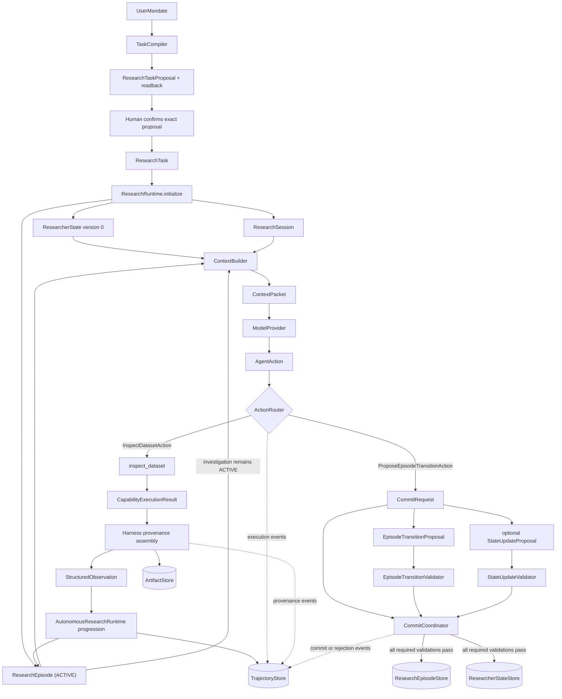

# Milestone 1 Runtime Design

Status: **implementation-ready design, not implementation**.

This document is authoritative for the first executable slice only. It refines the global architecture
without changing its scientific, authority, state, or evidence invariants.

## 1. Objective

Milestone 1 proves that the autonomous research runtime has a working heartbeat:

```text
ResearcherState + ResearchEpisode
-> reconstructed ContextPacket
-> ModelProvider
-> typed AgentAction
-> authorized capability or semantic-transition request
-> StructuredObservation or CommitResult
-> ResearchEpisode progression
-> next reconstructed ContextPacket
```

It includes one real read-only capability, `inspect_dataset`, against a small deterministic dataset.
It does not implement the temporal scientific kernel.

## 2. Design strategy

The complete system architecture remains visible and authoritative. Only one vertical slice at a time
is elaborated to implementation-ready detail.

Milestone 1 uses:

- Python 3.12 or newer;
- `uv` for environment and dependency management;
- `pytest` for deterministic, integration, and behavioral-eval execution;
- a deterministic `ScriptedModelProvider` for required tests;
- narrow logical store interfaces with in-memory implementations;
- no commitment to the final package hierarchy or production persistence technology.

Strict typing is required at the public seams. The exact checker and enforcement configuration may
be added after those types exist.

## 3. Scope boundary

Milestone 1 proves:

- deterministic mandate compilation without invented scientific meaning;
- coherent runtime initialization;
- autonomous multi-turn progression;
- typed action dispatch;
- authorized read-only capability execution;
- harness-owned provenance assembly;
- structured observations;
- `ResearchEpisode` progression without automatic `ResearcherState` mutation;
- independently validated episode transitions and state updates;
- atomic and idempotent semantic commits;
- trajectory recording;
- context reconstruction after provider-context loss.

Milestone 1 does not prove:

- temporal admissibility;
- legal `InformationSet I_t` construction;
- target maturity or `TrainingSample S_t`;
- feature fitting legality;
- model training;
- predictive-system freeze;
- protected backtesting;
- evaluation or validation;
- production persistence;
- real provider authentication.

The toy dataset carries `reference_time` and `available_at` only to prepare continuity with
Milestone 2. Their presence does not imply enforcement.

## 4. Canonical flow and authority



The diagram is subordinate to locked invariants, approved contracts, and correct executable tests.

### Authority model

```text
ModelProvider                requests actions
ActionRouter                 validates and dispatches
Capability                   computes and returns values
Harness provenance machinery establishes authoritative execution provenance
AutonomousResearchRuntime    owns progression authority
Validators                   authorize semantic transitions
Stores                       own persistence mechanics
```

Providers, tools, and capabilities receive no independent writable research-state store handles.
The runtime and governed commit path may use narrow store interfaces.

## 5. Public test seams

Tests should target the highest stable observable seam that isolates a real responsibility. Internal
helpers are not public seams merely because they are easy to call.

### 5.1 Task formalization and confirmation seam

Conceptually:

```text
compile(UserMandate, ResearchEnvironmentSummary)
→ TaskCompilationResult containing ResearchTaskProposal + readback

confirm(exact proposal identity/version/semantics, human decision)
→ ResearchTask or explicit rejection/conflict
```

Observable contract:

- original mandate and every explicit semantic remain recoverable;
- broad discovery, relationship type, seed-versus-constraint meaning, unresolved semantics, and
  bounded completion expectations appear in the readback;
- blocking mission ambiguity requests clarification, while researchable uncertainty may remain;
- no `ResearchTask` or research side effect exists before human confirmation;
- confirmation binds the exact proposal reviewed; edits require new readback and confirmation;
- exact confirmation retry converges on one task and changed semantics conflict;
- compilation performs no model call, research, mutation, or protected access.

The canonical contract is
`docs/architecture/mission/transitions/confirm-task.md`.

### 5.2 Runtime initialization seam

Canonical global contract: `docs/architecture/runtime/transitions/initialize-research.md`.

```text
initialize(ResearchTask, ResearchEnvironmentSnapshot) -> RuntimeInitialization
```

Observable contract:

- one `ResearchSession` is created;
- `ResearcherState` starts at version 0 with no invented findings or exposure;
- one `ResearchEpisode` starts in `ACTIVE`;
- initialization makes no model call;
- all three identities refer to the same task and environment snapshot.

### 5.3 Autonomous turn seam

Conceptually:

```text
advance_one_turn(session_id) -> TurnResult
```

This is the primary runtime seam. Internally it loads current state and episode, reconstructs context,
calls the provider, validates and routes one action, assembles provenance, persists authorized
progression, and returns the observable result.

For an inspection turn, correctness is observed through:

- the exact `ContextPacket` sent to the scripted provider;
- the normalized action and authorization decision;
- the bounded `StructuredObservation`;
- the updated `ResearchEpisode`;
- unchanged `ResearcherState`;
- append-only trajectory events;
- any referenced artifact.

### 5.4 Authorized capability-execution seam

```text
execute(InspectDatasetAction, AuthorizedExecutionContext)
-> StructuredObservation
```

This seam includes routing, capability execution, and harness provenance assembly. The lower-level
capability result is tested directly only for focused computation cases.

Observable contract:

- action identity and bounds are validated;
- access occurs only through `AuthorizedDataView`;
- source data is unchanged;
- model-facing content is bounded;
- authoritative provenance reflects actual execution and access metadata rather than capability
  self-report;
- large details are referenced through `ArtifactStore`.

### 5.5 Semantic commit seam

```text
commit(CommitRequest) -> CommitResult
```

`CommitRequest` contains:

```text
EpisodeTransitionProposal
optional StateUpdateProposal
idempotency metadata
```

The proposals are semantically distinct and validated independently.

Observable contract:

- an episode lifecycle transition does not imply a state delta;
- a lifecycle-only transition requires explicit absence of a state proposal;
- when a state proposal is present, any required validation failure commits neither proposal;
- a successful combined commit persists both effects atomically;
- exact successful replay returns the original result without another scientific commit;
- key reuse with different semantic payload returns `IDEMPOTENCY_CONFLICT`.

### 5.6 Context reconstruction seam

Canonical global contract:
`docs/architecture/runtime/transitions/build-context-packet.md`.

```text
build_current_context(session_id) -> ContextPacket
```

Observable contract:

- current task, state, active research episode, environment, permissions, warnings, and relevant
  references are reconstructed from durable stores;
- provider transcript is unnecessary;
- complete trajectory is not inserted as if it were state;
- superseded or terminal working material is represented according to current status.

### 5.7 Whole-episode behavioral seam

```text
run_until_terminal(session_id, configured_limits) -> EpisodeRunResult
```

This exercises the whole organism with a scripted provider. It is an integration test with
deterministic behavior and the future location of model behavioral evals. It must enforce action,
turn, time, and resource limits even though their production values remain deferred.

## 6. Typed action family

Canonical decoding contract: `docs/architecture/runtime/transitions/decode-action-intent.md`.

Milestone 1 exposes only:

```text
AgentAction
|- InspectDatasetAction
|- ProposeEpisodeTransitionAction
```

A common action envelope conceptually carries:

```text
action_id
session_id
episode_id
kind
arguments
idempotency_key where the action is effectful
```

`ProposeEpisodeTransitionAction` requests construction and processing of a `CommitRequest`. It
does not mutate either `ResearchEpisode` or `ResearcherState`.

No generic plugin framework is part of Milestone 1.

## 7. inspect_dataset contract

Conceptual request:

```text
dataset_ref
optional selected semantic field IDs
bounded preview size
```

`CapabilityExecutionResult` contains computation and result facts. Harness-owned machinery combines
it with actual authorization, resource access, execution, environment, timing, and artifact metadata
to construct the authoritative `StructuredObservation`.

The observation envelope contains:

```text
observation_id
action_id
status
observation_type
summary
payload
warnings
provenance
artifact_refs
recoverability
```

The inspection payload contains:

```text
dataset_ref
schema summary
field semantics
row count
temporal coverage
missingness summary
bounded preview
```

The capability must not mutate data, return the whole dataset, fit anything, make scientific claims,
access protected data, reinterpret field meaning, or update `ResearcherState`.

## 8. Toy dataset

Use one deterministic synthetic monthly dataset of approximately 12 to 24 rows with:

```text
reference_time
available_at
predictor_value
target_value
```

It includes at least one publication delay, one missing predictor value, and stable semantic field IDs
through a minimal schema. It has no protected partition.

Milestone 2 reuses this exact fixture for temporal admissibility, `InformationSet I_t`, target
maturity, and `TrainingSample S_t` tests.

## 9. Failure vocabulary

Milestone 1 defines only:

```text
INVALID_REQUEST
AUTHORITY_DENIED
NOT_FOUND
MALFORMED_MODEL_RESPONSE
PROVIDER_UNAVAILABLE
INVALID_EPISODE_TRANSITION
STALE_STATE_VERSION
INVALID_EVIDENCE_REFERENCE
IDEMPOTENCY_CONFLICT
INTERNAL_FAILURE
```

A structured failure contains:

```text
code
safe model-facing message
recoverability
artifact_ref or diagnostic_ref when applicable
```

Raw traceback, stdout, and stderr remain drill-down artifacts. `AUTHORITY_DENIED` is a governance
result and must not be represented as an ordinary retryable technical error.

## 10. Failure-mode to test matrix

| Risk area | Plausible false success | Test at seam | Expected evidence |
|---|---|---|---|
| Task compilation | Missing horizon is silently defaulted | Task compilation contract | `PARTIALLY_RESOLVED`; horizon remains absent |
| Task compilation | Explicit target changes to a nearby field | Task compilation contract | Original target identity preserved |
| Initialization | Setup secretly invokes the model | Initialization contract | Provider that fails on invocation is untouched |
| Initialization | Initial state contains invented findings | Initialization contract | State version 0 has epistemic zero state |
| Initialization | Same task sessions share mutable state | Initialization contract | Independent session, state, and episode identities |
| Context | Full trajectory is treated as current state | Context reconstruction | Packet contains selected current material, not transcript replay |
| Context | Active research episode disappears after provider-context loss | Context reconstruction | Equivalent packet rebuilt from stores |
| Provider | Provider-native response leaks inward | Autonomous turn | Runtime sees normalized `ModelResponse` only |
| Provider | Malformed action is treated as valid | Autonomous turn | `MALFORMED_MODEL_RESPONSE`; no capability execution |
| Routing | Unknown action executes | Authorized execution | `INVALID_REQUEST`; denial event recorded |
| Routing | Action names another session or episode | Authorized execution | Rejected identity mismatch; no side effect |
| Authority | Unauthorized dataset is inspected | Authorized execution | `AUTHORITY_DENIED`; protected values absent |
| Capability | Source data changes during inspection | Authorized execution | Before and after content identity is equal |
| Capability | Entire dataset enters model context | Authorized execution | Preview bounded; larger material referenced |
| Provenance | Capability lies about accessed dataset/version | Authorized execution | Harness metadata overrides or rejects the claim |
| Observation | Capability failure returns raw traceback as primary content | Authorized execution | Safe structured failure plus diagnostic reference |
| Progression | Observation directly changes durable state | Autonomous turn | State version and content unchanged |
| Progression | Observation is absent from the next turn | Two-turn integration | Next packet contains episode working evidence |
| Trajectory | Rejected actions disappear | Autonomous turn | Rejection remains in append-only trajectory |
| Transition | Terminal episode transitions again | Semantic commit | `INVALID_EPISODE_TRANSITION`; stores unchanged |
| State update | Stale starting version commits | Semantic commit | `STALE_STATE_VERSION`; both proposals uncommitted |
| State update | Missing or unauthorized evidence reference commits | Semantic commit | `INVALID_EVIDENCE_REFERENCE`; both proposals uncommitted |
| Separation | Episode transition invents an implicit state delta | Semantic commit | State unchanged when state proposal is explicitly absent |
| Atomicity | Episode resolves while required state update fails | Semantic commit | Episode remains `ACTIVE`; state unchanged |
| Idempotency | Exact successful replay commits again | Semantic commit | Original result returned; no second scientific commit |
| Idempotency | Same key carries different semantic payload | Semantic commit | `IDEMPOTENCY_CONFLICT`; original commit unchanged |
| Recovery | Repairable invalid proposal ends the session | Whole episode | Episode stays `ACTIVE`; rejection observation enters next packet |
| Whole runtime | Tool result becomes immediate belief | Whole episode | Observation updates episode; only validated commit updates state |
| Milestone boundary | Presence of `available_at` is mistaken for temporal enforcement | Acceptance review | No M1 claim or test asserts `InformationSet` legality |

## 11. End-to-end acceptance scenario

### Fixture

A user mandate explicitly names:

- a descriptive inspection objective;
- the toy dataset;
- a target;
- a forecast horizon;
- no protected evidence.

The scripted provider is configured for three turns:

1. request `InspectDatasetAction`;
2. receive and reason over the resulting `StructuredObservation`;
3. request `ProposeEpisodeTransitionAction` with:
   - target status `RESOLVED`;
   - an `EpisodeTransitionProposal`;
   - a `StateUpdateProposal` containing only evidence-backed durable understanding;
   - the observation and artifact references;
   - a fixed idempotency key.

### Expected sequence

```text
UserMandate
-> ResearchTask
-> ResearchSession + ResearcherState version 0 + ResearchEpisode (ACTIVE)
-> ContextPacket 1
-> InspectDatasetAction
-> authorized inspect_dataset execution
-> CapabilityExecutionResult
-> harness provenance assembly
-> StructuredObservation
-> ResearchEpisode working evidence append
-> ContextPacket 2 reconstructed from state and episode
-> model interpretation and transition request
-> CommitRequest
-> independent proposal validation
-> atomic commit
-> ResearchEpisode (RESOLVED)
-> ResearcherState version 1
```

`TrajectoryStore` records every model, action, authorization, execution, observation, rejection if
any, and commit event.

### Required assertions before commit

- `ResearcherState` remains version 0 and contains no inspection conclusion.
- `ResearchEpisode` remains `ACTIVE` and references the observation.
- The observation preview is bounded.
- Provenance identifies the actual authorized dataset and execution.
- The source dataset is unchanged.
- The next context contains relevant episode evidence without requiring provider transcript replay.

### Required assertions after commit

- `ResearchEpisode` is `RESOLVED`.
- `ResearcherState` is version 1.
- The durable delta cites permitted evidence.
- The state contains no claim beyond what the observation supports.
- Episode and state effects share one successful semantic commit result.
- Trajectory and artifact references remain externally drillable.

### Idempotency companion

Re-submit the exact successful request:

- return the original `CommitResult`;
- create no second state version or episode transition;
- create no duplicate scientific commit record.

Re-submit the key with a changed synthesis, state delta, status, or evidence set:

- return `IDEMPOTENCY_CONFLICT`;
- preserve the original result and stores.

### Repair companion

Submit a transition with an invalid evidence reference:

- reject the commit;
- leave `ResearchEpisode` `ACTIVE`;
- leave `ResearcherState` at version 0;
- append a structured rejection observation and trajectory event;
- expose the repairable problem in the next context;
- allow a corrected request with a new idempotency key.

## 12. Definition of done

Milestone 1 is ready for implementation completion only when:

1. the full happy-path acceptance scenario passes deterministically;
2. the idempotency and repair companions pass;
3. every matrix row has an executable test or an explicit documented reason for deferral;
4. model context can be discarded and reconstructed from stores;
5. providers, capabilities, and tools have no independent writable research-state authority;
6. authoritative provenance comes from harness-observed execution;
7. no capability observation directly changes `ResearcherState`;
8. combined semantic-boundary persistence is atomic;
9. all state, episode, trajectory, and artifact references are internally consistent;
10. the canonical validation command passes;
11. a human-readable trace demonstrates the full organism without relying on private implementation
    details;
12. no test or documentation claims Milestone 2 temporal legality.

## 13. Deliberately deferred

The first implementation may decide cheap-to-refactor local details such as dataclass versus another
typed representation, module names, helper functions, and in-memory collection shapes.

It must not silently decide:

- a production persistence technology;
- the final event taxonomy;
- autonomous task clarification policy;
- real provider authentication;
- sandbox network policy;
- the scientific temporal kernel;
- protected-evidence semantics beyond the global architecture;
- the final UI or reporting design.
