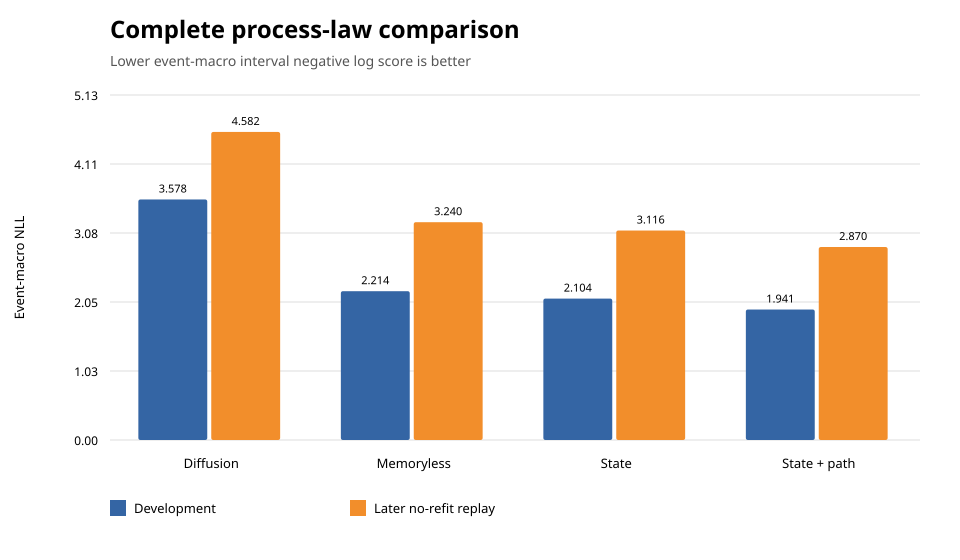
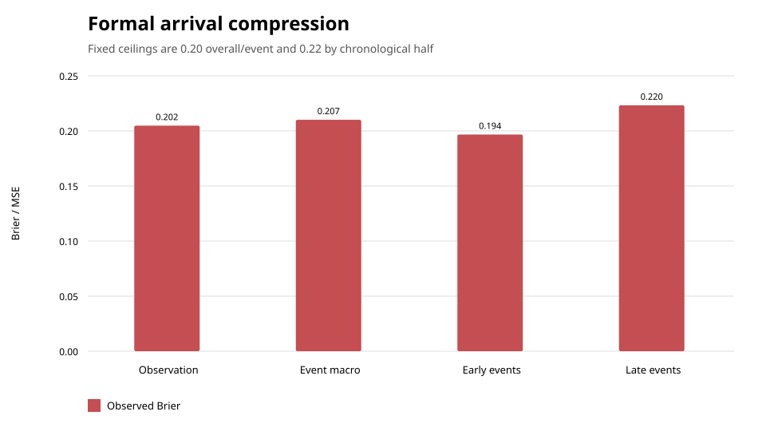

# Sticky probabilities: which financial time-series ideas transfer to Polymarket?

Status: **paper-ready working draft based on development and fresh-replication evidence; no
protected finding**.

## Abstract

We study registered Polymarket probability samples as bounded event-linked time series. The data
contain 803,862 hourly observations from 562 markets in 157 fresh development events, a separately
registered later cohort, and an independently acquired five-minute official CLOB panel. Two
questions organize the analysis: which established financial time-series ideas transfer to
prediction markets, and what stochastic process best describes observed contract probabilities?

A smooth constant-intensity diffusion is a poor description of the registered process. Hourly
increments have 62.4% interior zero mass, raw kurtosis of 157, strong duration dependence in update
arrival, negative dependence in adjacent nonzero signs, and sub-diffusive 24-hour variance
scaling. These signatures are broad across events and persist at five-minute resolution. In a
chronological comparison over 566,501 predictions and 113 events, a bounded zero-inflated marked
jump law with state-, duration-, and path-dependent arrival, sign, and magnitude beats a bounded
Gaussian diffusion and simpler hurdle laws. Its event-macro negative log score improves 7.74% over
the state-only hurdle and wins 112 of 113 event comparisons. The exact fitted law is then replayed
without refitting on a later cohort, where it improves 7.88% and wins all 27 eligible events against
state-only and diffusion comparators.

The result does not authorize a universal or protected claim. When the law is compressed to a
sparse binary arrival forecast inside the formal Chronos harness, it narrowly misses fixed
observation, event-macro, and late-period Brier ceilings. No freeze or protected evaluation is
issued. The evidence supports a regime-dependent family for registered samples—not a proven latent
belief SDE, executable-price model, or trading strategy.

## 1. Research questions

1. Which ideas from asset pricing, volatility modeling, market microstructure, and financial
   machine learning transfer to prediction-market probability series?
2. Which stochastic-process family best describes and predicts registered Polymarket probability
   changes?

The estimand is deliberately narrow. A registered probability sample is not automatically a
trade, quote, midpoint, latent belief, objective probability, or executable price. The paper asks
about the observation process retained by the corpus unless a separate measurement test supports a
stronger interpretation.

## 2. Data and epistemic design

### 2.1 Retained corpora

| Evidence surface | Events | Markets | Observations | Role |
|---|---:|---:|---:|---|
| Fresh hourly development cohort | 157 | 562 | 803,862 | Model development and chronological falsification |
| Later successor cohort | 29 | 147 | 42,549 in the signature replay | Unchanged fresh replication |
| Official five-minute CLOB panel | preselected from 10 events | 10 | 19,258 | Sampling-clock and source falsifier |
| Formal arrival schedule | 111 OOF events | at most 5 per event | 231 OOF decisions | Scalar formal replay |
| Original final holdout | 47 | 221 | unavailable | Remains protected and unexposed |

The production snapshot was acquired under the read-only `human_ro` role and retained by exact
content identity. Events—not rows—are the primary uncertainty and separation unit. The expanded
corpus keeps ancestor events embargoed, earlier fresh events in development, and the final
chronological block unavailable.

### 2.2 Time legality

At decision time (t), features use only observations whose `available_at <= t`. Labels use the
first later registered sample only after the declared horizon matures. Fitted cells and model
parameters use earlier event groups. Every development branch, failed execution, source digest,
actual access record, and result receipt remains in the ledger.

### 2.3 Weighting and evaluation

Rows within one event are dependent. Training gives each represented event equal total weight.
Headline comparisons report both observation-weighted and event-macro scores. Chronological folds
train on earlier events and test fixed later-event blocks. Early/late comparisons and per-event win
rates prevent one large event from silently determining the conclusion.

## 3. Process definitions

Let (P_t\in[0,1]) be the registered YES probability sample and
(\Delta P_{t+1}=P_{t+1}-P_t) a regular one-hour increment. Let (F_t) contain the legal
probability state, time information, elapsed quiet duration, previous nonzero sign, and previous
nonzero magnitude.

### 3.1 Bounded diffusion comparator

The diffusion comparator is a zero-drift Gaussian interval law with state-dependent scale:

\[
\Delta P_{t+1}\mid F_t \sim \mathcal{N}\left(0,
\sigma^2(c_t)P_t(1-P_t)\right),
\]

where (c_t) is a fixed probability/time-to-close cell. The bounded-state factor makes the
variance shrink near zero and one, but the observed one-step score uses the Gaussian probability
assigned to the same 0.001-wide interval as every rival.

### 3.2 Zero-inflated marked-jump law

The hurdle family decomposes change arrival, sign, and magnitude:

\[
\Pr(\Delta P_{t+1}=0\mid F_t)=1-q(F_t),
\]

\[
\Pr(\Delta P_{t+1}>0\mid \Delta P_{t+1}\neq0,F_t)=s(F_t),
\]

\[
\log |\Delta P_{t+1}|\mid \Delta P_{t+1}\neq0,F_t
\sim \mathcal{N}(\mu(F_t),\tau^2(F_t)).
\]

The full law uses probability band and quiet-duration band for (q), probability band and prior
nonzero sign for (s), and probability band and prior nonzero magnitude band for ((\mu,\tau)).
Every cell shrinks toward the event-equal global law with one event of prior weight. The
memoryless and state-only laws remove path variables; the diffusion removes the hurdle entirely.

For a nonzero observed change (x), the model assigns interval probability

\[
q(F_t)\,\Pr(\operatorname{sign}(x)\mid F_t)
\left[\Phi\!\left(\frac{\log(|x|+\epsilon)-\mu(F_t)}{\tau(F_t)}\right)
-\Phi\!\left(\frac{\log(\max(10^{-6},|x|-\epsilon))-\mu(F_t)}{\tau(F_t)}\right)\right],
\]

with (\epsilon=0.0005). A zero receives point mass (1-q(F_t)). Negative log interval
probability is averaged by observation and by event.

### 3.3 Formal binary compression

The formal replay isolates (Y_{t+1}=1[\Delta P_{t+1}\neq0]) and predicts (q(F_t)) from the
same fixed probability/quiet-duration cells. Its Brier score is

\[
\operatorname{BS}=\frac{1}{n}\sum_{i=1}^{n}(q_i-Y_i)^2.
\]

This is a narrower claim than the complete density law. It discards sign and magnitude and uses a
sparse common event-anchor schedule so the current scalar formal evaluator can govern it without
letting prediction see its outcome.

## 4. Descriptive evidence

| Signature | Earlier fresh cohort | Later cohort | Interpretation |
|---|---:|---:|---|
| Interior regular-hour zero mass | 62.40% | 44.85% | Strong but regime-dependent stickiness |
| Raw regular-increment kurtosis | 157.10 | 55.01 | A single Gaussian increment law is inadequate |
| 24-hour variance ratio | sub-diffusive; event test below 0.75 in 142/151 events | 0.230 pooled; below 0.75 in 24/26 events | Variance does not scale linearly with clock time |
| Nonzero sign reversal | 62.21% pooled; above 50% in 134/152 events | above 50% in 21/26 events | Registered marks are negatively dependent |
| Long-quiet/active next-move ratio | 0.025 pooled; below 0.50 in 83/83 eligible events | 0.074 event mean; below 0.50 in 7/7 eligible events | Arrival intensity depends on elapsed quiet time |
| Boundary next-sample persistence | 98.99% low; 97.07% high | 98.16% low; 99.12% high | Absorption/persistence matters near 0 and 1 |

Absolute levels change across cohorts, particularly zero mass. The stable claim is structural:
point mass, duration dependence, bounded state, reversal, and sub-diffusive aggregation recur. The
parameter values are not universal.

## 5. Predictive model comparisons

### 5.1 Component tests

| Component | Incremental event-macro improvement over state | Fixed gate |
|---|---:|---|
| Next-hour move arrival: add quiet-duration features | 27.63% Brier | Pass |
| Nonzero sign: add prior-path features | 3.96% Brier | Pass |
| Nonzero log magnitude: add prior-path features | 20.61% MSE | Pass |
| Heavy-tailed residual alternative after hurdle decomposition | — | Reject |

The raw series is heavy-tailed, but the residual-law test rejects the claim that an additional
heavy-tailed residual is required after zeros, state, and conditional magnitude are separated.

### 5.2 Complete one-hour observation laws

| Model | Development observation NLL | Development event NLL | Later event NLL |
|---|---:|---:|---:|
| Bounded state-dependent Gaussian diffusion | 3.511 | 3.578 | 4.582 |
| Memoryless zero-inflated marked jump | 1.865 | 2.214 | 3.240 |
| State-conditioned zero-inflated marked jump | 1.782 | 2.104 | 3.116 |
| State + duration/path zero-inflated marked jump | **1.585** | **1.941** | **2.870** |

The full law improves development event-macro NLL 7.74% over state-only, wins 112/113 events
against state-only and 113/113 against diffusion, and wins in both chronological halves. Frozen
without refitting, it improves 7.88% on the later cohort and wins 27/27 events against both
state-only and diffusion.

### 5.3 Five-minute measurement falsifier

On 19,012 regular five-minute increments, interior zero mass is 78.00%, raw kurtosis is 203.64,
nonzero reversal is 67.87%, and the 24-hour variance ratio is 0.067. Next-sample move probability
falls from 55.95% with no preceding quiet sample to 0.20% after at least 24 quiet hours. The
official five-minute paths match all 1,580 eligible retained hourly samples within ten minutes;
99.49% are exact and mean absolute difference is 0.0000487 probability units. Coarse hourly
sampling alone therefore does not explain the main signatures on this preselected panel.

## 6. Formal negative result

The sparse formal arrival replay produces 231 out-of-fold predictions over 111 events. The fixed
gate is not met:

| Formal check | Result | Ceiling | Status |
|---|---:|---:|---|
| Observation Brier | 0.202002 | 0.200000 | Fail |
| Event-macro Brier | 0.207234 | 0.200000 | Fail |
| Early event-macro Brier | 0.194038 | 0.220000 | Pass |
| Late event-macro Brier | 0.220194 | 0.220000 | Fail |
| Absolute mean calibration gap | 0.048827 | 0.050000 | Pass |
| Largest event share of squared error | 0.054132 | 0.100000 | Pass |

This is a close rejection, not permission to round the result into success. The candidate is not
frozen and the final 47-event block remains unexposed. The negative result shows that a broad
complete-law advantage does not guarantee that one component remains strong under a sparse scalar
compression.

## 7. What transfers from finance—and what changes

| Established idea | Assessment | Prediction-market modification |
|---|---|---|
| Proper scoring rules and chronological validation | Transfers directly | Cluster and weight by event; retain trial selection history |
| Local/state-dependent volatility | Transfers | Must respect bounded probability state and terminal persistence |
| Event-time point processes and duration models | Transfers strongly | Update intensity depends on quiet duration, state, semantics, and observation mechanism |
| Volatility/mark clustering | Transfers | Separate arrival clustering from conditional sign and magnitude |
| Heavy-tailed returns | Transfers only after decomposition | Raw tails do not imply heavy-tailed residuals after hurdle structure |
| Martingale/no-arbitrage benchmark | Useful but conditional | No replicating underlying; physical, pricing, and sampled measures differ |
| Constant Brownian diffusion | Fails descriptively and predictively | Requires point mass, jumps, bounded state, and irregular information time |
| Independent return signs | Fails for registered nonzero marks | Reversal may reflect bounce, rounding, aggregation, or belief correction |
| Black–Scholes replication | Does not transfer directly | Binary semantic resolution and market incompleteness break the standard setup |
| Cross-contract arbitrage | Potentially transfers | Requires complete mutually exclusive outcome surfaces and executable quotes |

## 8. Interpretation

The best-supported description of registered Polymarket probabilities is a bounded,
zero-inflated marked-jump process with duration- and path-dependent intensity and marks. “Jump” here
means a nonzero registered change, not proof of a discontinuous latent efficient price. The
observed series may combine information arrival, quote/trade sampling, rounding, stale
observations, bid/ask effects, and market-specific participation.

The model family transfers across chronology, but score levels and descriptive parameters change.
That favors a stable structural family with regime-dependent parameters rather than one universal
calibration. The formal negative further warns against compressing the family or changing the
sampling design and assuming the result survives.

## 9. Limitations

- Registered samples are not identified as trades, quotes, midpoints, latent beliefs, or
  executable prices.
- The five-minute panel contains ten preselected markets; it is a measurement falsifier, not a
  venue-wide quote study.
- Related contracts and semantic categories create dependence that event grouping mitigates but
  does not eliminate.
- The diffusion comparator is deliberately simple. Rejection does not eliminate every bounded
  continuous-time latent process with microstructure noise or endogenous sampling.
- No protected evaluation was run because the formal arrival candidate failed development.
- No result establishes objective-probability equality, causality, alpha, Sharpe ratio, or profit
  after spread, fees, latency, slippage, and market impact.
- The current protected evaluator lacks a governed distribution-valued log-score plugin, so the
  full density law remains development plus fresh-replication evidence.

## 10. Conclusion

Several finance ideas transfer when their assumptions are rewritten around event-linked bounded
probabilities: proper scoring, chronological validation, state-dependent volatility, duration
models, and marked point processes are useful. Constant diffusion, independent signs, and direct
Black–Scholes-style replication are poor defaults. Across broad development and a no-refit later
cohort, the most useful sampled-process family is a state-, duration-, and path-conditioned
zero-inflated marked jump. The paper's strongest claim is structural and observational. Its
narrower formal arrival claim is rejected, and the protected holdout remains fresh.

## References and evidence

The literature-to-claim mapping is retained in
[`../literature/theory-transfer-map.md`](../literature/theory-transfer-map.md). Exact source,
receipt, corpus, and claim mappings are in [`evidence-index.md`](evidence-index.md). Generated
figures are reproducible through [`build_figures.py`](build_figures.py).
